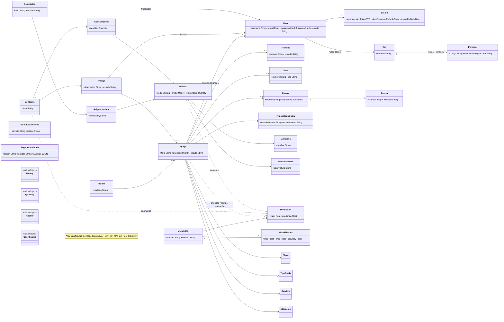

# Modelo de Dominio - SISGAD5

> **Versión:** 2.1
> **Fecha:** 2026-11-01
> **Total:** 28 clases + modelos ML en 6 contextos delimitados (4 de dominio implementados, 1 técnico, 2 ACL planificados) + Shared Kernel
> **Cambios v2.1:** (a) alias oficial corregido a **"Mesa de Prueba"** (`backend-mp` = backend Mesa de Prueba); (b) contextos 1+2 fusionados en **Usuarios y Autenticación** (mismo servicio y BD); (c) Nomencladores reclasificado como **Shared Kernel**; (d) columna *Tipo* para separar contextos de dominio vs. técnicos/ACL.
> **Fuente:** [SISGAD5_doc/docs/03-07](https://github.com/ybotet/SISGAD5_doc), actualizado según código real del monorepo

---

## 1. Contextos Delimitados (Bounded Contexts)

### 1.1 Mapa de contextos (vista consolidada v2.1)

| # | Contexto Delimitado | Tipo | Responsabilidad | Agregados / Entidades principales | Servicio técnico | Estado |
|---|---------------------|------|-----------------|-----------------------------------|------------------|--------|
| 1 | Usuarios y Autenticación | Dominio | Login, JWT, sesiones, datos maestros de usuarios, RBAC | Usuario, Sesión, Rol, Permiso | `backend-users` (Node.js) | ✅ Implementado |
| 2 | Gestión de Quejas y Trabajos *(alias operativo: Mesa de Prueba)* | Dominio | Ciclo completo de la queja: registro → prueba → trabajo → cierre | Queja, Prueba, Trabajo, Teléfono, Línea, Pizarra, Puerto | `backend-mp` (Node.js) — *backend Mesa de Prueba* | ✅ Implementado |
| 3 | Gestión de materiales | Dominio | Control transaccional de stock, asignaciones y consumos | Material, Asignación(+Items), Consumo(+Items), Categoría, UnidadMedida | `backend-materiales-go` (Go) | ✅ Implementado |
| 4 | Predicción y analítica (IA) | Dominio | Modelado predictivo MLOps: demanda, tiempos, anomalías, prioridad, fallos | Modelos ML (5), Predicción, Métricas de modelo | `prediction-service` (Python + FastAPI + scikit-learn) | ✅ Implementado (read-only, sin BD propia aún) |
| 5 | Infraestructura y Observabilidad | Técnico | Gateway, rate limiting, logging centralizado, métricas, dashboards | Sistema de monitoreo | `api-gateway` + Loki/Grafana/Prometheus + scripts | 🟡 Parcial (backups sin gestión como dominio) |
| — | Catálogos y Auditoría | Shared Kernel | Información de referencia (nomencladores) y trazabilidad de cambios | Clave, TipoQueja, Servicio, Ubicación…, Auditoría | Distribuido en `backend-mp` / `backend-users` | ✅ Implementado (sin servicio propio — decisión consciente) |
| A | Integración SAP ERP | ACL | Adaptador de exportación compatible con SAP | — (capa de adaptación) | Planificado (`RF-MAT-27`) | 🔵 Planificado |
| B | Integración GLPI | ACL | Adaptador REST/webhook para tickets externos | — (capa de adaptación) | Planificado (sin RF asignado aún) | 🔵 Planificado |

> **Nota metodológica v2.1:**
> 1. Los antiguos contextos "Autenticación" y "Gestión de usuarios y roles" se **fusionan**: compiten el mismo agregado raíz (`Usuario`), el mismo servicio (`backend-users`) y la misma base de datos (`bd_sisgad5_users`); separarlos era una división técnica, no de dominio.
> 2. "Nomencladores y auditoría" deja de contarse como Bounded Context propio: al estar distribuido y ser consumido por varios contextos sin lenguaje ubicuo independiente, se modela como **Shared Kernel** (sección 7). No se elimina: su implementación está terminada y operativa.
> 3. "Seguridad e infraestructura" pasa a llamarse **Infraestructura y Observabilidad** y se marca como contexto **técnico**, no de negocio, evitando solaparse con el contexto 1 (que es quien posee el dominio de identidad/RBAC).
> 4. A y B siguen siendo **Anti-Corruption Layers**, no contextos de dominio; se conservan en el mapa por coherencia con el análisis funcional original.

### 1.2 Diagrama de contextos (v2.1)

```
┌─────────────────────────────────────────────────────────────────────────────┐
│                                   SISGAD5                                    │
├──────────────────────┬──────────────────────┬───────────────────────────────┤
│  Usuarios y Auth     │  Quejas y Trabajos   │      Gestión de Materiales    │
│  (backend-users) ✅  │  "Mesa de Prueba" ✅ │  (backend-materiales-go) ✅   │
│  Usuario, Sesion,    │  (backend-mp)        │  Material, Categoria,         │
│  Rol, Permiso        ├──────────────────────┤  UnidadMedida,                │
│                      │ Queja, Prueba,       │  Asignacion(+Items),          │
│                      │ Trabajo, Telefono,   │  Consumo(+Items)              │
│                      │ Linea, Pizarra,      │                               │
│                      │ Puerto               │                               │
├──────────────────────┴──────────────────────┴───────────────────────────────┤
│  Prediccion y Analitica (IA) ✅: prediction-service (Python/FastAPI)        │
│  Modelos ML (Demanda, Tiempo, Anomalias, Prioridad, Fallos)                 │
├─────────────────────────────────────────────────────────────────────────────┤
│  Infraestructura y Observabilidad (tecnico, 🟡): api-gateway · Loki ·       │
│  Grafana · Prometheus · Backups                                             │
├─────────────────────────────────────────────────────────────────────────────┤
│  ACL externas (🔵 planificadas): Adaptador SAP ERP · Adaptador GLPI         │
├─────────────────────────────────────────────────────────────────────────────┤
│  SHARED KERNEL — Catalogos y Auditoria (✅ distribuido, sin servicio propio) │
│  Clave · TipoQueja · Servicio · Ubicacion · RegistroAuditoria · ValueObjs   │
└─────────────────────────────────────────────────────────────────────────────┘
```

---
## 2. Contexto Usuarios y Autenticación (backend-users)

### User (Agregado Raíz)
| Atributo | Tipo | Reglas |
|----------|------|--------|
| id | UUID | PK |
| email | String | Único, not null, email válido |
| password_hash | String | Bcrypt, not null |
| nombre | String | Not null |
| apellido | String | Not null |
| activo | Boolean | Default: true |
| ultimologin | DateTime | Nullable |
| intentos_fallidos | Integer | Default: 0 |
| bloqueado_hasta | DateTime | Nullable |
| created_at | DateTime | Auto |
| updated_at | DateTime | Auto |

**Métodos:**
- `verificarPassword(password: String): Boolean`
- `incrementarIntentosFallidos(): void`
- `resetearIntentosFallidos(): void`
- `bloquear(minutos: Integer): void`
- `estaBloqueado(): Boolean`

### Sesion (Entidad)
| Atributo | Tipo | Reglas |
|----------|------|--------|
| id | UUID | PK |
| user_id | UUID | FK → User |
| refresh_token_hash | String | Único, not null |
| user_agent | String | Nullable |
| ip | String | Nullable |
| expira_en | DateTime | Not null |
| revocada | Boolean | Default: false |
| created_at | DateTime | Auto |

**Métodos:**
- `revocar(): void`
- `estaVigente(): Boolean`

---

## 3. Contexto Usuarios y Autenticación — submódulo RBAC (Roles y Permisos)

### Rol (Agregado Raíz)
| Atributo | Tipo | Reglas |
|----------|------|--------|
| id | UUID | PK |
| nombre | String | Único, not null (Admin, Tecnico, Operador, Jefe, Analista, Director, Auditor) |
| descripcion | String | Nullable |
| created_at | DateTime | Auto |

### Permiso (Entidad)
| Atributo | Tipo | Reglas |
|----------|------|--------|
| id | UUID | PK |
| nombre | String | Único, not null (ej: users:create, quejas:read, materiales:write) |
| recurso | String | Not null |
| accion | String | Not null (create, read, update, delete) |
| created_at | DateTime | Auto |

### User_Roles (Value Object - Tabla Pivot)
| Atributo | Tipo | Reglas |
|----------|------|--------|
| user_id | UUID | FK → User, PK compuesta |
| rol_id | UUID | FK → Rol, PK compuesta |
| asignado_por | UUID | FK → User (admin que asignó) |
| asignado_en | DateTime | Auto |

### Roles_Permisos (Value Object - Tabla Pivot)
| Atributo | Tipo | Reglas |
|----------|------|--------|
| rol_id | UUID | FK → Rol, PK compuesta |
| permiso_id | UUID | FK → Permiso, PK compuesta |

---

## 4. Contexto Quejas y Trabajos — "Mesa de Prueba" (backend-mp)

### Telefono (Agregado Raíz)
| Atributo | Tipo | Reglas |
|----------|------|--------|
| id | Integer | PK, Autoinc |
| numero | String | Único, not null |
| cliente_id | Integer | FK → Cliente (externo), not null |
| estado | Enum | activo | baja |
| fecha_baja | DateTime | Nullable |
| ubicacion | String | Nullable |
| observaciones | Text | Nullable |
| created_at | DateTime | Auto |
| updated_at | DateTime | Auto |

### Linea (Agregado Raíz)
| Atributo | Tipo | Reglas |
|----------|------|--------|
| id | Integer | PK, Autoinc |
| numero | String | Único, not null |
| cliente_id | Integer | FK → Cliente, not null |
| estado | Enum | activo | baja |
| fecha_baja | DateTime | Nullable |
| tipo_linea_id | Integer | FK → TipoLinea |
| created_at | DateTime | Auto |
| updated_at | DateTime | Auto |

### Pizarra (Agregado Raíz)
| Atributo | Tipo | Reglas |
|----------|------|--------|
| id | Integer | PK, Autoinc |
| nombre | String | Not null |
| tipo_pizarra_id | Integer | FK → TipoPizarra |
| ubicacion_fisica | String | Nullable |
| latitud | Decimal(10,8) | Nullable |
| longitud | Decimal(11,8) | Nullable |
| estado | Enum | activo | baja |
| fecha_baja | DateTime | Nullable |
| created_at | DateTime | Auto |
| updated_at | DateTime | Auto |

### Puerto (Entidad - Perteneciente a Pizarra)
| Atributo | Tipo | Reglas |
|----------|------|--------|
| id | Integer | PK, Autoinc |
| pizarra_id | Integer | FK → Pizarra, not null |
| numero_puerto | Integer | Not null, único por pizarra |
| tipo_conexion | Enum | entrada | salida |
| elemento_conectado_id | Integer | Nullable (polimórfico: telefono/linea/pizarra) |
| elemento_conectado_tipo | String | Nullable |
| created_at | DateTime | Auto |

### Queja (Agregado Raíz)
| Atributo | Tipo | Reglas |
|----------|------|--------|
| id | Integer | PK, Autoinc |
| num_reporte | Integer | Único, autoinc por año |
| telefono_id | Integer | FK → Telefono, nullable |
| linea_id | Integer | FK → Linea, nullable |
| pizarra_id | Integer | FK → Pizarra, nullable |
| tipo_queja_id | Integer | FK → TipoQueja, not null |
| servicio_id | Integer | FK → Servicio, not null |
| ubicacion_id | Integer | FK → Ubicacion, not null |
| clave_id | Integer | FK → Clave (clasificación compuesta), not null |
| reportado_por | String | Not null |
| prioridad | Integer | 1-4, calculado automáticamente |
| estado | Enum | Abierta | Probada | Asignada | Pendiente | Resuelta | Cerrada |
| fecha | DateTime | Not null, default now |
| tecnico_asignado_id | UUID | FK → User, nullable |
| created_at | DateTime | Auto |
| updated_at | DateTime | Auto |

**Métodos:**
- `calcularPrioridad(): Integer`
- `puedeTransicionar(nuevoEstado: Enum): Boolean`
- `transicionar(nuevoEstado: Enum, usuarioId: UUID): void`
- `asignarTecnico(tecnicoId: UUID): void`

### FlujoEstadoQueja (Entidad - Historial)
| Atributo | Tipo | Reglas |
|----------|------|--------|
| id | Integer | PK, Autoinc |
| queja_id | Integer | FK → Queja, not null |
| estado_anterior | Enum | Nullable (null para estado inicial) |
| estado_nuevo | Enum | Not null |
| usuario_id | UUID | FK → User, not null |
| observaciones | Text | Nullable |
| ip | String | Nullable |
| created_at | DateTime | Auto |

### Prueba (Agregado Raíz)
| Atributo | Tipo | Reglas |
|----------|------|--------|
| id | Integer | PK, Autoinc |
| queja_id | Integer | FK → Queja, nullable |
| trabajo_id | Integer | FK → Trabajo, nullable |
| tecnico_id | UUID | FK → User, not null |
| fecha | DateTime | Not null |
| exitoso | Boolean | Not null |
| mediciones | JSON | Nullable |
| observaciones | Text | Nullable |
| created_at | DateTime | Auto |

**Regla:** queja_id XOR trabajo_id debe ser not null (al menos uno)

### Trabajo (Agregado Raíz)
| Atributo | Tipo | Reglas |
|----------|------|--------|
| id | Integer | PK, Autoinc |
| queja_id | Integer | FK → Queja, nullable |
| descripcion | Text | Not null |
| tecnico_asignado_id | UUID | FK → User, nullable |
| tiempo_estimado_horas | Decimal(5,2) | Nullable |
| tiempo_real_horas | Decimal(5,2) | Nullable |
| estado | Enum | Abierto | Asignado | En_Proceso | Cerrado |
| fecha_creacion | DateTime | Auto |
| fecha_asignacion | DateTime | Nullable |
| fecha_cierre | DateTime | Nullable |
| created_at | DateTime | Auto |
| updated_at | DateTime | Auto |

### Clave / Clasificadores (Catálogos MP)
| Entidad | Descripción |
|---------|-------------|
| TipoQueja | Tipo de incidencia (Corte, Ruido, Intermitente, etc.) |
| Servicio | Servicio afectado (Telefonía Básica, Internet, TV, etc.) |
| Ubicacion | Zona geográfica |
| Clave | Clasificación compuesta (tipo + servicio + ubicacion) |
| TipoLinea | Tipo de línea (Analógica, Digital, Fibra, etc.) |
| TipoPizarra | Tipo de pizarra (MDF, IDF, PABX, etc.) |
| Clasificacion | Clasificaciones adicionales |
| ClasificadorClave | Claves jerárquicas |
| Clave | Códigos de clasificación |
| Cable | Tipos de cable |
| Senalizacion | Tipos de señalización |
| Sistema | Sistemas de conmutación |
| Planta | Plantas/Edificios |
| Propietario | Propietarios de infraestructura |
| Mandos | Mandos de conmutación |
| GruposTrabajo | Grupos de trabajo |
| TipoMovimiento | Tipos de movimiento (Instalación, Traslado, Baja) |

---

## 5. Contexto Materials (Gestión de Materiales)

### Material (Agregado Raíz)
| Atributo | Tipo | Reglas |
|----------|------|--------|
| id | Integer | PK, Autoinc |
| codigo | String | Único, not null |
| nombre | String | Not null |
| descripcion | Text | Nullable |
| precio_unitario | Decimal(12,2) | > 0, not null |
| categoria_id | Integer | FK → Categoria, not null |
| unidad_id | Integer | FK → UnidadMedida, not null |
| stock_minimo | Integer | Default: 0 |
| activo | Boolean | Default: true |
| created_at | DateTime | Auto |
| updated_at | DateTime | Auto |

### Categoria (Agregado Raíz)
| Atributo | Tipo | Reglas |
|----------|------|--------|
| id | Integer | PK, Autoinc |
| nombre | String | Único, not null |
| descripcion | Text | Nullable |
| activo | Boolean | Default: true |
| created_at | DateTime | Auto |

### UnidadMedida (Agregado Raíz)
| Atributo | Tipo | Reglas |
|----------|------|--------|
| id | Integer | PK, Autoinc |
| nombre | String | Único, not null (ej: m, und, kg, caja, rollo) |
| simbolo | String | Único, not null |
| descripcion | Text | Nullable |
| activo | Boolean | Default: true |
| created_at | DateTime | Auto |

### Asignacion (Agregado Raíz)
| Atributo | Tipo | Reglas |
|----------|------|--------|
| id | Integer | PK, Autoinc |
| trabajador_id | UUID | FK → User (rol Técnico/Analista), not null |
| trabajo_id | Integer | FK → Trabajo (MP), nullable |
| fecha | DateTime | Not null, default now |
| observaciones | Text | Nullable |
| estado | Enum | Pendiente | Entregada | Parcial | Cancelada |
| created_at | DateTime | Auto |
| updated_at | DateTime | Auto |

### AsignacionItem (Entidad - Perteneciente a Asignacion)
| Atributo | Tipo | Reglas |
|----------|------|--------|
| id | Integer | PK, Autoinc |
| asignacion_id | Integer | FK → Asignacion, not null |
| material_id | Integer | FK → Material, not null |
| cantidad | Integer | > 0, not null |
| costo_unitario_momento | Decimal(12,2) | > 0, capturado al crear |
| created_at | DateTime | Auto |

### Consumo (Agregado Raíz)
| Atributo | Tipo | Reglas |
|----------|------|--------|
| id | Integer | PK, Autoinc |
| trabajador_id | UUID | FK → User, not null |
| trabajo_id | Integer | FK → Trabajo (MP), not null |
| asignacion_id | Integer | FK → Asignacion, nullable |
| fecha | DateTime | Not null, default now |
| observaciones | Text | Nullable |
| created_at | DateTime | Auto |

### ConsumoItem (Entidad - Perteneciente a Consumo)
| Atributo | Tipo | Reglas |
|----------|------|--------|
| id | Integer | PK, Autoinc |
| consumo_id | Integer | FK → Consumo, not null |
| material_id | Integer | FK → Material, not null |
| cantidad | Integer | > 0, not null |
| costo_unitario_real | Decimal(12,2) | > 0, capturado al crear |
| created_at | DateTime | Auto |

---

## 6. Contexto Prediction (Analítica Predictiva / IA)

> Servicio: `prediction-service` (Python 3.11 + FastAPI + scikit-learn, puerto 5005). Read-only respecto a los datos de MP/Materials; persistirá en `bd_predictions`.

### Modelos ML cargados (artefactos `.joblib`, 5 modelos)

| Modelo | Endpoint REST | Entradas principales | Salida |
|--------|---------------|----------------------|--------|
| Demanda de materiales | `GET /api/v1/demanda-materiales` | categoria, periodo, zona | Predicción de demanda + intervalo |
| Tiempo de resolución | `GET /api/v1/tiempo-resolucion/{queja_id}` | Features de la queja (MP) | Horas estimadas de resolución |
| Anomalías de consumo | `GET /api/v1/anomalias-consumo` | Serie de consumos (Materials) | Ítems anómalos + score |
| Prioridad de queja | `GET /api/v1/prioridad-queja/{queja_id}` | Features de la queja | Prioridad sugerida (1-4) + confianza |
| Fallos de infraestructura | `GET /api/v1/fallos-infraestructura` | Pizarra/puerto, historial | Probabilidad de fallo + riesgo |

### Value Objects / Schemas (Pydantic)

| Objeto | Descripción |
|--------|-------------|
| `PredictionResult` | valor, confianza, modelo_version, timestamp |
| `ModelMetrics` | MAE, RMSE, Accuracy, Precision, Recall por modelo |
| `ModelRegistryEntry` | nombre, ruta .joblib, versión, fecha de entrenamiento |

**Relaciones:**
```
Queja (MP) ──(lee vía API)──> TiempoResolucion, PrioridadQueja
Consumo (Materials) ──(lee vía API)──> AnomaliasConsumo
Material/Categoria ──> DemandaMateriales
Pizarra/Puerto (MP) ──> FallosInfraestructura
ModeloML 1 ── * Prediccion ; ModeloML ── 1 ModelMetrics
```

---

## 7. Shared Kernel — Catálogos y Auditoría (con Value Objects compartidos)

> **Decisión v2.1:** el antiguo contexto "Nomencladores y auditoría" se integra aquí como **Shared Kernel** (no es un Bounded Context propio; está implementado y distribuido en `backend-mp` / `backend-users`). Regla de gobierno: cualquier cambio en estas entidades requiere acuerdo explícito de los equipos/contextos consumidores.

### 7.1 Nomencladores (entidades de referencia)
| Entidad | Ejemplos / Claves típicas | Servicio anfitrión |
|---------|---------------------------|--------------------|
| Clave | tipos de avería/código de falla | `backend-mp` |
| TipoQueja | clasificación de la queja | `backend-mp` |
| Servicio | servicios telefónicos ofertados | `backend-mp` |
| Ubicacion | direcciones, nodos, centrales | `backend-mp` |
| Categoria / UnidadMedida | catálogo de materiales | `backend-materiales-go` |
| RegistroAuditoria | trazabilidad de cambios (quién/qué/cuándo) | `backend-users` / `backend-mp` |

### 7.2 Value Objects Compartidos

| Value Object | Atributos | Usado en |
|--------------|-----------|----------|
| **Email** | value: String | User |
| **PasswordHash** | value: String | User |
| **TokenJWT** | value: String, expiracion: DateTime | Sesion |
| **RefreshToken** | value: String, expiracion: DateTime | Sesion |
| **Money** | amount: Decimal, currency: String (CUP) | Material, AsignacionItem, ConsumoItem |
| **Quantity** | value: Integer (>0) | AsignacionItem, ConsumoItem |
| **Priority** | value: Integer (1-4) | Queja |
| **Coordinates** | lat: Decimal, lng: Decimal | Pizarra |
| **Pagination** | page: Integer, limit: Integer, total: Integer, pages: Integer | Listados |

---

## 8. Relaciones Principales

```
User 1 ── * Sesion
User * ── * Rol (User_Roles)
Rol * ── * Permiso (Roles_Permisos)

Telefono * ── 1 Cliente
Linea * ── 1 Cliente
Pizarra 1 ── * Puerto
Puerto * ── 1 (Telefono | Linea | Pizarra) [Polimórfico]

Queja * ── 1 Telefono
Queja * ── 1 Linea
Queja * ── 1 Pizarra
Queja * ── 1 TipoQueja
Queja * ── 1 Servicio
Queja * ── 1 Ubicacion
Queja * ── 1 Clave
Queja 1 ── * FlujoEstadoQueja
Queja * ── 1 User (tecnico_asignado)

Prueba * ── 1 Queja (opcional)
Prueba * ── 1 Trabajo (opcional)
Prueba * ── 1 User (tecnico)

Trabajo * ── 1 Queja (opcional)
Trabajo * ── 1 User (tecnico_asignado)

Material * ── 1 Categoria
Material * ── 1 UnidadMedida

Asignacion * ── 1 User (trabajador)
Asignacion * ── 1 Trabajo (opcional)
Asignacion 1 ── * AsignacionItem
AsignacionItem * ── 1 Material

Consumo * ── 1 User (trabajador)
Consumo * ── 1 Trabajo
Consumo * ── 1 Asignacion (opcional)
Consumo 1 ── * ConsumoItem
ConsumoItem * ── 1 Material
```

---

## 9. Diagramas de Clases

> **Archivo fuente (PlantUML completo, 39 entidades):** [`docs/diagrams/class_diagrams/domain_model_classes.puml`](../diagrams/class_diagrams/domain_model_classes.puml) — instrucciones de renderizado en el [README de la carpeta](../diagrams/class_diagrams/README.md).
> A continuación se incluye una versión resumida en Mermaid, renderizada directamente por GitHub, con los agregados raíz y relaciones principales de cada contexto.



---

## 10. Referencias

- [Casos de Uso](03_use_cases.es.md)
- [Glosario](04_glossary.es.md)
- [Reglas de Negocio](06_business_rules.es.md)
- [Diagramas de Secuencia](08_sequence_diagrams.es.md)
- [Modelo de Datos ER](11_data_model.es.md)