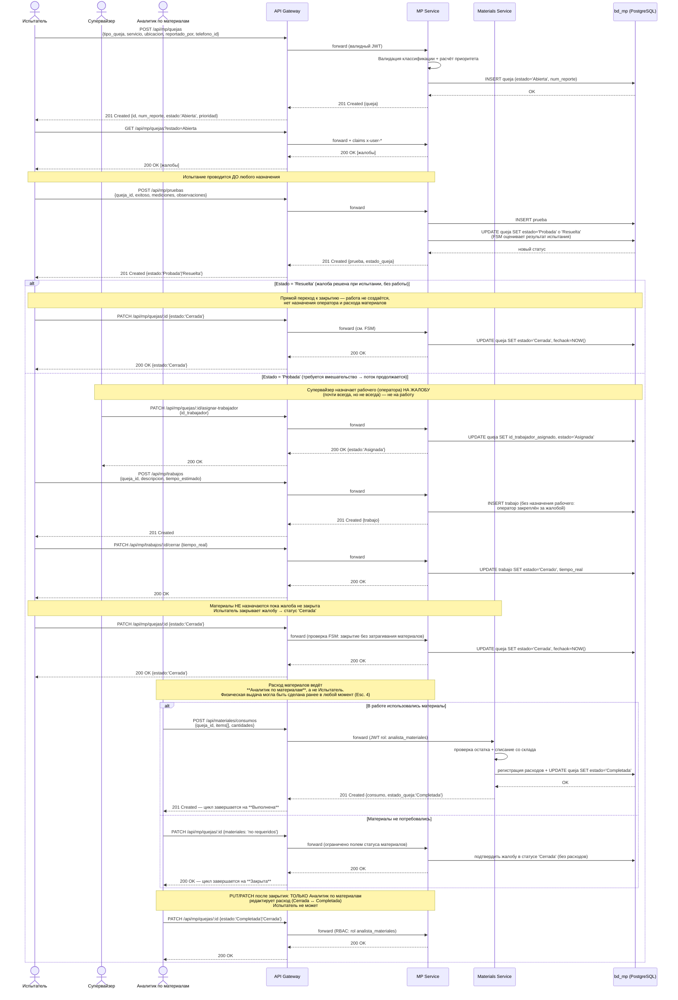
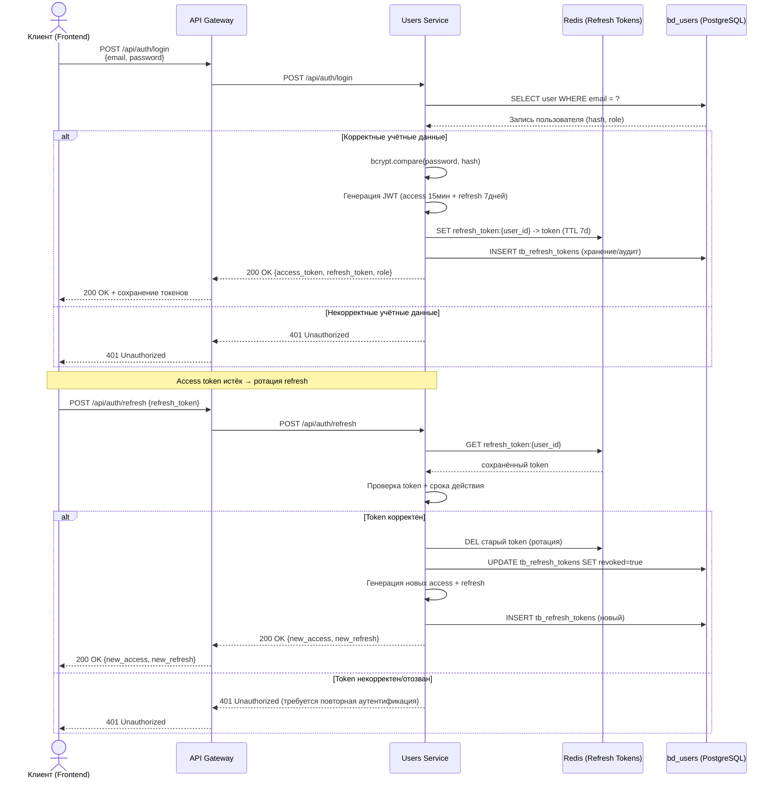
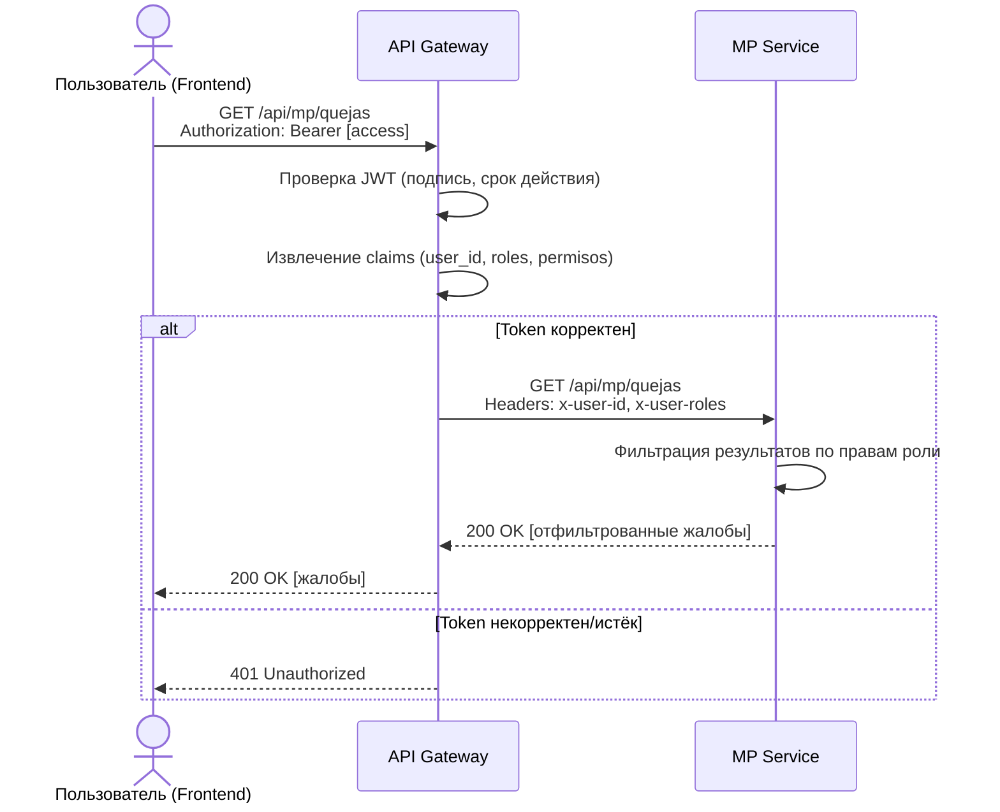
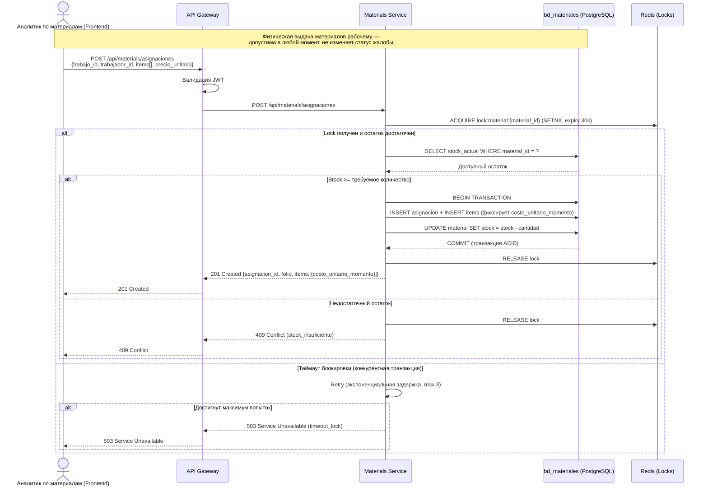
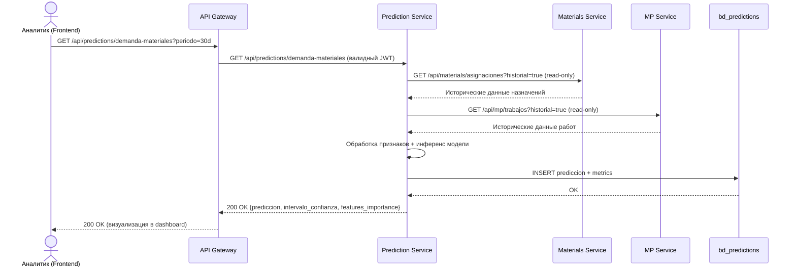

# 📊 Диаграммы последовательностей — SISGAD5

> **Версия:** 2.8 (консолидированная реальная предметная область: без роли «Оператор»; Испытатель создаёт жалобу, тестирует ДО назначения, вводит работы и закрывает → `Закрыта`; Супервайзер только назначает рабочих на жалобу; **расход материалов — исключительная ответственность Аналитика по материалам** → `Выполнена` или завершает цикл как `Закрыта`; **назначение материалов независимо и происходит в любой момент**; избыточные сценарии объединены/удалены)
> **Дата:** 2026-11-02
> **Язык:** Русский (ru) — эквивалент на испанском: [`08_sequence_diagrams.es.md`](08_sequence_diagrams.es.md)
> **Задача:** TASK-100-04
> **Статус:** ✅ Выполнено
> **Критерий:** критические сценарии с диаграммами Mermaid + таблицы сообщений
> **Расположение:** документ перемещён в `docs/` согласно сквозной нумерации 00–14 (v2.8). Прежние копии в `docs/diagrams/sequence_diagrams/` остались указателями.
> **Объединённые источники:** каноническая диаграмма из `docs/diagrams/sequence_diagrams/` (версия TASK-100-04, 4 сценария) + `08_sequence_diagrams.ru.md` v1.0 (3 ASCII-сценария, конвертированы в Mermaid). В v2.5–v2.7 сценарии расхода (бывш. Esc.5) и закрытия-саги (бывш. Esc.6) были объединены внутри Сценария 1 из-за функционального перекрытия.

---

## Указатель сценариев

| # | Сценарий | Тип | Происхождение в пред. источниках |
|---|-----------|------|---------------------------|
| 1 | Полный поток жалобы (Открыта → Закрыта → Выполнена) — включает закрытие, сагу компенсаций и учёт расходов | Критический | бывш. Esc.1 + бывш. Esc.5 + бывш. Esc.6 (объединены v2.5–v2.7) |
| 2 | Вход и аутентификация JWT с ротацией refresh | Критический | diag Esc.1 + 08_ru §3 |
| 3 | Доступ к защищённому ресурсу через Gateway | Критический | 08_ru §3 |
| 4 | Назначение материалов с проверкой остатка на складе | Критический | diag Esc.2 + 08_ru §2 |
| 5 | Прогнозирование потребности в материалах | Дополнительный | diag Esc.4 |

> **Назначение ≠ Расход (v2.5):** **назначение** материалов — это физическая выдача рабочему и может происходить **в любой момент** (Сценарий 4); оно НЕ меняет статус жалобы. **Расход** — бухгалтерская запись после закрытия, которую делает Аналитик по материалам и которая переводит `Закрыта → Выполнена` (Сценарий 1).

## Сценарий 1: Полный поток жалобы (Открыта → Закрыта → Выполнена)

**Роли предметной области (v2.7):** Испытатель (создаёт жалобу, проводит испытания, вводит работы, закрывает; статус `Испытана`/`Решена` возвращает БД после регистрации испытания) · Супервайзер (зарегистрированный начальник: **назначает рабочего (оператора) на жалобу**; не вводит работы и не создаёт жалобы) · **Аналитик по материалам** (регистрирует/редактирует расход материалов после закрытия; если заявляет, что материалы не потребовались в закрытой жалобе — цикл завершается). **Роль «Оператор» не существует** — жалобу создаёт Испытатель. **Назначения рабочего на работу не существует**: оператор назначается только на жалобу. **Назначение ≠ Расход**: назначение материалов — физическая выдача рабочему, возможна в любой момент (см. Сценарий 4), без изменения статуса жалобы; расход — бухгалтерская операция после закрытия, исключительная прерогатива Аналитика.

**Актёры:** Испытатель, Супервайзер, Аналитик по материалам · **Участники:** API Gateway, MP Service, Materials Service, bd_mp

### Таблица сообщений — полный поток жалобы (роли v2.4)

| # | Откуда | Куда | Сообщение | Данные |
|---|----|-------|---------|-------|
| 1 | Испытатель | Система | `POST /api/mp/quejas` | {tipo_queja, servicio, ubicacion, reportado_por, telefono_id} — жалобу создаёт Испытатель (роли Оператор не существует) |
| 2 | Система | Испытатель | 201 Created | {queja: {id, num_reporte, estado: "Abierta", prioridad}} |
| 3 | Испытатель | Система | `GET /api/mp/quejas?estado=Abierta` | - |
| 4 | Испытатель | Система | `POST /api/mp/pruebas` | {queja_id, exitoso, mediciones, observaciones} — **испытание ДО назначения** |
| 5 | Система (БД через FSM) | Испытатель | 201 Created | {prueba, estado_queja: "Probada" \| "Resuelta"} — БД возвращает статус после регистрации испытания |
| 6a | Испытатель | Система | `PATCH /api/mp/quejas/:id` (ветка Resuelta) | {estado: "Cerrada"} — прямое закрытие, без работы и материалов |
| 6b | Супервайзер | Система | `PATCH /api/mp/quejas/:id/asignar-trabajador` (ветка Probada) | {id_trabajador} — оператор назначается **на жалобу**, почти всегда но не всегда |
| 7 | Испытатель | Система | `POST /api/mp/trabajos` (ветка Probada) | {queja_id, descripcion, tiempo_estimado} — работу вводит Испытатель; **без поля рабочего** |
| 8 | Испытатель | Система | `PATCH /api/mp/trabajos/:id/cerrar` | {tiempo_real} |
| 9 | Испытатель | Система | `PATCH /api/mp/quejas/:id` (закрытие) | {estado: "Cerrada"} — закрывает Испытатель; материалы НЕ трогает |
| 10 | Система | Испытатель | 200 OK | {queja: {estado: "Cerrada", fechaok}} |
| 11a | Аналитик по материалам | Система | `POST /api/materiales/consumos` (были материалы) | {queja_id, items[], cantidades, costo_unitario_real} → проверяет `расход ≤ неотгруженное назначение` (бывш. Esc.5), списывает склад с локом и переводит жалобу в **"Completada"** — цикл завершается. При сбое Materials: компенсация саги, жалоба остаётся `Cerrada` |
| 11b | Аналитик по материалам | Система | `PATCH /api/mp/quejas/:id` (материалы не нужны) | {materiales: "no requeridos"} → подтверждает **"Cerrada"** без расходов — цикл завершается |
| 12 | Аналитик по материалам | Система | `PATCH /api/mp/quejas/:id` (после закрытия) | Только редактирование расхода (Cerrada ↔ Completada); RBAC исключительно Аналитика |

> **Правила предметной области (v2.4):**
> 1. **Роль «Оператор» не существует** — жалобу создаёт **Испытатель**.
> 2. **Супервайзер** (зарегистрированный начальник) **выполняет только назначения рабочего на жалобу**, никогда не вводит работы и не создаёт жалобы.
> 3. **Испытание выполняется до назначения**; статус `Probada`/`Resuelta` возвращает БД (FSM) после регистрации испытания.
> 4. **Рабочий (оператор) назначается на ЖАЛОБУ, не на работу** — эндпоинта назначения рабочего на работу не существует; `POST /trabajos` не принимает técnico/trabajador.
> 5. **Работу вводит Испытатель** (`POST /trabajos`) и выполняется почти всегда, кроме случая прямого решения жалобы при испытании (статус `Resuelta` → закрытие без работы).
> 6. **Материалы не назначаются пока жалоба не закрыта**: Испытатель закрывает → **`Cerrada`**. Затем **Аналитик по материалам** регистрирует расход → **`Completada`**; если заявлено, что материалы не требовались, жалоба остаётся `Cerrada` и цикл завершается.
> 7. **Расход материалов — исключительная ответственность Аналитика по материалам** (роль `analista_materiales`): Испытатель не может регистрировать расходы ни менять Cerrada↔Completada.
> 8. Последующие `PUT`/`PATCH` после закрытия служат **только** для редактирования статуса жалобы между `Cerrada` и `Completada` (расход материалов), выполняет их только Аналитик по материалам.
> 9. **Внутренняя механика (бывш. Сценарий 6, объединён здесь в v2.7):** фактическое закрытие с привязанными работами выполняется как **оркестрированная сага с компенсацией** — шаги `SELECT queja → валидация FSM → UPDATE estado='Cerrada' + fechaok` транзакционны; если последующая регистрация расхода не удалась (недостаток склада или Materials Service недоступен), сага откатывает расход, жалоба остаётся `Cerrada`, Аналитик может повторить.
> 10. **Проверка расхода против назначения (бывш. Сценарий 5, объединён здесь в v2.7):** при регистрации расходов Materials Service проверяет `Σ(расходы) ≤ Σ(назначения) − Σ(предыдущие расходы)` по жалобе/работе; при превышении — `400 consumo_excede_asignacion` и жалоба НЕ переходит в `Completada`. `costo_unitario_real` фиксируется в позиции расхода (`costo_unitario_momento` зафиксирован в назначении).

---

## Сценарий 2: Вход и аутентификация с JWT (+ ротация refresh)

**Актёры:** Клиент (Frontend) · **Участники:** API Gateway, Users Service, Redis, bd_users

### Таблица сообщений — вход и аутентификация

| Шаг | Эмитент | Сообщение | Получатель | Протокол | Описание |
| ---- | ------ | ------- | ------- | --------- | ----------- |
| 1 | Клиент (Frontend) | `POST /api/auth/login` | API Gateway | HTTPS | Отправка учётных данных (email + password) |
| 2 | API Gateway | `POST /api/auth/login` | Users Service | REST/JSON | Переадресация учётных данных в сервис |
| 3 | Users Service | `SELECT * FROM usuarios WHERE email = ?` | bd_users | SQL | Поиск пользователя по email |
| 4 | bd_users | Запись пользователя (hash пароля и роль) | Users Service | SQL | Ответ с данными пользователя |
| 5 | Users Service | `bcrypt.compare(password, hash)` | — | Internal | Проверка пароля |
| 6 | Users Service | `JWT.sign({id, role, exp})` | — | Internal | Генерация access token (15 мин) |
| 7 | Users Service | `JWT.sign({id, exp})` | — | Internal | Генерация refresh token (7 дней) |
| 8 | Users Service | `SET refresh:{user_id} → token (TTL 7d)` | Redis | Redis | Сохранение refresh token |
| 9 | Users Service | `INSERT tb_refresh_tokens` | bd_users | SQL | Хранение для аудита/отзыва |
| 10 | Users Service | `200 OK {access, refresh, role}` | API Gateway | REST/JSON | Ответ с токенами |
| 11 | API Gateway | `200 OK {access, refresh, role}` | Клиент | HTTPS | Ответ фронтенду |
| 12 | Клиент (Frontend) | `POST /api/auth/refresh` {refresh_token} | API Gateway | HTTPS | Продление после истечения access |
| 13 | Users Service | Проверка refresh в Redis/БД, ротация | — | Internal | DELETE старого + INSERT нового (revoked=true у прежнего) |
| 14 | Users Service | `200 OK {new_access, new_refresh}` | API Gateway | REST/JSON | Новые токены |
| 15 | API Gateway | `200 OK {new_access, new_refresh}` | Клиент | HTTPS | Ответ фронтенду |

---

## Сценарий 3: Доступ к защищённому ресурсу (claims через Gateway)

**Актёры:** Пользователь · **Участники:** API Gateway, MP Service

### Таблица сообщений — доступ к защищённому ресурсу

| # | Откуда | Куда | Сообщение | Данные |
|---|----|-------|---------|-------|
| 1 | Пользователь | Gateway | `GET /api/mp/quejas` | Header: Authorization: Bearer \<access\> |
| 2 | Gateway | - | Проверка JWT (подпись, срок) | - |
| 3 | Gateway | - | Извлечение claims (user_id, roles) | - |
| 4 | Gateway | MP | `GET /api/mp/quejas` | Headers: X-User-Id, X-User-Roles |
| 5 | MP | Gateway | 200 OK | [жалобы, отфильтрованные по правам] |
| 6 | Gateway | Пользователь | 200 OK | [жалобы] |

---

## Сценарий 4: Назначение материалов с проверкой остатка на складе

**Актёры:** Аналитик по материалам (Frontend) — v2.7: **назначение материалов — физическая выдача рабочему и может выполняться в любой момент** (до, во время или после работ); НЕ меняет статус жалобы. Отличается от **расхода** (бухгалтерская запись после закрытия, переводящая `Cerrada → Completada`, см. Сценарий 1). Управление обоими процессами исключительно за Аналитиком по материалам. · **Участники:** API Gateway, Materials Service, Redis (Locks), bd_materiales

### Таблица сообщений — назначение материалов

| Шаг | Эмитент | Сообщение | Получатель | Протокол | Описание |
| ---- | ------ | ------- | ------- | --------- | ----------- |
| 1 | Аналитик по материалам (Frontend) | `POST /api/materials/asignaciones` | API Gateway | HTTPS | Запрос назначения (несколько позиций) |
| 2 | API Gateway | Проверка JWT | — | Internal | Валидация аутентификации |
| 3 | API Gateway | `POST /api/materials/asignaciones` | Materials Service | REST/JSON | Переадресация запроса |
| 4 | Materials Service | `SETNX lock:material:{id} (expiry 30s)` | Redis | Redis | Получение распределённой блокировки |
| 5 | Redis | `OK` или `EXISTS` | Materials Service | Redis | Ответ блокировки |
| 6 | Materials Service | `SELECT stock_actual WHERE id = ?` | bd_materiales | SQL | Запрос доступного остатка |
| 7 | bd_materiales | Доступный остаток | Materials Service | SQL | Ответ с количеством на складе |
| 8 | Materials Service | `BEGIN TRANSACTION` | bd_materiales | SQL | Начало транзакции |
| 9 | Materials Service | `INSERT INTO asignaciones` + `INSERT INTO items` | bd_materiales | SQL | Создание записи (фиксирует `costo_unitario_momento`) |
| 10 | Materials Service | `UPDATE material SET stock = stock - n` | bd_materiales | SQL | Уменьшение остатка |
| 11 | bd_materiales | `COMMIT` | Materials Service | SQL | Атомарное подтверждение транзакции |
| 12 | Materials Service | `DEL lock:material:{id}` | Redis | Redis | Освобождение блокировки |
| 13 | Materials Service | `201 Created {asignacion_id, folio}` | API Gateway | REST/JSON | Подтверждение создания назначения |
| 14 | API Gateway | `201 Created` | Аналитик по материалам | HTTPS | Ответ фронтенду |
| 15 | Materials Service | `409 Conflict` (stock_insuficiente) | API Gateway | REST/JSON | Ошибка: недостаточный остаток |
| 16 | Materials Service | Повтор с экспоненциальной задержкой (max 3) | — | Internal | Попытка при занятой блокировке |

---

## Сценарий 5: Прогнозирование потребности в материалах (дополнительный)

**Актёры:** Аналитик · **Участники:** API Gateway, Prediction Service, Materials Service, MP Service, bd_predictions

---

## Ссылки

- [Варианты использования](03_use_cases.ru.md)
- [Модель предметной области](07_domain_model.ru.md)
- [Машины состояний](09_state_machines.ru.md)
- [Стратегия безопасности](13_security.ru.md)
- [Диаграмма пакетов](diagrams/component_diagrams/package_diagram.md)

---

## Журнал изменений

### v2.8 — 2026-11-02 (перемещение в сквозную нумерацию docs/)
1. **Перенесено из `docs/diagrams/sequence_diagrams/sequence_diagrams.md` → `docs/08_sequence_diagrams.ru.md`** согласно сквозной нумерации документации 00–14, запрошенной владельцем. Содержимое (5 сценариев, v2.7) сохранено полностью, переведено на русский язык.
2. **Внутренние ссылки исправлены** на относительные пути от `docs/`.
3. Документ является зеркальным переводом `08_sequence_diagrams.es.md` v2.8.
4. `docs/diagrams/sequence_diagrams/README.md` теперь указывает на этот канонический документ.

### v2.7 — 2026-11-02 (окончательное удаление избыточных сценариев — консолидация в 5)
Удалены сценарии расхода (бывш. Esc.5) и закрытия-саги (бывш. Esc.6) — содержимое объединено в Сценарии 1 как правила предметной области (правила 9 и 10). Прогнозирование перенумеровано в Esc. 5.

### v2.5–v2.6 — 2026-11-02
Разделение понятий «назначение» и «расход»; исправления публикаций. Детали — в журнале испанской версии.

### v2.0–v2.4 — 2026-11-02
Объединение дублирующихся источников, исправления ролей (Испытатель/Супервайзер/Аналитик по материалам), переименование конечных статусов (`Cerrada`/`Completada`). Детали — в журнале испанской версии `08_sequence_diagrams.es.md`.
