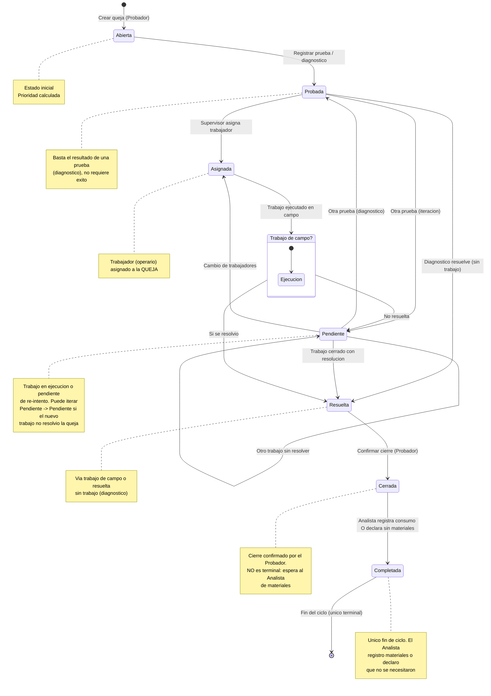
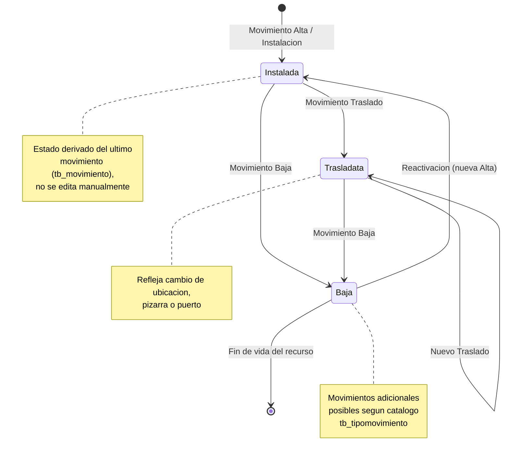
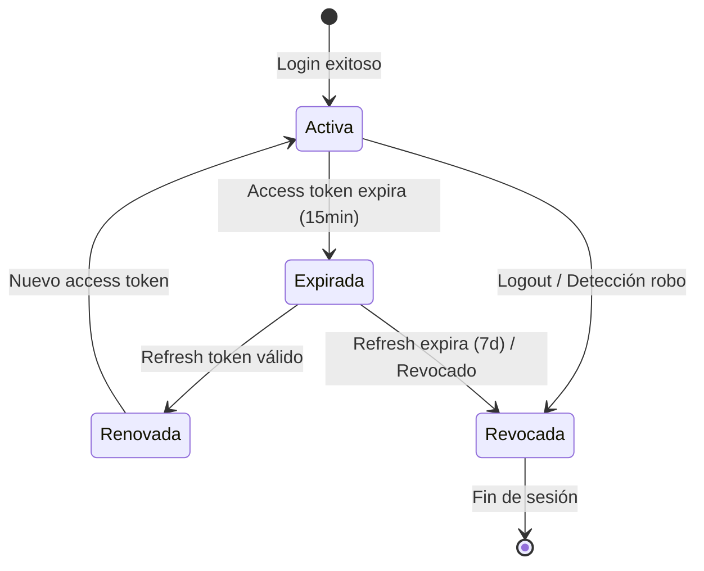

# Máquinas de Estado - SISGAD5

> **Versión:** 3.0
> **Fecha:** 2026-11-03
> **Alcance:** Máquina de estado de **Queja** (MP Service) — única máquina de negocio — y máquinas de contexto (Sesión, Usuario). Añadida la línea de vida **Teléfono/Línea** basada en el historial de **Movimientos**.
> **Consistencia:** Alineada con `08_sequence_diagrams.es.md` v2.7 (roles: Probador, Supervisor, Analista de materiales).
> **v3.0:** Eliminadas las máquinas de *Trabajo* y *Asignación de materiales* (son entidades sin ciclo de estado propio; su gestión queda cubierta por los eventos de la máquina de Queja y por la lógica del Materials Service).

---

## 1. Máquina de Estado: Queja (MP Service)

### Estados
```
Abierta → Probada → Asignada → Pendiente → Resuelta → Cerrada → Completada
                     (diagnóstico)              (fin del ciclo)

No existe reapertura: Completada es el único estado terminal.
Cerrada NO es terminal: toda queja cerrada debe culminar en Completada
(con materiales registrados o declarados "no requeridos" por el Analista).
```

Estados terminales: **Completada** (único fin de ciclo, gestionado por el Analista de materiales). `Cerrada` es un estado de espera de gestión de materiales, no terminal.

### Transiciones Permitidas

| Estado Actual | Estado Siguiente | Actor | Condición | Acción |
|---------------|------------------|-------|-----------|--------|
| Abierta | Probada | Probador | Prueba/diagnóstico registrado (no requiere resultado exitoso) | Registrar prueba, cambiar estado |
| Probada | Asignada | Supervisor | Trabajador (operario) asignado a la queja | Asignar trabajador a la QUEJA |
| Probada | Resuelta | Probador | Queja resuelta sin intervención de un trabajo (diagnóstico resolutivo) | Marcar resolución directa tras la prueba |
| Probada | Pendiente | Probador | Se realiza otra prueba (iteración) | Registrar nueva prueba |
| Asignada | Resuelta | Probador | Decisión "Trabajo de campo": **Sí, se resolvió** | Cerrar con resolución obtenida en el trabajo |
| Asignada | Pendiente | Probador | Decisión "Trabajo de campo": **No resuelta** | El trabajo ejecutado no resolvió la queja |
| Asignada | Probada | Probador | Prueba/diagnóstico registrado | Registrar prueba |
| Pendiente | Pendiente | Probador | Nuevo trabajo realizado sobre la queja **sin resolverla** (re-iteración) | Registrar otro intento de reparación |
| Pendiente | Probada | Probador | Se realiza otra prueba (diagnóstico) | Registrar nueva prueba |
| Pendiente | Asignada | Supervisor | Cambio de trabajadores para otra reparación | Reasignar trabajadores a la queja |
| Pendiente | Resuelta | Probador | Trabajo cerrado con resolución | Cerrar trabajo con resultado positivo |
| Resuelta | Cerrada | Probador | Confirmación final del cierre | Cambiar estado |
| Cerrada | Completada | Analista de materiales | Tras el cierre: registra consumo de materiales **o** declara explícitamente "no se necesitaron materiales" | Culminar el ciclo (única salida válida del cierre) |

> **Nota roles (v2.0):** El antiguo "Técnico" pasa a llamarse **Probador** (quien prueba, crea trabajos y cierra). El antiguo "Jefe/Operador" pasa a llamarse **Supervisor** (solo asignaciones). La asignación de materiales NO cambia el estado de la queja; solo el **registro final** por el Analista produce la transición `Cerrada → Completada` — tanto si hubo consumos como si declaró que no se necesitaron materiales.
>
> **Nota v3.0:** `Completada` es el **único fin de ciclo**: no existe terminal en `Cerrada`; toda queja cerrada debe ser gestionada por el Analista de materiales (con o sin materiales) hasta `Completada`.

### Transiciones PROHIBIDAS (Bloqueadas por RN-QUE-03)
- **Abierta → Asignada** (debe registrarse primero una prueba: pasar por Probada)
- Abierta → Pendiente (saltar Probada/Asignada)
- Abierta → Resuelta (saltar estados intermedios)
- Abierta → Cerrada (saltar todos)
- Probada → Cerrada (saltar Resuelta)
- **Cerrada → Abierta** (no existe reabrir; y Cerrada tampoco es terminal — debe ir a Completada)
- Cerrada → Probada / Cerrada → Resuelta (retrocesos no permitidos)
- Cerrada → [*] (fin directo prohibido: toda queja cerrada debe pasar por el Analista hacia Completada, con o sin materiales)
- Completada → cualquier estado (estado terminal absoluto)
- Probada/Asignada/Pendiente/Resuelta → Completada (Completada solo se alcanza desde Cerrada, por el Analista de materiales)

### Diagrama Mermaid



### Eventos de Dominio (Event Storming)

| Evento | Trigger | Actor | Datos |
|--------|---------|-------|-------|
| QuejaCreada | POST /quejas | Probador | {id, num_reporte, prioridad, estado: "Abierta"} |
| QuejaProbada | POST /pruebas (resultado de diagnóstico) | Probador | {id, prueba_id} |
| QuejaAsignada | POST /quejas/:id/asignar-trabajador | Supervisor | {id, id_trabajador, estado_anterior, estado_nuevo} |
| TrabajoCreado | POST /trabajos | Probador | {id, queja_id} |
| TrabajoCerrado | PATCH /trabajos/:id/cerrar | Probador | {id, tiempo_real} |
| QuejaResuelta | PATCH /quejas/:id (estado=Resuelta) | Probador | {id, via: "trabajo_campo" o "sin_trabajo"} |
| QuejaCerrada | PATCH /quejas/:id (estado=Cerrada) | Probador | {id} |
| MaterialesAsignados | POST /asignaciones (entrega a trabajador) | Analista de materiales | {id, trabajador_id, items} — no cambia estado de queja |
| ConsumoRegistrado | POST /consumos | Analista de materiales | {id, queja_id, items} |
| QuejaCompletada | PATCH /quejas/:id (estado=Completada) | Analista de materiales | {id, materiales: "registrados" o "no_requeridos"} |

> ⚠️ Eliminado `QuejaReabierta` (v2.0): no existe reabrir una queja.

---

## 2. Máquina de Estado: Teléfono / Línea — Línea de vida por Movimientos (MP Service)

La línea de vida de un **Teléfono** y de una **Línea** no se modela con estados propios sino como reflejo del **historial de Movimientos** (`tb_movimiento`, FK a `tb_tipomovimiento`). Cada movimiento registrado (Alta/Instalación, Traslado, Baja, entre otros tipos existentes) deriva el estado efectivo del recurso.

### Estados derivados del último movimiento
```
[*] → Instalada (Alta/Instalación) ⇄ Trasladata (Traslado) → Baja (Baja) → [*]
Otros tipos de movimiento posibles según catálogo tb_tipomovimiento
```

### Transiciones Permitidas

| Estado Actual | Estado Siguiente | Actor | Movimiento (tipo) | Condición |
|---------------|------------------|-------|-------------------|-----------|
| (sin registrar) | Instalada | Probador / Supervisor | Alta / Instalación | Puesta en servicio del teléfono/línea |
| Instalada | Trasladata | Probador / Supervisor | Traslado | Cambio de ubicación/pizarra/puerto |
| Trasladata | Trasladata | Probador / Supervisor | Traslado | Re-ubicaciones sucesivas |
| Instalada / Trasladata | Baja | Probador / Supervisor | Baja | Retiro del servicio |
| Baja | Instalada | Probador / Supervisor | Alta / Instalación | Reactivación con nuevo movimiento de alta |

> **Reglas:**
> - El estado **nunca se edita directamente**: siempre se deduce del último movimiento aplicado al teléfono/línea (fuente de verdad = historial).
> - Los movimientos pueden originarse desde una queja resuelta (p. ej. traslados o bajas asociados a la reparación), pero su registro es independiente del ciclo de la queja.
> - El catálogo `tb_tipomovimiento` admite más tipos además de Alta/Traslado/Baja; nuevos tipos extienden esta máquina sin modificar las reglas anteriores.

### Diagrama Mermaid



### Eventos de Dominio

| Evento | Trigger | Actor | Datos |
|--------|---------|-------|-------|
| MovimientoRegistrado | POST /movimientos | Probador / Supervisor | {id_telefono?, id_linea?, id_tipomovimiento, fecha, motivo, id_os?} |
| TelefonoTrasladado | POST /movimientos (tipo=Traslado) | Probador / Supervisor | {id_telefono, ubicacion_anterior, ubicacion_nueva} |
| RecursoDadoDeBaja | POST /movimientos (tipo=Baja) | Probador / Supervisor | {id_telefono? , id_linea?} |

---

## 3. Máquina de Estado: Sesión (Auth Context)

### Estados
```
Activa → Expirada → Renovada → Activa
    │                        │
    └──────── Revocada ─────┘
         (Logout / Seguridad)
```

### Transiciones

| Estado Actual | Estado Siguiente | Trigger |
|---------------|------------------|---------|
| Activa | Expirada | access_token expira (15 min) |
| Expirada | Renovada | POST /auth/refresh con refresh_token válido |
| Renovada | Activa | Nuevo access_token emitido |
| Activa | Revocada | POST /auth/logout O detección robo refresh |
| Expirada | Revocada | Refresh_token expira (7 días) O revocado |

### Diagrama Mermaid



---

## 4. Máquina de Estado: Usuario (Users Context)

### Estados
```
Activo → Bloqueado → Activo
   │           │
   └───────────┴──→ Inactivo (baja lógica)
```

### Transiciones

| Estado Actual | Estado Siguiente | Trigger |
|---------------|------------------|---------|
| Activo | Bloqueado | 5 intentos fallidos login |
| Bloqueado | Activo | Expiración bloqueo (15 min) O admin desbloquea |
| Activo | Inactivo | Admin da de baja (soft delete) |
| Inactivo | Activo | Admin reactiva |

---

## 5. Diagramas Fuente

Ver archivos Mermaid en: [`docs/diagrams/state_machines/`](../diagrams/state_machines/)

- `queja_state.mmd`
- `movimiento_state.mmd` (Teléfono/Línea)
- `sesion_state.mmd`
- `usuario_state.mmd`

> ⚠️ Eliminados v3.0: `trabajo_state.mmd` y `asignacion_state.mmd` (sin máquina de estado propia).

---

## 6. Registro de Cambios

| Versión | Fecha | Cambios |
|---------|-------|---------|
| 3.0 | 2026-11-03 | **Eliminadas** las máquinas de *Trabajo* y *Asignación de materiales* (no tienen ciclo de estado propio). **Añadida** la máquina de *Teléfono/Línea* derivada del historial de Movimientos (Alta, Traslado, Baja + tipos adicionales del catálogo). `Completada` pasa a ser el **único fin de ciclo**: `Cerrada` ya no es terminal (con o sin materiales, el Analista lleva la queja a Completada). Rombo de decisión "Trabajo de campo" desde `Asignada` (Sí→Resuelta / No→Pendiente). Nueva autotransición `Pendiente → Pendiente` (otro trabajo sin resolver). `Probada` = diagnóstico (no requiere prueba exitosa). Actualizado §3 en adelante por renumeración. |
| 2.0 | 2026-11-02 | Renombrados roles (Técnico→Probador, Jefe/Operador→Supervisor). Añadido estado **Completada** a la queja y transición `Cerrada → Completada` (Analista de materiales). Eliminada reapertura (`Cerrada → Abierta`). Nuevas transiciones: `Probada → Resuelta` (sin trabajo), `Asignada → Resuelta` (trabajo de campo), `Probada/Pendiente → Probada` (otra prueba), `Pendiente → Asignada` (cambio de trabajadores). Prohibida `Abierta → Asignada`. Trabajadores se asignan a la QUEJA (eliminado `Abierto → Asignado` en Trabajo). Separados conceptos asignación vs consumo de materiales. Alineado con `08_sequence_diagrams.es.md` v2.7. |
| 1.0 | 2026-09-25 | Versión inicial. |

---

## 7. Referencias

- [Reglas de Negocio](06_business_rules.es.md)
- [Casos de Uso](03_use_cases.es.md)
- [Modelo de Dominio](07_domain_model.es.md)
- [Diagramas de Secuencia](08_sequence_diagrams.es.md)
- [Event Storming](practices/practice_03_event_storming.es.md)