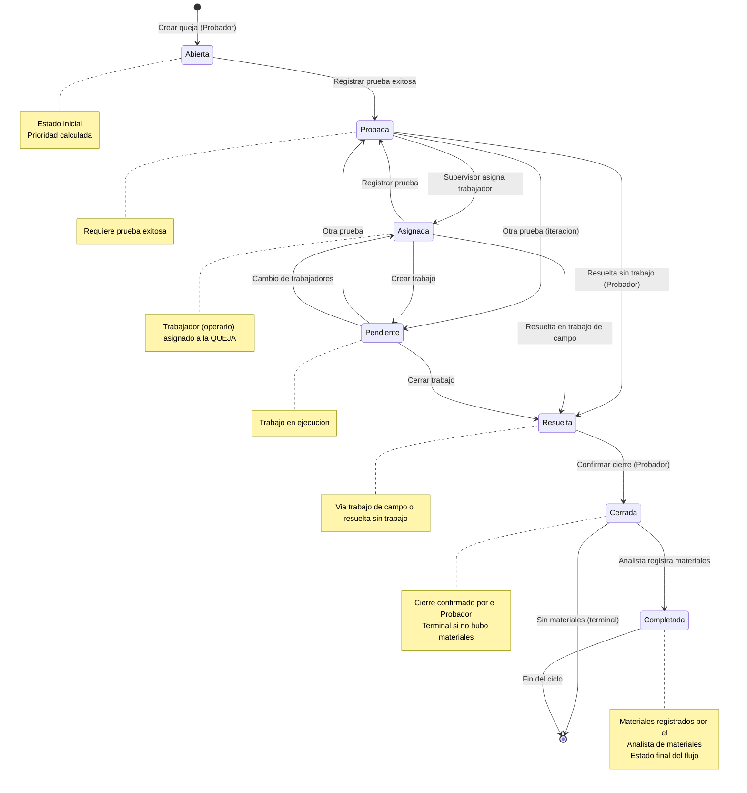
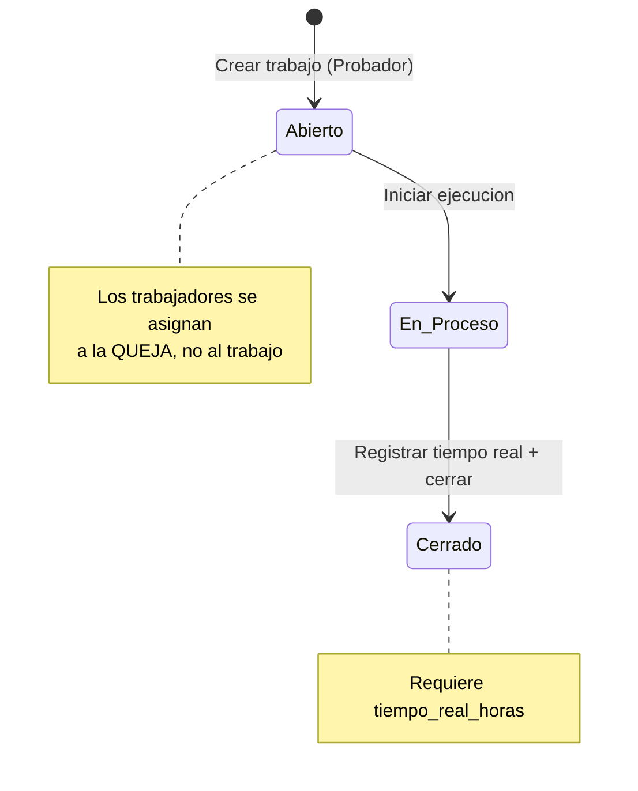
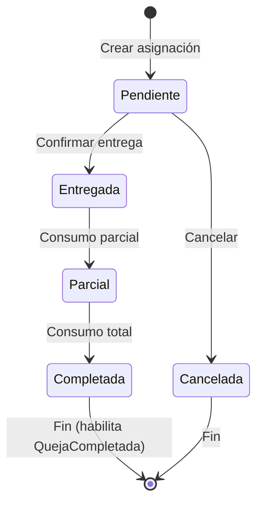
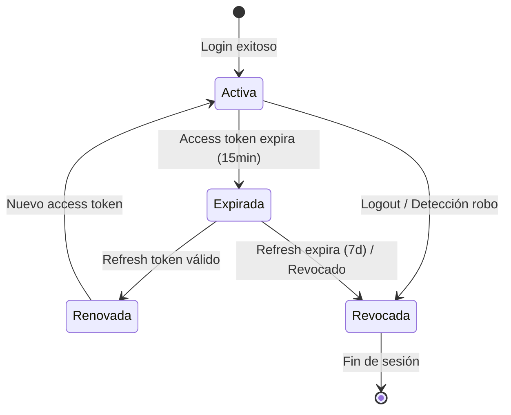

# Máquinas de Estado - SISGAD5

> **Versión:** 2.0
> **Fecha:** 2026-11-02
> **Alcance:** Máquinas de estado de **MP Service** (Queja, Trabajo) y **Materials Service** (Asignación), más Auth/Users.
> **Consistencia:** Alineada con `08_sequence_diagrams.es.md` v2.7 (roles: Probador, Supervisor, Analista de materiales).

---

## 1. Máquina de Estado: Queja (MP Service)

### Estados
```
Abierta → Probada → Asignada → Pendiente → Resuelta → Cerrada → Completada
                                                                  (fin del ciclo)
No existe reapertura: Cerrada y Completada son estados terminales
```

Estados terminales: **Completada** (materiales gestionados por el Analista) y **Cerrada** (terminal alternativo cuando no se utilizaron materiales).

### Transiciones Permitidas

| Estado Actual | Estado Siguiente | Actor | Condición | Acción |
|---------------|------------------|-------|-----------|--------|
| Abierta | Probada | Probador | Prueba registrada (exitoso=true) | Registrar prueba, cambiar estado |
| Probada | Asignada | Supervisor | Trabajador (operario) asignado a la queja | Asignar trabajador a la QUEJA |
| Probada | Resuelta | Probador | Queja resuelta sin intervención de un trabajo | Marcar resolución directa tras la prueba |
| Probada | Pendiente | Probador | Se realiza otra prueba (iteración) | Registrar nueva prueba |
| Asignada | Pendiente | Probador | Trabajo creado | Crear orden de trabajo |
| Asignada | Probada | Probador | Prueba registrada | Registrar prueba |
| Asignada | Resuelta | Probador | Resolución lograda en trabajo de campo | Resolver vía trabajo de campo |
| Pendiente | Probada | Probador | Se realiza otra prueba | Registrar nueva prueba |
| Pendiente | Asignada | Supervisor | Cambio de trabajadores para otra reparación | Reasignar trabajadores a la queja |
| Pendiente | Resuelta | Probador | Trabajo cerrado | Cerrar trabajo |
| Resuelta | Cerrada | Probador | Confirmación final del cierre | Cambiar estado |
| Cerrada | Completada | Analista de materiales | Materiales registrados/asignados tras el cierre | Gestionar materiales y culminar el ciclo |

> **Nota roles (v2.0):** El antiguo "Técnico" pasa a llamarse **Probador** (quien prueba, crea trabajos y cierra). El antiguo "Jefe/Operador" pasa a llamarse **Supervisor** (solo asignaciones). La asignación de materiales NO cambia el estado de la queja; solo el **consumo/registro final de materiales** por el Analista produce la transición `Cerrada → Completada`. Si el Analista declara que no se necesitaron materiales, la queja culmina en **Cerrada**.

### Transiciones PROHIBIDAS (Bloqueadas por RN-QUE-03)
- **Abierta → Asignada** (debe registrarse primero una prueba: pasar por Probada)
- Abierta → Pendiente (saltar Probada/Asignada)
- Abierta → Resuelta (saltar estados intermedios)
- Abierta → Cerrada (saltar todos)
- Probada → Cerrada (saltar Resuelta)
- **Cerrada → Abierta** (no existe reabrir; Cerrada es terminal salvo hacia Completada)
- Cerrada → Probada / Cerrada → Resuelta (retrocesos no permitidos)
- Completada → cualquier estado (estado terminal absoluto)
- Probada/Asignada/Pendiente/Resuelta → Completada (Completada solo se alcanza desde Cerrada, por el Analista de materiales)

### Diagrama Mermaid



### Eventos de Dominio (Event Storming)

| Evento | Trigger | Actor | Datos |
|--------|---------|-------|-------|
| QuejaCreada | POST /quejas | Probador | {id, num_reporte, prioridad, estado: "Abierta"} |
| QuejaProbada | POST /pruebas (exitoso=true) | Probador | {id, prueba_id} |
| QuejaAsignada | POST /quejas/:id/asignar-trabajador | Supervisor | {id, id_trabajador, estado_anterior, estado_nuevo} |
| TrabajoCreado | POST /trabajos | Probador | {id, queja_id} |
| TrabajoCerrado | PATCH /trabajos/:id/cerrar | Probador | {id, tiempo_real} |
| QuejaResuelta | PATCH /quejas/:id (estado=Resuelta) | Probador | {id, via: "trabajo_campo" o "sin_trabajo"} |
| QuejaCerrada | PATCH /quejas/:id (estado=Cerrada) | Probador | {id} |
| MaterialesAsignados | POST /asignaciones (entrega a trabajador) | Analista de materiales | {id, trabajador_id, items} — no cambia estado de queja |
| ConsumoRegistrado | POST /consumos | Analista de materiales | {id, queja_id, items} |
| QuejaCompletada | PATCH /quejas/:id (estado=Completada) | Analista de materiales | {id, materiales: "registrados" o "no_requeridos"} |

> ⚠️ Eliminado `QuejaReabierta` (v2.0): no existe reabrir una queja.

---

## 2. Máquina de Estado: Trabajo (MP Service)

### Estados
```
Abierto → En_Proceso → Cerrado
```

### Transiciones Permitidas

> **v2.0:** El trabajador (operario) se asigna a la **QUEJA**, no al trabajo. Por ello el trabajo ya nace con los trabajadores disponibles y NO existe la transición `Abierto → Asignado`. El trabajo lo crea e inserta el propio **Probador**.

| Estado Actual | Estado Siguiente | Actor | Condición |
|---------------|------------------|-------|-----------|
| Abierto | En_Proceso | Probador | Inicio de ejecución (trabajadores tomados de la queja) |
| En_Proceso | Cerrado | Probador | Tiempo real registrado |

### Diagrama Mermaid



---

## 3. Máquina de Estado: Asignación (Materials Service)

### Estados
```
Pendiente → Entregada → Parcial → Completada
    └→ Cancelada (antes de entregar)
```

### Transiciones Permitidas

La **asignación** es la entrega física de materiales a un trabajador y puede realizarse **en cualquier momento**; por sí sola NO cambia el estado de la queja. El **consumo** lo registra el **Analista de materiales** (no el Probador).

| Estado Actual | Estado Siguiente | Actor | Condición |
|---------------|------------------|-------|-----------|
| Pendiente | Entregada | Analista de materiales | Trabajador confirma recepción |
| Pendiente | Cancelada | Analista de materiales | Cancelada antes de entrega |
| Entregada | Parcial | Analista de materiales | Algunos items consumidos |
| Parcial | Completada | Analista de materiales | Todos los items consumidos |

> La transición final de la queja (`Cerrada → Completada`) ocurre cuando el Analista registra el consumo total o declara que no se necesitaron materiales (ver §1).

### Diagrama Mermaid



---

## 4. Máquina de Estado: Sesión (Auth Context)

### Estados
```
Activa → Expirada → Renovada → Activa
    │                        │
    └──────── Revocada ─────┘
         (Logout / Seguridad)
```

### Transiciones

| Estado Actual | Estado Siguiente | Trigger |
|---------------|------------------|---------|
| Activa | Expirada | access_token expira (15 min) |
| Expirada | Renovada | POST /auth/refresh con refresh_token válido |
| Renovada | Activa | Nuevo access_token emitido |
| Activa | Revocada | POST /auth/logout O detección robo refresh |
| Expirada | Revocada | Refresh_token expira (7 días) O revocado |

### Diagrama Mermaid



---

## 5. Máquina de Estado: Usuario (Users Context)

### Estados
```
Activo → Bloqueado → Activo
   │           │
   └───────────┴──→ Inactivo (baja lógica)
```

### Transiciones

| Estado Actual | Estado Siguiente | Trigger |
|---------------|------------------|---------|
| Activo | Bloqueado | 5 intentos fallidos login |
| Bloqueado | Activo | Expiración bloqueo (15 min) O admin desbloquea |
| Activo | Inactivo | Admin da de baja (soft delete) |
| Inactivo | Activo | Admin reactiva |

---

## 6. Diagramas Fuente

Ver archivos Mermaid en: [`docs/diagrams/state_machines/`](../diagrams/state_machines/)

- `queja_state.mmd`
- `trabajo_state.mmd`
- `asignacion_state.mmd`
- `sesion_state.mmd`
- `usuario_state.mmd`

---

## 7. Registro de Cambios

| Versión | Fecha | Cambios |
|---------|-------|---------|
| 2.0 | 2026-11-02 | Renombrados roles (Técnico→Probador, Jefe/Operador→Supervisor). Añadido estado **Completada** a la queja y transición `Cerrada → Completada` (Analista de materiales). Eliminada reapertura (`Cerrada → Abierta`). Nuevas transiciones: `Probada → Resuelta` (sin trabajo), `Asignada → Resuelta` (trabajo de campo), `Probada/Pendiente → Probada` (otra prueba), `Pendiente → Asignada` (cambio de trabajadores). Prohibida `Abierta → Asignada`. Trabajadores se asignan a la QUEJA (eliminado `Abierto → Asignado` en Trabajo). Separados conceptos asignación vs consumo de materiales. Alineado con `08_sequence_diagrams.es.md` v2.7. |
| 1.0 | 2026-09-25 | Versión inicial. |

---

## 8. Referencias

- [Reglas de Negocio](06_business_rules.es.md)
- [Casos de Uso](03_use_cases.es.md)
- [Modelo de Dominio](07_domain_model.es.md)
- [Diagramas de Secuencia](08_sequence_diagrams.es.md)
- [Event Storming](practices/practice_03_event_storming.es.md)