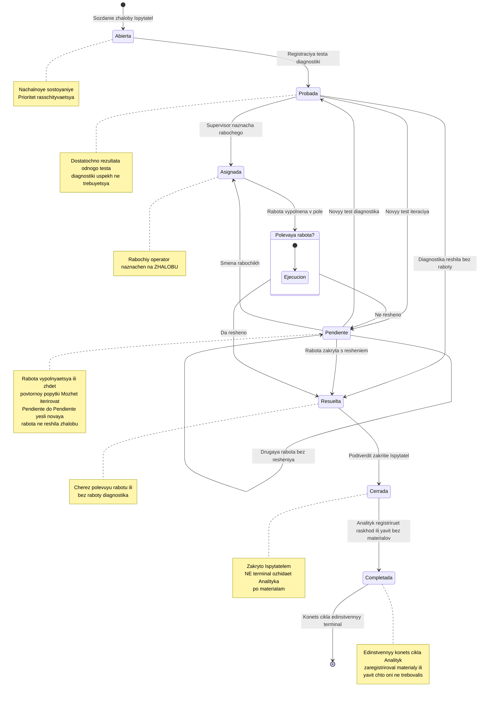
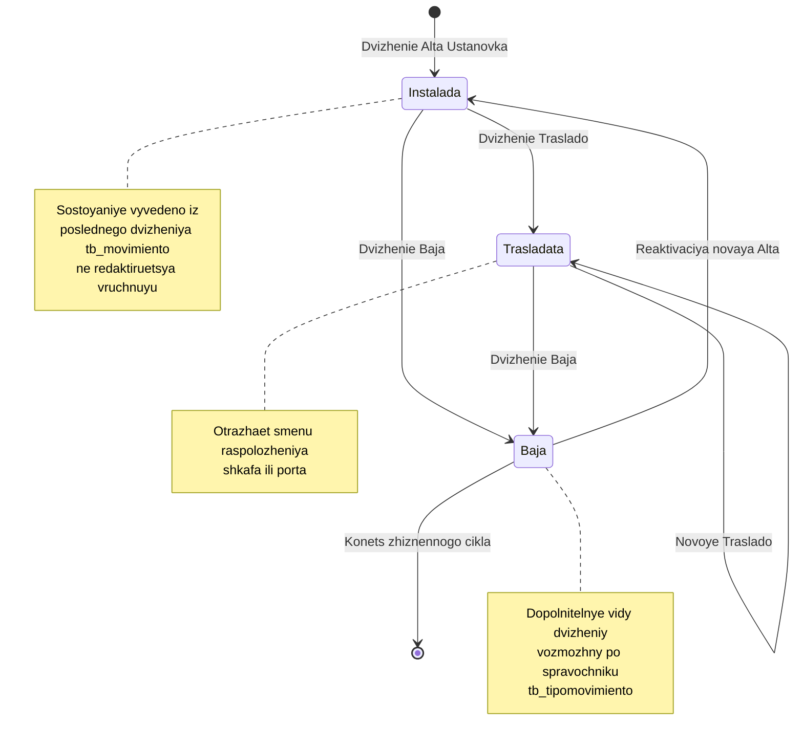
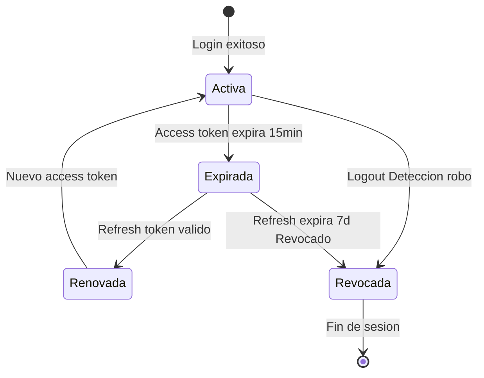

# Машины состояний - SISGAD5

> **Версия:** 3.0
> **Дата:** 2026-11-03
> **Область применения:** Машина состояний **Жалобы** (MP Service) — единственная бизнес-машина; машина жизненного цикла **Телефона/Линии** на основе истории **Движений**; контекстные машины (Сессия, Пользователь).
> **Согласованность:** Выровнена с `08_sequence_diagrams.ru.md` v2.7 (роли: Испытатель, Супервайзер, Аналитик по материалам).
> **v3.0:** Устранены машины *Работа* и *Назначение материалов* (сущности без собственного жизненного цикла; их управление покрыто событиями машины Жалобы и логикой Materials Service).

---

## 1. Машина состояний: Жалоба (MP Service)

### Состояния
```
Abierta -> Probada -> Asignada -> Pendiente -> Resuelta -> Cerrada -> Completada
                     (диагностика)                        (конец цикла)

Повторное открытие не существует: Completada — единственное терминальное состояние.
Cerrada НЕ терминальна: любая закрытая жалоба должна завершиться в Completada
(с зарегистрированными материалами или с заявлением аналитика о том, что материалы не потребовались).
```

Терминальные состояния: **Completada** (единственный конец цикла, управляется Аналитиком по материалам). `Cerrada` — промежуточное состояние ожидания управления материалами, не терминальное.

### Разрешённые переходы

| Текущее состояние | Следующее состояние | Актёр | Условие | Действие |
|-------------------|---------------------|-------|---------|----------|
| Abierta | Probada | Испытатель | Зарегистрированы тест/диагностика (успешный результат не требуется) | Зарегистрировать тест, сменить статус |
| Probada | Asignada | Супервайзер | Рабочий (оператор) назначен на жалобу | Назначить рабочего на ЖАЛОБУ |
| Probada | Resuelta | Испытатель | Жалоба решена без выполнения работы (диагностика решила проблему) | Отметить прямое решение после теста |
| Probada | Pendiente | Испытатель | Проводится новый тест (итерация) | Зарегистрировать новый тест |
| Asignada | Resuelta | Испытатель | Решение «Полевая работа»: **да, решено** | Закрыть с решением, полученным в работе |
| Asignada | Pendiente | Испытатель | Решение «Полевая работа»: **не решено** | Выполненная работа не решила жалобу |
| Asignada | Probada | Испытатель | Зарегистрированы тест/диагностика | Зарегистрировать тест |
| Pendiente | Pendiente | Испытатель | Новая работа по жалобе **без решения** (реитерация) | Зарегистрировать новую попытку ремонта |
| Pendiente | Probada | Испытатель | Проводится новый тест (диагностика) | Зарегистрировать новый тест |
| Pendiente | Asignada | Супервайзер | Смена рабочих для другого ремонта | Переназначить рабочих на жалобу |
| Pendiente | Resuelta | Испытатель | Работа закрыта с решением | Закрыть работу с положительным результатом |
| Resuelta | Cerrada | Испытатель | Финальное подтверждение закрытия | Сменить статус |
| Cerrada | Completada | Аналитик по материалам | После закрытия: регистрирует расход материалов **или** явно заявляет, что материалы не потребовались | Завершить цикл (единственный допустимый выход из закрытия) |

> **Примечание о ролях (v2.0):** бывший «Техник» переименован в **Испытатель** (тестирует, создаёт работы, закрывает). Бывший «Jefe/Operador» — в **Супервайзер** (только назначения). Назначение материалов НЕ меняет статус жалобы; только **финальный учёт** Аналитиком вызывает переход `Cerrada -> Completada` — как при наличии расходов, так и при заявлении, что материалы не требовались.
>
> **Примечание v3.0:** `Completada` — **единственный конец цикла**: терминаль в `Cerrada` отсутствует; любая закрытая жалоба должна быть обработана Аналитиком по материалам (с материалами или без) до `Completada`.

### Запрещённые переходы (заблокировано правилом RN-QUE-03)
- **Abierta -> Asignada** (сначала обязан быть тест: через Probada)
- Abierta -> Pendiente (пропустить Probada/Asignada)
- Abierta -> Resuelta (пропустить промежуточные состояния)
- Abierta -> Cerrada (пропустить все)
- Probada -> Cerrada (пропустить Resuelta)
- **Cerrada -> Abierta** (повторное открытие не существует; и Cerrada не терминальна — должна идти в Completada)
- Cerrada -> Probada / Cerrada -> Resuelta (обратные переходы запрещены)
- Cerrada -> [*] (прямой конец запрещён: любая закрытая жалоба проходит через Аналитика к Completada, с материалами или без)
- Completada -> любое состояние (абсолютный терминал)
- Probada/Asignada/Pendiente/Resuelta -> Completada (Completada достижима только из Cerrada, силами Аналитика по материалам)

### Диаграмма Mermaid



### События домена (Event Storming)

| Событие | Триггер | Актёр | Данные |
|---------|---------|-------|--------|
| QuejaCreada | POST /quejas | Испытатель | {id, num_reporte, prioridad, estado: "Abierta"} |
| QuejaProbada | POST /pruebas (результат диагностики) | Испытатель | {id, prueba_id} |
| QuejaAsignada | POST /quejas/:id/asignar-trabajador | Супервайзер | {id, id_trabajador, estado_anterior, estado_nuevo} |
| TrabajoCreado | POST /trabajos | Испытатель | {id, queja_id} |
| TrabajoCerrado | PATCH /trabajos/:id/cerrar | Испытатель | {id, tiempo_real} |
| QuejaResuelta | PATCH /quejas/:id (estado=Resuelta) | Испытатель | {id, via: "polevaya_rabota" ili "bez_raboty"} |
| QuejaCerrada | PATCH /quejas/:id (estado=Cerrada) | Испытатель | {id} |
| MaterialesAsignados | POST /asignaciones (выдача рабочему) | Аналитик по материалам | {id, trabajador_id, items} — ne menyayet status zhaloby |
| ConsumoRegistrado | POST /consumos | Аналитик по материалам | {id, queja_id, items} |
| QuejaCompletada | PATCH /quejas/:id (estado=Completada) | Аналитик по материалам | {id, materialy: "zaregistrirovany" ili "ne_trebovalis"} |

> Ustraneno `QuejaReabierta` (v2.0): povtornoye otkrytiye zhaloby ne sushchestvuyet.

---

## 2. Машина состояний: Телефон / Линия — Жизненный цикл по Движениям (MP Service)

Жизненный цикл **Телефона** и **Линии** моделируется не собственными состояниями, а как отражение **истории Движений** (`tb_movimiento`, FK на `tb_tipomovimiento`). Каждое зарегистрированное движение (Установка/Ввод в эксплуатацию, Перемещение, Списание — и другие существующие типы) определяет фактическое состояние ресурса.

### Состояния, выводимые из последнего движения
```
[*] -> Instalada (Alta/Установка) <-> Trasladata (Traslado/Перемещение) -> Baja (Baja/Списание) -> [*]
Vozmozhmy inye typy dvizheniy soglasno spravochniku tb_tipomovimiento
```

### Разрешённые переходы

| Текущее состояние | Следующее состояние | Актёр | Движение (тип) | Условие |
|-------------------|---------------------|-------|----------------|---------|
| (не зарегистрирован) | Instalada | Испытатель / Супервайзер | Alta / Установка | Ввод телефона/линии в эксплуатацию |
| Instalada | Trasladata | Испытатель / Супервайзер | Traslado / Перемещение | Смена расположения/шкафа/порта |
| Trasladata | Trasladata | Испытатель / Супервайзер | Traslado | Последовательные перемещения |
| Instalada / Trasladata | Baja | Испытатель / Супервайзер | Baja / Списание | Вывод из эксплуатации |
| Baja | Instalada | Испытатель / Супервайзер | Alta / Установка | Реактивация с новым движением установки |

> **Правила:**
> - Состояние **никогда не редактируется напрямую**: всегда выводится из последнего движения, применённого к телефону/линии (источник истины = история).
> - Движения могут возникать из закрытой жалобы (напр., перемещения или списания, связанные с ремонтом), но их регистрация независима от цикла жалобы.
> - Справочник `tb_tipomovimiento` допускает больше типов, чем Alta/Traslado/Baja; новые типы расширяют эту машину без изменения предыдущих правил.

### Диаграмма Mermaid



### События домена

| Событие | Триггер | Актёр | Данные |
|---------|---------|-------|--------|
| MovimientoRegistrado | POST /movimientos | Испытатель / Супервайзер | {id_telefono?, id_linea?, id_tipomovimiento, fecha, motivo, id_os?} |
| TelefonoTrasladado | POST /movimientos (tipo=Traslado) | Испытатель / Супервайзер | {id_telefono, ubicacion_anterior, ubicacion_nueva} |
| RecursoDadoDeBaja | POST /movimientos (tipo=Baja) | Испытатель / Супервайзер | {id_telefono?, id_linea?} |

---

## 3. Машина состояний: Сессия (Auth Context)

### Состояния
```
Activa -> Expirada -> Renovada -> Activa
    |                        |
    --------- Revocada ------+
         (Logout / Обнаружение кражи)
```

### Переходы

| Текущее состояние | Следующее состояние | Триггер |
|-------------------|---------------------|---------|
| Activa | Expirada | access_token истекает (15 мин) |
| Expirada | Renovada | POST /auth/refresh с действительным refresh_token |
| Renovada | Activa | Выдан новый access_token |
| Activa | Revocada | POST /auth/logout ИЛИ обнаружение кражи refresh |
| Expirada | Revocada | refresh_token истекает (7 дней) ИЛИ отозван |

### Диаграмма Mermaid



---

## 4. Машина состояний: Пользователь (Users Context)

### Состояния
```
Activo -> Bloqueado -> Activo
   |           |
   -----------+-----> Inactivo (логическое удаление)
```

### Переходы

| Текущее состояние | Следующее состояние | Триггер |
|-------------------|---------------------|---------|
| Activo | Bloqueado | 5 неудачных попыток входа |
| Bloqueado | Activo | Истечение блокировки (15 мин) ИЛИ снятие администратором |
| Activo | Inactivo | Администратор удаляет (soft delete) |
| Inactivo | Activo | Администратор активирует |

---

## 5. Исходные диаграммы

Файлы Mermaid в репозитории: [`docs/diagrams/state_machines/`](../diagrams/state_machines/)

| Файл | Машина | Раздел |
|------|--------|--------|
| `queja_state.mmd` | Жалоба (MP Service) | §1 |
| `movimiento_state.mmd` | Телефон/Линия по Движениям (MP Service) | §2 |
| `sesion_state.mmd` | Сессия (Auth Context) | §3 |
| `usuario_state.mmd` | Пользователь (Users Context) | §4 |

> Ustraneny v3.0: `trabajo_state.mmd` i `asignacion_state.mmd` (net sobstvennoy mashiny sostoyaniy).

---

## 6. Журнал изменений

| Версия | Дата | Изменения |
|--------|------|-----------|
| 3.0 | 2026-11-03 | **Устранены** машины *Работа* и *Назначение материалов* (нет собственного жизненного цикла). **Добавлена** машина *Телефон/Линия*, выводимая из истории Движений (Alta, Traslado, Baja + доп. типы справочника). `Completada` — **единственный конец цикла**: `Cerrada` больше не терминальна (с материалами или без, Аналитик доводит жалобу до Completada). Ромб решения «Полевая работа» из `Asignada` (Да->Resuelta / Нет->Pendiente). Новый самопереход `Pendiente -> Pendiente` (другая работа без решения). `Probada` = диагностика (успех не требуется). Перенумерация §3 и далее. |
| 2.0 | 2026-11-02 | Переименованы роли (Техник->Испытатель, Jefe/Operador->Супервайзер). Добавлено состояние **Completada** и переход `Cerrada -> Completada` (Аналитик по материалам). Устранено повторное открытие. Новые переходы: Probada->Resuelta (без работы), Asignada->Resuelta (полевая работа), Probada/Pendiente->Probada (новый тест), Pendiente->Asignada (смена рабочих). Запрещён Abierta->Asignada. Рабочие назначаются на ЖАЛОБУ. Разделены назначение и расход материалов. |
| 1.0 | 2026-09-25 | Начальная версия. |

---

## 7. Ссылки

- [Бизнес-правила](06_business_rules.ru.md)
- [Варианты использования](03_use_cases.ru.md)
- [Модель домена](07_domain_model.ru.md)
- [Диаграммы последовательностей](08_sequence_diagrams.ru.md)
- [Event Storming](practices/practice_03_event_storming.ru.md)
