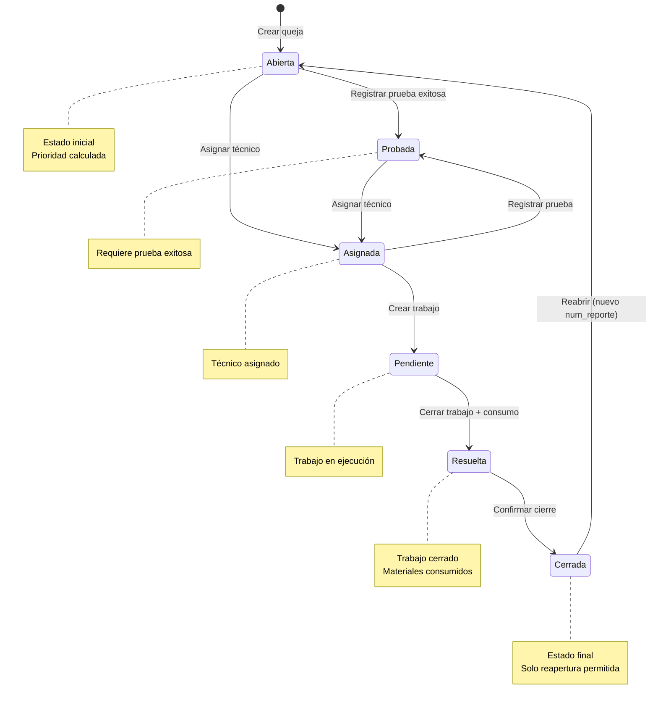
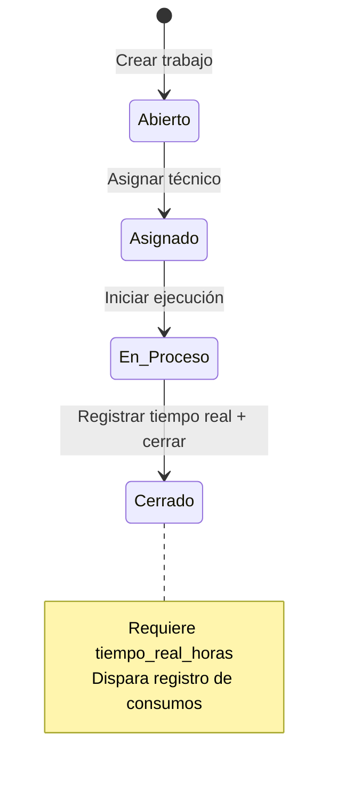
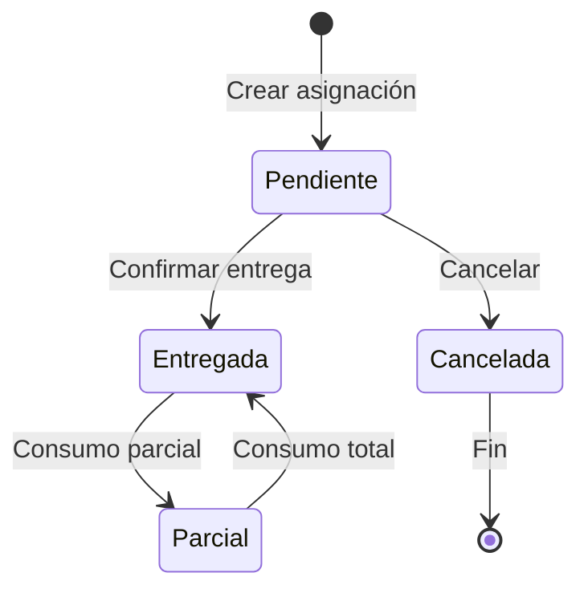
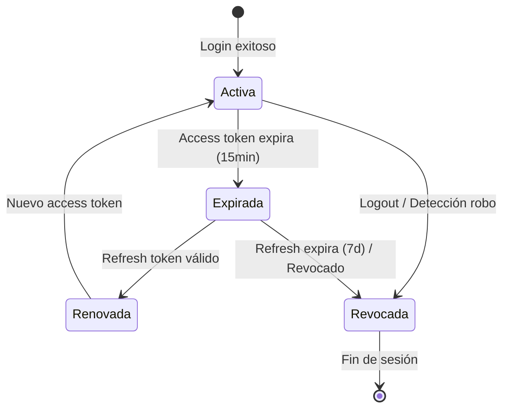

# Машины состояний - SISGAD5

> **Версия:** 1.0
> **Дата:** 2026-09-25

---

## 1. Машина состояний: Жалоба (MP Service)

### Состояния
```
Abierta → Probada → Asignada → Pendiente → Resuelta → Cerrada
   │         │          │           │           │          │
   └─────────┴──────────┴───────────┴───────────┴──────────┘
                     (Повторное открытие: Cerrada → Abierta)
```

### Разрешённые переходы

| Текущее состояние | Следующее состояние | Актёр | Условие | Действие |
|-------------------|---------------------|-------|---------|----------|
| Abierta | Probada | Техник | Тест зарегистрирован (exitoso=true) | Зарегистрировать тест, сменить статус |
| Abierta | Asignada | Jefe/Operador | Техник назначен | Назначить техника |
| Probada | Asignada | Jefe/Operador | Техник назначен | Назначить техника |
| Asignada | Pendiente | Техник | Создана работа | Создать заказ работы |
| Asignada | Probada | Техник | Тест зарегистрирован | Зарегистрировать тест |
| Pendiente | Resuelta | Техник | Работа закрыта + расход зарегистрирован | Закрыть работу, зарегистрировать расход |
| Resuelta | Cerrada | Operador/Jefe | Финальное подтверждение | Сменить статус |
| Cerrada | Abierta | Operador/Jefe | Обоснованное повторное открытие | Новый num_reporte, статус=Abierta |

### Запрещённые переходы (Bloquировано правилом RN-QUE-03)
- Abierta → Pendiente (пропустить Probada/Asignada)
- Abierta → Resuelta (пропустить промежуточные состояния)
- Abierta → Cerrada (пропустить все)
- Probada → Pendiente (пропустить Asignada)
- Probada → Resuelta (пропустить Asignada/Pendiente)
- Probada → Cerrada (пропустить все)
- Asignada → Resuelta (пропустить Pendiente)
- Asignada → Cerrada (пропустить Pendiente/Resuelta)
- Pendiente → Cerrada (пропустить Resuelta)
- Любое → Abierta (кроме Cerrada → Abierta при повторном открытии)

### Диаграмма Mermaid



### События домена (Event Storming)

| Событие | Триггер | Данные |
|--------|---------|-------|
| QuejaCreada | POST /quejas | {id, num_reporte, prioridad, estado: "Abierta"} |
| QuejaProbada | PATCH /quejas/:id (estado=Probada) | {id, prueba_id, tecnico_id} |
| QuejaAsignada | PATCH /quejas/:id/asignar | {id, tecnico_id, estado_anterior, estado_nuevo} |
| TrabajoCreado | POST /trabajos | {id, queja_id, tecnico_id} |
| TrabajoCerrado | PATCH /trabajos/:id/cerrar | {id, tiempo_real} |
| ConsumoRegistrado | POST /consumos | {id, trabajo_id, items} |
| QuejaResuelta | PATCH /quejas/:id (estado=Resuelta) | {id} |
| QuejaCerrada | PATCH /quejas/:id (estado=Cerrada) | {id} |
| QuejaReabierta | PATCH /quejas/:id (estado=Abierta desde Cerrada) | {id, nuevo_num_reporte} |

---

## 2. Машина состояний: Работа (MP Service)

### Состояния
```
Abierto → Asignado → En_Proceso → Cerrado
```

### Разрешённые переходы

| Текущее состояние | Следующее состояние | Актёр | Условие |
|-------------------|---------------------|-------|---------|
| Abierto | Asignado | Jefe | Техник назначен |
| Asignado | En_Proceso | Техник | Начало выполнения |
| En_Proceso | Cerrado | Техник | Зарегистрировано реальное время |

### Диаграмма Mermaid



---

## 3. Машина состояний: Назначение (Materials Service)

### Состояния
```
Pendiente → Entregada → Parcial → (Cancelada)
                    │
                    └─→ (если все позиции полностью расходованы)
```

### Разрешённые переходы

| Текущее состояние | Следующее состояние | Условие |
|-------------------|---------------------|---------|
| Pendiente | Entregada | Техник подтверждает получение |
| Pendiente | Cancelada | Аналитик отменяет до доставки |
| Entregada | Parcial | Некоторые позиции расходованы |
| Parcial | Entregada | Все позиции расходованы |

### Диаграмма Mermaid



---

## 4. Машина состояний: Сессия (Auth Context)

### Состояния
```
Activa → Expirada → Renovada → Activa
    │                        │
    └──────── Revocada ─────┘
         (Logout / Обнаружение кражи)
```

### Переходы

| Текущее состояние | Следующее состояние | Триггер |
|-------------------|---------------------|---------|
| Activa | Expirada | access_token истекает (15 мин) |
| Expirada | Renovada | POST /auth/refresh с действительным refresh_token |
| Renovada | Activa | Выдан новый access_token |
| Activa | Revocada | POST /auth/logout ИЛИ обнаружение кражи refresh |
| Expirada | Revocada | refresh_token истекает (7 дней) ИЛИ отозван |

### Диаграмма Mermaid



---

## 5. Машина состояний: Пользователь (Users Context)

### Состояния
```
Activo → Bloqueado → Activo
   │           │
   └───────────┴──→ Inactivo (логическое удаление)
```

### Переходы

| Текущее состояние | Следующее состояние | Триггер |
|-------------------|---------------------|---------|
| Activo | Bloqueado | 5 неудачных попыток входа |
| Bloqueado | Activo | Истечение блокировки (15 мин) ИЛИ снятие администратором |
| Activo | Inactivo | Администратор удаляет (soft delete) |
| Inactivo | Activo | Администратор активирует |

---

## 6. Исходные диаграммы

См. файлы Mermaid: [`docs/diagrams/state_machines/`](../diagrams/state_machines/)

- `queja_state.mmd`
- `trabajo_state.mmd`
- `asignacion_state.mmd`
- `sesion_state.mmd`
- `usuario_state.mmd`

---

## 7. Ссылки

- [Бизнес-правила](06_business_rules.ru.md)
- [Варианты использования](03_use_cases.ru.md)
- [Модель домена](07_domain_model.ru.md)
- [Диаграммы последовательностей](08_sequence_diagrams.ru.md)
- [Event Storming](../practices/practice_03_event_storming.md)
