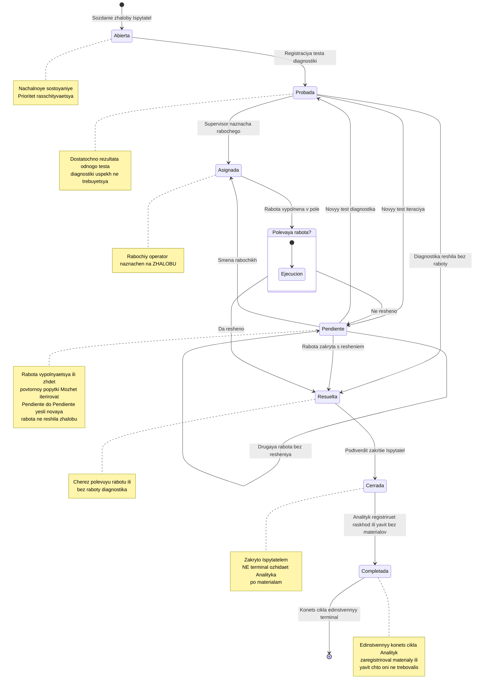

# Машины состояний - SISGAD5

> **Версия:** 3.2
> **Дата:** 2026-11-03
> **Область применения:** Единственная машина состояний системы: **Жалоба** (MP Service / Материалы). Формальных машин состояний больше не существует.
> **Согласованность:** Выровнена с `08_sequence_diagrams.ru.md` v2.7 (роли: Испытатель, Супервайзер, Аналитик по материалам).
> **v3.2:** Устранены машины *Сессия* и *Пользователь*: их флаги состояния (activa/revocada, activo/bloqueado/inactivo) — это атрибуты CRUD, управляемые бизнес-правилами в `backend-users`, а не бизнес-машины состояний. Технические детали находятся в `docs/api/users.yaml` и коде.
> **v3.1:** Устранена машина *Телефон/Линия по Движениям*: движения — это номенклатурный справочник (`tb_tipomovimiento`) со множеством типов, контроль состояний ресурса отсутствует; его история покрыта `11_data_model` и API движений.
> **v3.0:** Устранены машины *Работа* и *Назначение материалов* (сущности без собственного жизненного цикла; их управление покрыто событиями машины Жалобы и логикой Materials Service).

---

## 1. Машина состояний: Жалоба (MP Service)

### Состояния
```
Abierta -> Probada -> Asignada -> Pendiente -> Resuelta -> Cerrada -> Completada
                     (диагностика)                        (конец цикла)

Повторное открытие не существует: Completada — единственное терминальное состояние.
Cerrada НЕ терминальна: любая закрытая жалоба должна завершиться в Completada
(с зарегистрированными материалами или с заявлением аналитика о том, что материалы не потребовались).
```

Терминальные состояния: **Completada** (единственный конец цикла, управляется Аналитиком по материалам). `Cerrada` — промежуточное состояние ожидания управления материалами, не терминальное.

### Разрешённые переходы

| Текущее состояние | Следующее состояние | Актёр | Условие | Действие |
|-------------------|---------------------|-------|---------|----------|
| Abierta | Probada | Испытатель | Зарегистрированы тест/диагностика (успешный результат не требуется) | Зарегистрировать тест, сменить статус |
| Probada | Asignada | Супервайзер | Рабочий (оператор) назначен на жалобу | Назначить рабочего на ЖАЛОБУ |
| Probada | Resuelta | Испытатель | Жалоба решена без выполнения работы (диагностика решила проблему) | Отметить прямое решение после теста |
| Probada | Pendiente | Испытатель | Проводится новый тест (итерация) | Зарегистрировать новый тест |
| Asignada | Resuelta | Испытатель | Решение «Полевая работа»: **да, решено** | Закрыть с решением, полученным в работе |
| Asignada | Pendiente | Испытатель | Решение «Полевая работа»: **не решено** | Выполненная работа не решила жалобу |
| Asignada | Probada | Испытатель | Зарегистрированы тест/диагностика | Зарегистрировать тест |
| Pendiente | Pendiente | Испытатель | Новая работа по жалобе **без решения** (реитерация) | Зарегистрировать новую попытку ремонта |
| Pendiente | Probada | Испытатель | Проводится новый тест (диагностика) | Зарегистрировать новый тест |
| Pendiente | Asignada | Супервайзер | Смена рабочих для другого ремонта | Переназначить рабочих на жалобу |
| Pendiente | Resuelta | Испытатель | Работа закрыта с решением | Закрыть работу с положительным результатом |
| Resuelta | Cerrada | Испытатель | Финальное подтверждение закрытия | Сменить статус |
| Cerrada | Completada | Аналитик по материалам | После закрытия: регистрирует расход материалов **или** явно заявляет, что материалы не потребовались | Завершить цикл (единственный допустимый выход из закрытия) |

> **Примечание о ролях (v2.0):** бывший «Техник» переименован в **Испытатель** (тестирует, создаёт работы, закрывает). Бывший «Jefe/Operador» — в **Супервайзер** (только назначения). Назначение материалов НЕ меняет статус жалобы; только **финальный учёт** Аналитиком вызывает переход `Cerrada -> Completada` — как при наличии расходов, так и при заявлении, что материалы не требовались.
>
> **Примечание v3.0:** `Completada` — **единственный конец цикла**: терминаль в `Cerrada` отсутствует; любая закрытая жалоба должна быть обработана Аналитиком по материалам (с материалами или без) до `Completada`.

### Запрещённые переходы (заблокировано правилом RN-QUE-03)
- **Abierta -> Asignada** (сначала обязан быть тест: через Probada)
- Abierta -> Pendiente (пропустить Probada/Asignada)
- Abierta -> Resuelta (пропустить промежуточные состояния)
- Abierta -> Cerrada (пропустить все)
- Probada -> Cerrada (пропустить Resuelta)
- **Cerrada -> Abierta** (повторное открытие не существует; и Cerrada не терминальна — должна идти в Completada)
- Cerrada -> Probada / Cerrada -> Resuelta (обратные переходы запрещены)
- Cerrada -> [*] (прямой конец запрещён: любая закрытая жалоба проходит через Аналитика к Completada, с материалами или без)
- Completada -> любое состояние (абсолютный терминал)
- Probada/Asignada/Pendiente/Resuelta -> Completada (Completada достижима только из Cerrada, силами Аналитика по материалам)

### Диаграмма Mermaid



### События домена (Event Storming)

| Событие | Триггер | Актёр | Данные |
|---------|---------|-------|--------|
| QuejaCreada | POST /quejas | Испытатель | {id, num_reporte, prioridad, estado: "Abierta"} |
| QuejaProbada | POST /pruebas (результат диагностики) | Испытатель | {id, prueba_id} |
| QuejaAsignada | POST /quejas/:id/asignar-trabajador | Супервайзер | {id, id_trabajador, estado_anterior, estado_nuevo} |
| TrabajoCreado | POST /trabajos | Испытатель | {id, queja_id} |
| TrabajoCerrado | PATCH /trabajos/:id/cerrar | Испытатель | {id, tiempo_real} |
| QuejaResuelta | PATCH /quejas/:id (estado=Resuelta) | Испытатель | {id, via: "polevaya_rabota" ili "bez_raboty"} |
| QuejaCerrada | PATCH /quejas/:id (estado=Cerrada) | Испытатель | {id} |
| MaterialesAsignados | POST /asignaciones (выдача рабочему) | Аналитик по материалам | {id, trabajador_id, items} — ne menyayet status zhaloby |
| ConsumoRegistrado | POST /consumos | Аналитик по материалам | {id, queja_id, items} |
| QuejaCompletada | PATCH /quejas/:id (estado=Completada) | Аналитик по материалам | {id, materialy: "zaregistrirovany" ili "ne_trebovalis"} |

> Ustraneno `QuejaReabierta` (v2.0): povtornoye otkrytiye zhaloby ne sushchestvuyet.

---

---

## 2. Не включённые машины (решение об области применения)

Система имеет **единственную формальную машину состояний: Жалоба**. Намеренно исключены:

| Сущность | Причина исключения | Версия |
|----------|--------------------|--------|
| Работа | Нет собственного жизненного цикла; покрыта событиями машины Жалобы | v3.0 |
| Назначение материалов | Управление Materials Service без собственной FSM | v3.0 |
| Телефон/Линия (Движения) | Номенклатурный справочник `tb_tipomovimiento` со множеством типов; контроль состояний ресурса отсутствует. История покрыта `11_data_model` и API движений | v3.1 |
| Сессия (Auth) / Пользователь (Users) | Флаги CRUD (`revoked`, `activo`, `bloqueado`), управляемые бизнес-правилами в `backend-users`; техническое поведение описано в `docs/api/users.yaml` и коде, бизнес-FSM не требуется | v3.2 |

---

## 3. Исходные диаграммы

Файл Mermaid в репозитории: [`docs/diagrams/state_machines/`](../diagrams/state_machines/)

| Файл | Машина | Раздел |
|------|--------|--------|
| `queja_state.mmd` | Жалоба (MP Service) | §1 |

> ⚠️ Устранены v3.2: `sesion_state.mmd` и `usuario_state.mmd` (не являются бизнес-машинами состояний).
> ⚠️ Устранены v3.1: `movimiento_state.mmd` (отсутствует контроль состояний; справочник со множеством типов).
> ⚠️ Устранены v3.0: `trabajo_state.mmd` и `asignacion_state.mmd` (нет собственной машины состояний).

---

## 4. Журнал изменений

| Версия | Дата | Изменения |
|--------|------|-----------|
| 3.2 | 2026-11-03 | **Устранены** машины *Сессия* и *Пользователь*: не являются бизнес-машинами состояний (флаги CRUD, управляемые правилами в `backend-users`; технические детали в `docs/api/users.yaml`). Перенумерация разделов. Добавлена таблица §2 «Не включённые машины», консолидирующая решения об области применения v3.0–v3.2. Единственная FSM системы: **Жалоба**. |
| 3.1 | 2026-11-03 | **Устранена** машина *Телефон/Линия по Движениям*: движения — номенклатурный справочник (`tb_tipomovimiento`) со множеством типов, контроль состояний отсутствует; история покрыта `11_data_model` и API движений. Перенумерация разделов (§2 Сессия, §3 Пользователь). |
| 3.0 | 2026-11-03 | **Устранены** машины *Работа* и *Назначение материалов* (нет собственного жизненного цикла). **Добавлена** машина *Телефон/Линия*, выводимая из истории Движений (Alta, Traslado, Baja + доп. типы справочника). `Completada` — **единственный конец цикла**: `Cerrada` больше не терминальна (с материалами или без, Аналитик доводит жалобу до Completada). Ромб решения «Полевая работа» из `Asignada` (Да->Resuelta / Нет->Pendiente). Новый самопереход `Pendiente -> Pendiente` (другая работа без решения). `Probada` = диагностика (успех не требуется). Перенумерация §3 и далее. |
| 2.0 | 2026-11-02 | Переименованы роли (Техник->Испытатель, Jefe/Operador->Супервайзер). Добавлено состояние **Completada** и переход `Cerrada -> Completada` (Аналитик по материалам). Устранено повторное открытие. Новые переходы: Probada->Resuelta (без работы), Asignada->Resuelta (полевая работа), Probada/Pendiente->Probada (новый тест), Pendiente->Asignada (смена рабочих). Запрещён Abierta->Asignada. Рабочие назначаются на ЖАЛОБУ. Разделены назначение и расход материалов. |
| 1.0 | 2026-09-25 | Начальная версия. |

---

## 5. Ссылки

- [Бизнес-правила](06_business_rules.ru.md)
- [Варианты использования](03_use_cases.ru.md)
- [Модель домена](07_domain_model.ru.md)
- [Диаграммы последовательностей](08_sequence_diagrams.ru.md)
- [Event Storming](practices/practice_03_event_storming.ru.md)
