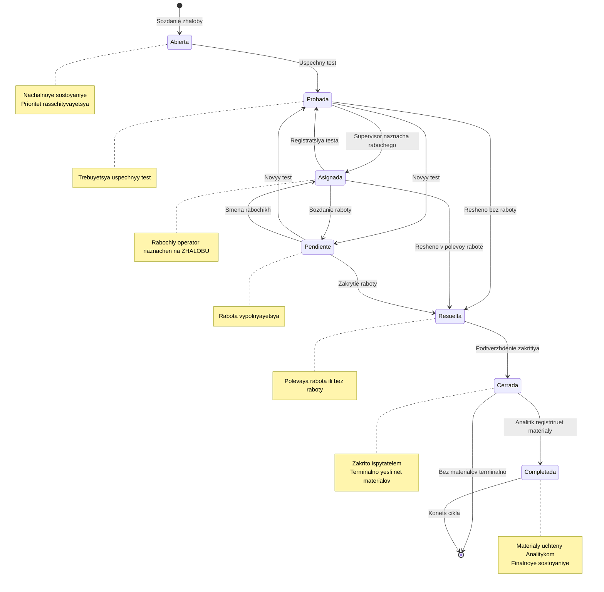
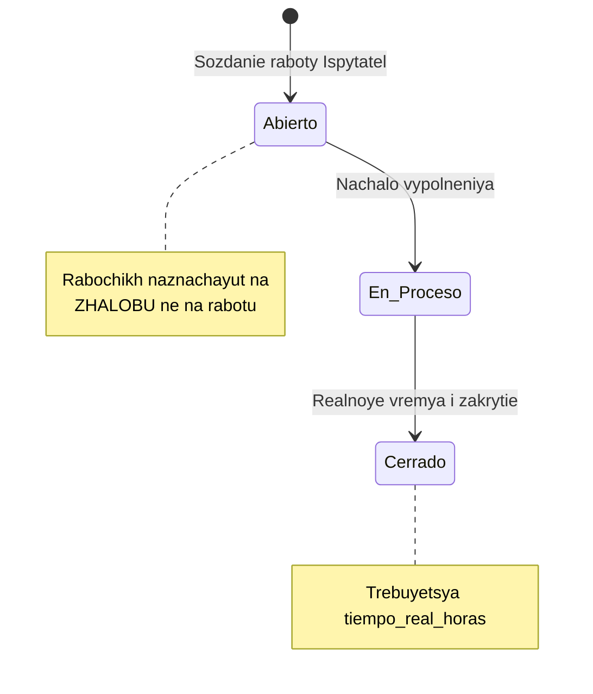
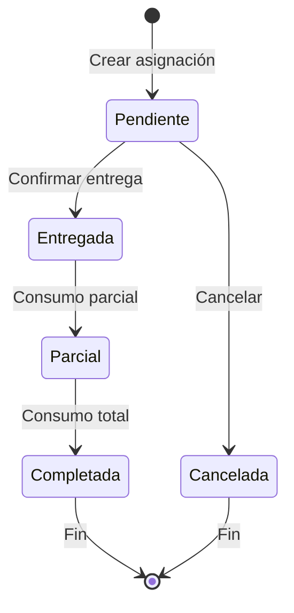
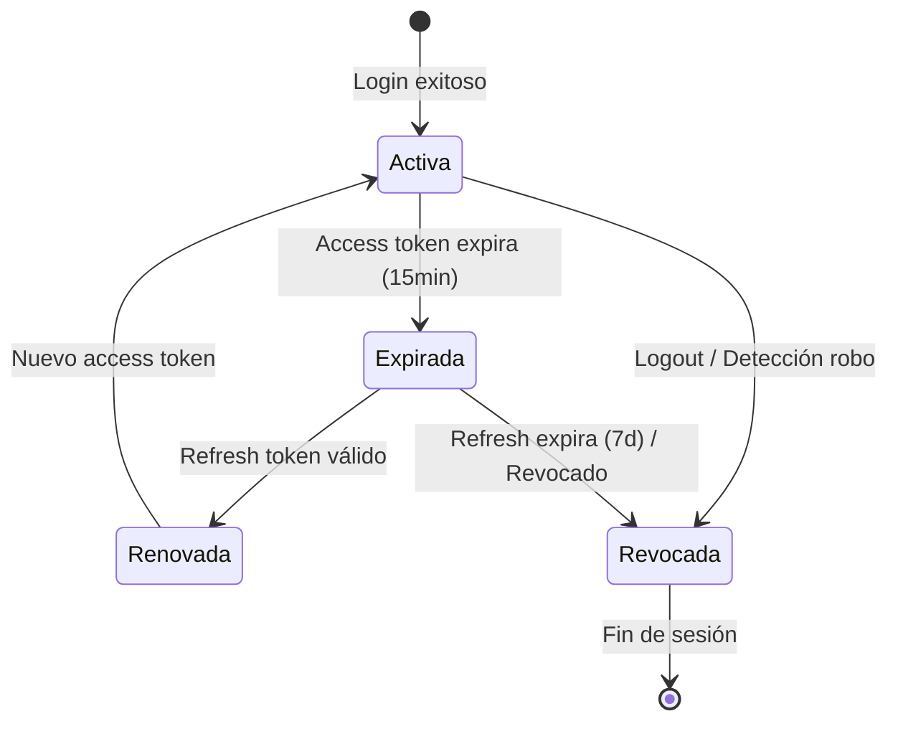

# Машины состояний - SISGAD5

> **Версия:** 1.0
> **Дата:** 2026-09-25

---

## 1. Машина состояний: Жалоба (MP Service)

### Состояния
```
Abierta → Probada → Asignada → Pendiente → Resuelta → Cerrada → Completada
                                                                  (конец цикла)
Повторное открытие не существует: Cerrada и Completada — терминальные состояния
```

Терминальные состояния: **Completada** (материалы учтены Аналитиком) и **Cerrada** (альтернативный терминал, когда материалы не использовались).

### Разрешённые переходы

| Текущее состояние | Следующее состояние | Актёр | Условие | Действие |
|-------------------|---------------------|-------|---------|----------|
| Abierta | Probada | Испытатель | Тест зарегистрирован (exitoso=true) | Зарегистрировать тест, сменить статус |
| Probada | Asignada | Супервайзер | Рабочий (оператор) назначен на жалобу | Назначить рабочего на ЖАЛОБУ |
| Probada | Resuelta | Испытатель | Жалоба решена без вмешательства работы | Отметить прямое решение после теста |
| Probada | Pendiente | Испытатель | Проводится новый тест (итерация) | Зарегистрировать новый тест |
| Asignada | Pendiente | Испытатель | Создана работа | Создать заказ работы |
| Asignada | Probada | Испытатель | Тест зарегистрирован | Зарегистрировать тест |
| Asignada | Resuelta | Испытатель | Решение достигнуто в полевой работе | Решить через полевую работу |
| Pendiente | Probada | Испытатель | Проводится новый тест | Зарегистрировать новый тест |
| Pendiente | Asignada | Супервайзер | Смена рабочих для другого ремонта | Переназначить рабочих на жалобу |
| Pendiente | Resuelta | Испытатель | Работа закрыта | Закрыть работу |
| Resuelta | Cerrada | Испытатель | Финальное подтверждение закрытия | Сменить статус |
| Cerrada | Completada | Аналитик по материалам | Материалы зарегистрированы после закрытия | Управление материалами, конец цикла |

> **Примечание о ролях (v2.0):** бывший «Техник» переименован в **Испытатель** (тестирует, создаёт работы, закрывает). бывший «Jefe/Operador» — в **Супервайзер** (только назначения). Назначение материалов НЕ меняет статус жалобы; только финальный учёт материалов Аналитиком вызывает переход `Cerrada → Completada`. Если материалов не требовалось, жалоба завершается в **Cerrada**.


### Запрещённые переходы (Bloquировано правилом RN-QUE-03)
- **Abierta → Asignada** (сначала обязан быть тест: через Probada)
- Abierta → Pendiente (пропустить Probada/Asignada)
- Abierta → Resuelta (пропустить промежуточные состояния)
- Abierta → Cerrada (пропустить все)
- Probada → Cerrada (пропустить Resuelta)
- **Cerrada → Abierta** (повторное открытие не существует)
- Cerrada → Probada / Cerrada → Resuelta (обратные переходы запрещены)
- Completada → любое состояние (абсолютный терминал)
- Probada/Asignada/Pendiente/Resuelta → Completada (только из Cerrada, Аналитиком по материалам)

### Диаграмма Mermaid



### События домена (Event Storming)

| Событие | Триггер | Актёр | Данные |
|---------|---------|-------|--------|
| QuejaCreada | POST /quejas | Испытатель | {id, num_reporte, prioridad, estado: "Abierta"} |
| QuejaProbada | POST /pruebas (exitoso=true) | Испытатель | {id, prueba_id} |
| QuejaAsignada | POST /quejas/:id/asignar-trabajador | Супервайзер | {id, id_trabajador, estado_anterior, estado_nuevo} |
| TrabajoCreado | POST /trabajos | Испытатель | {id, queja_id} |
| TrabajoCerrado | PATCH /trabajos/:id/cerrar | Испытатель | {id, tiempo_real} |
| QuejaResuelta | PATCH /quejas/:id (estado=Resuelta) | Испытатель | {id, via: rabota ili bez raboty} |
| QuejaCerrada | PATCH /quejas/:id (estado=Cerrada) | Испытатель | {id} |
| MaterialesAsignados | POST /asignacias (vidacha rabochemu) | Аналитик по материалам | {id, trabajador_id, items} — ne menyayet status zhaloby |
| ConsumoRegistrado | POST /consumos | Аналитик по материалам | {id, queja_id, items} |
| QuejaCompletada | PATCH /quejas/:id (estado=Completada) | Аналитик по материалам | {id, materialy: utocheny ili ne trebovalis} |

> ⚠️ Ustraneno `QuejaReabierta` (v2.0): povtornoye otkrytiye zhaloby ne sushchestvuyet.

---

## 2. Машина состояний: Работа (MP Service)

### Состояния
```
Abierto → En_Proceso → Cerrado
```

### Разрешённые переходы

> **v2.0:** Рабочий (оператор) назначается на **ЖАЛОБУ**, а не на работу. Переход `Abierto → Asignado` устранён. Работу создаёт и вносит сам **Испытатель**.

| Текущее состояние | Следующее состояние | Актёр | Условие |
|-------------------|---------------------|-------|---------|
| Abierto | En_Proceso | Испытатель | Начало выполнения (рабочие берутся из жалобы) |
| En_Proceso | Cerrado | Испытатель | Зарегистрировано реальное время |

### Диаграмма Mermaid



---

## 3. Машина состояний: Назначение (Materials Service)

### Состояния
```
Pendiente → Entregada → Parcial → Completada
    └→ Cancelada (до доставки)
```

### Разрешённые переходы

**Назначение** материалов — это физическая выдача рабочему в **любой момент**; само по себе оно НЕ меняет статус жалобы. **Расход** регистрирует **Аналитик по материалам** (не Испытатель).

| Текущее состояние | Следующее состояние | Актёр | Условие |
|-------------------|---------------------|-------|---------|
| Pendiente | Entregada | Аналитик по материалам | Рабочий подтверждает получение |
| Pendiente | Cancelada | Аналитик по материалам | Отменено до доставки |
| Entregada | Parcial | Аналитик по материалам | Некоторые позиции расходованы |
| Parcial | Completada | Аналитик по материалам | Все позиции расходованы |

> Финальный переход жалобы (`Cerrada → Completada`) происходит, когда Аналитик регистрирует полный расход или заявляет, что материалы не требовались (см. §1).

### Диаграмма Mermaid



---

## 4. Машина состояний: Сессия (Auth Context)

### Состояния
```
Activa → Expirada → Renovada → Activa
    │                        │
    └──────── Revocada ─────┘
         (Logout / Обнаружение кражи)
```

### Переходы

| Текущее состояние | Следующее состояние | Триггер |
|-------------------|---------------------|---------|
| Activa | Expirada | access_token истекает (15 мин) |
| Expirada | Renovada | POST /auth/refresh с действительным refresh_token |
| Renovada | Activa | Выдан новый access_token |
| Activa | Revocada | POST /auth/logout ИЛИ обнаружение кражи refresh |
| Expirada | Revocada | refresh_token истекает (7 дней) ИЛИ отозван |

### Диаграмма Mermaid



---

## 5. Машина состояний: Пользователь (Users Context)

### Состояния
```
Activo → Bloqueado → Activo
   │           │
   └───────────┴──→ Inactivo (логическое удаление)
```

### Переходы

| Текущее состояние | Следующее состояние | Триггер |
|-------------------|---------------------|---------|
| Activo | Bloqueado | 5 неудачных попыток входа |
| Bloqueado | Activo | Истечение блокировки (15 мин) ИЛИ снятие администратором |
| Activo | Inactivo | Администратор удаляет (soft delete) |
| Inactivo | Activo | Администратор активирует |

---

## 6. Исходные диаграммы

См. файлы Mermaid: [`docs/diagrams/state_machines/`](../diagrams/state_machines/)

- `queja_state.mmd`
- `trabajo_state.mmd`
- `asignacion_state.mmd`
- `sesion_state.mmd`
- `usuario_state.mmd`

---

## 7. Журнал изменений

| Версия | Дата | Изменения |
|--------|------|-----------|
| 2.0 | 2026-11-02 | Переименованы роли (Техник→Испытатель, Jefe/Operador→Супервайзер). Добавлено состояние **Completada** и переход `Cerrada → Completada` (Аналитик по материалам). Устранено повторное открытие. Новые переходы: Probada→Resuelta (без работы), Asignada→Resuelta (полевая работа), Probada/Pendiente→Probada (новый тест), Pendiente→Asignada (смена рабочих). Запрещён Abierta→Asignada. Рабочие назначаются на ЖАЛОБУ (устранён Abierto→Asignado в Работе). Разделены назначение и расход материалов. Согласовано с `08_sequence_diagrams.es.md` v2.7. |
| 1.0 | 2026-09-25 | Начальная версия. |

---

## 8. Ссылки

- [Бизнес-правила](06_business_rules.ru.md)
- [Варианты использования](03_use_cases.ru.md)
- [Модель домена](07_domain_model.ru.md)
- [Диаграммы последовательностей](08_sequence_diagrams.ru.md)
- [Event Storming](practices/practice_03_event_storming.ru.md)
