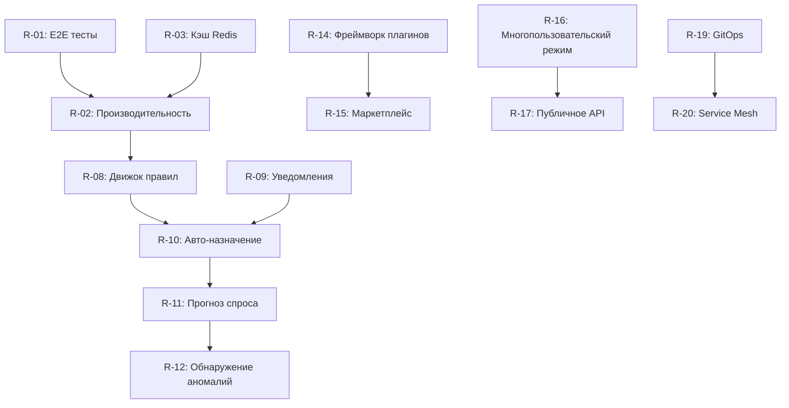

# Дорожная карта развития - SISGAD5

> **Версия:** 1.0
> **Дата:** 2026-09-25
> **Горизонт:** 24 месяца (Фазы 0-12 завершены → Поддержка и развитие)

---

## 1. Долгосрочное видение

**SISGAD5** эволюционирует из системы управления телекоммуникациями в **полноценную платформу операционного менеджмента сети** с возможностями аналитического прогнозирования, интеллектуальной автоматизации и расширяемостью для множества доменов.

### Стратегические цели
1. **Автоматизация:** Сократить ручное вмешательство на 60% за 18 месяцев
2. **Интеллект:** Прогнозирование сбоев и оптимизация ресурсов
3. **Масштабируемость:** Поддержать 10x текущую нагрузку без переработки
4. **Расширяемость:** Фреймворк плагинов для новых доменов (TV, Internet, 5G)
5. **Опыт:** Единый UX, mобильный-first, доступный

---

## 2. Дорожная карта по кварталам

### Q4 2026 (Текущий - Фаза 12: Поддержка)
| Инициатива | Статус | Усилие | Ответственный |
|------------|--------|--------|----------------|
| Стабилизация v1.0 | ✅ Завершено | - | Команда |
| Полная документация | 🔄 В процессе | 🏗️ 1-3 дней | Тех. писатель |
| Мониторинг продакшена | ⏳ В ожидании | 🏗️ 1-3 дней | DevOps |
| Жёсткая настройка безопасности | ⏳ В ожидании | 🏗️ 1-3 дней | SecOps |
| Поддержка 24/7 | ⏳ В ожидании | 🏛️ > 3 дней | Операции |

---

### Q1 2027 - Стабилизация, Качество и MLOps

| ID | Инициатива | Описание | Усилие | Приоритет |
|----|------------|----------|--------|-----------|
| R-01 | **Полные E2E тесты** | 100% покрытие критических сценариев с Playwright | 🏗️ 1-3 дней | 🔴 Критическое |
| R-02 | **База метрик производительности** | Установить базовые метрики, оптимизировать медленные запросы | 🏗️ 1-3 дней | 🔴 Критическое |
| R-03 | **Распределённый кэш** | Redis для сессий, каталогов MP, KPI дашбордов | 🏗️ 1-3 дней | 🟡 Высокое |
| R-04 | **Версионирование API** | Стратегия v1/v2, постепенное устаревание | 🏗️ 1-3 дней | 🟡 Высокое |
| R-05 | **Автоматический бэкап/DR** | Восстановление протестировано ежемесячно, RPO < 1ч, RTO < 4ч | 🏗️ 1-3 дней | 🔴 Критическое |
| R-06 | **Доступность WCAG 2.1 AA** | Аудит и исправление frontend | 🏗️ 1-3 дней | 🟡 Высокое |
| R-07 | **Полная интернационализация** | ES/RU во всех модулях, локализация дат/валют | 🏗️ 1-3 дней | 🟡 Высокое |
| R-07b | **Prediction Service Foundation** | Python + FastAPI + MLflow + Airflow стек, bd_predictions | 🏛️ > 3 дней | 🔴 Критическое |
| R-07c | **Разработка ML моделей** | 6 прогнозных моделей (спрос, время, аномалии, приоритет, сбои, назначение) | 🏛️ > 3 дней | 🔴 Критическое |

---

### Q2 2027 - Автоматизация и ИИ

| ID | Инициатива | Описание | Усилие | Приоритет |
|----|------------|----------|--------|-----------|
| R-08 | **Движок бизнес-правил (Drools/JSON Logic)** | Внешняя настройка бизнес-правил (приоритет, поток состояний) | 🏛️ > 3 дней | 🟡 Высокое |
| R-09 | **Push/WebSocket уведомления** | WebSockets + Service Workers для мгновенных оповещений | 🏗️ 1-3 дней | 🟡 Высокое |
| R-10 | **Автоматическое назначение техников** | Алгоритм: близость + загрузка + специализация + доступность | 🏛️ > 3 дней | 🟢 Среднее |
| R-11 | **Прогноз спроса на материалы** | Prediction Service ML: временной ряд → оповещение о пополнении | 🏛️ > 3 дней | 🔴 Критическое |
| R-12 | **Обнаружение аномалий в жалобах** | Prediction Service ML: шаблоны, кластеризация, сезонность | 🏛️ > 3 дней | 🔴 Критическое |
| R-13 | **Чат-бот поддержки уровня 1** | Автоматический FAQ, создание жалобы по шагам, проверка статуса | 🏗️ 1-3 дней | 🟢 Среднее |
| R-13b | **API эндпоинты предсказаний** | REST API /api/predictions/* с 6 эндпоинтами | 🏗️ 1-3 дней | 🔴 Критическое |
| R-13c | **MLOps конвейеры (Airflow)** | Периодическое обучение и переобучение | 🏛️ > 3 дней | 🔴 Критическое |

---

### Q3 2027 - Расширяемость и Платформа

| ID | Инициатива | Описание | Усилие | Приоритет |
|----|------------|----------|--------|-----------|
| R-14 | **Фреймворк плагинов** | SDK для внешних модулей (TV, Internet, IoT, 5G) | 🏛️ > 3 дней | 🟢 Среднее |
| R-15 | **Внутренний маркетплейс** | Каталог плагинов, версионирование, зависимости | 🏛️ > 3 дней | ⚪ Низкое |
| R-16 | **Многопользовательский режим** | Логическая изоляция для нескольких дирекций/компаний | 🏛️ > 3 дней | 🟢 Среднее |
| R-17 | **Документированное публичное API** | Портал разработчиков, rate limiting по клиентам, OAuth2 | 🏗️ 1-3 дней | 🟢 Среднее |
| R-18 | **Event Sourcing + CQRS** | Полная аудитория, воспроизведение, read-оптимизированные проекции | 🏛️ > 3 дней | ⚪ Низкое |
| R-18b | **Интерпретируемость ML-моделей (SHAP/LIME)** | Объяснение предсказаний для конечных пользователей | 🏛️ > 3 дней | 🟢 Среднее |

---

### Q4 2027 - Операционная зрелость

| ID | Инициатива | Описание | Усилие | Приоритет |
|----|------------|----------|--------|-----------|
| R-19 | **Полный GitOps** | ArgoCD/Flux, окружения как код, прогрессивная доставка | 🏗️ 1-3 дней | 🟡 Высокое |
| R-20 | **Service Mesh (Istio/Linkerd)** | mTLS, распределение трафика, расширенная наблюдаемость | 🏛️ > 3 дней | 🟢 Среднее |
| R-21 | **Chaos Engineering** | Плановые эксперименты: задержка, сбои, сетевая сегментация | 🏗️ 1-3 дней | 🟢 Среднее |
| R-22 | **FinOps** | Затраты по сервису/команде, оповещения о бюджете, оптимизация | 🏗️ 1-3 дней | 🟢 Среднее |
| R-23 | **Автоматическое соответствие** | Политики OPA/Gatekeeper, непрерывный аудит | 🏗️ 1-3 дней | 🟢 Среднее |

---

## 3. Технический бэклог (Технический долг и непрерывное улучшение)

| Область | Элементы |
|---------|----------|
| **Backend Users** | Миграция на TypeScript, OpenAPI first, GraphQL gateway |
| **Backend MP** | Разделение домена quejas/trabajos на микросервисы, event-driven |
| **Backend Materials** | Внутренний gRPC, кэш Redis, фоновые задачи (Asynq) |
| **Prediction Service** | Мониторинг дрейфа моделей, автоматическое переобучение, интерпретируемость |
| **Frontend** | Микрофронтенды, Storybook, визуальные регрессионные тесты, PWA |
| **Инфраструктура** | Полный IaC (Terraform/Pulumi), policy as code |
| **Данные** | Data lake (Parquet), ELT (dbt), ML платформа (MLflow) |

---

## 4. Метрики успеха (KPI развития)

| Метрика | Текущее (Q4 2026) | Цель Q4 2027 |
|--------|-------------------|---------------|
| **Покрытие тестами** | ~25% | ≥ 80% |
| **Частота деплоев** | Еженедельно | Ежедневно (main) |
| **Lead Time для изменений** | 2-3 дня | < 4 часов |
| **MTTR (Инциденты)** | 2-4 часа | < 30 мин |
| **Change Failure Rate** | ~15% | < 5% |
| **Доступность** | 99.5% | 99.9% |
| **Задержка API p95** | ~300ms | < 150ms |
| **Одновременные пользователи** | 100 | 500+ |
| **Удовлетворённость пользователей** | N/A | > 4.5/5 |

---

## 5. Критические зависимости

---

## 6. Необходимые ресурсы

| Роль | Q4 2026 | Q1 2027 | Q2 2027 | Q3 2027 | Q4 2027 |
|------|---------|---------|---------|---------|---------|
| **Backend Developers** | 2 | 3 | 3 | 3 | 2 |
| **Frontend Developer** | 1 | 1 | 1 | 1 | 1 |
| **DevOps/Platform** | 1 | 1 | 1 | 1 | 1 |
| **QA/Automation** | 0.5 | 1 | 1 | 1 | 1 |
| **Data/ML Engineer** | 0 | 0 | 0.5 | 1 | 1 |
| **Tech Writer** | 0.5 | 0.5 | 0.5 | 0.5 | 0.5 |
| **Product Owner** | 0.5 | 0.5 | 0.5 | 0.5 | 0.5 |

---

## 7. Риски и смягчение

| Риск | Вероятность | Влияние | Смягчение |
|------|-------------|---------|-----------|
| **Утечка знаний** (маленькая команда) | Высокая | Критическое | Полная документация, pair programming, коэффициент bus factor ≥ 2 |
| **Накопленный технический долг** | Средняя | Высокое | 20% времени спринта на refactoring, обязательные ADR |
| **Изменения требований регулирования** | Средняя | Среднее | Модульная архитектура, feature flags, externalized config |
| **Непредвиденная масштабируемость БД** | Низкая | Критическое | Непрерывное тестирование нагрузки, read replicas, план партиционирования |
| **Зависимость от облачного провайдера** | Средняя | Среднее | Стратегия multi-cloud, переносимые контейнеры, избегать lock-in |

---

## 8. Управление (Governance)

### 8.1 Ритуалы
| Ритуал | Частота | Участники | Результат |
|--------|---------|-----------|-----------|
| **Спринт планирование** | 2 недели | Вся команда | Спринт backlog |
| **Ежедневный стендап** | Ежедневно | Devs + PO | Синхронизация, блокеры |
| **Архитектурный обзор** | Ежемесячно | Tech Lead + Devs | ADR, принятие решений |
| **Ретроспектива** | 2 недели | Вся команда | Улучшения процессов |
| **Обзор дорожной карты** | Ежеквартально | PO + Tech Lead + Stakeholders | Обновлённая дорожная карта |

### 8.2 Журнал решений (ADRs)
- Расположение: `docs/adr/`
- Формат: MADR (Markdown Architectural Decision Records)
- Требуется для: Архитектурных изменений, выбора технологий, паттернов

---

## 9. Ссылки

- [TASKLIST.md](../TASKLIST.md) - Подробные задачи по фазам
- [SPEC.md](../SPEC.md) - Базовое техническое задание
- [Архитектура](../ARCHITECTURE.md) - Архитектурные решения
- [Руководство по эксплуатации](15_operations.ru.md) - Текущая эксплуатация
- [Тестирование](16_testing.ru.md) - Стратегия качества
