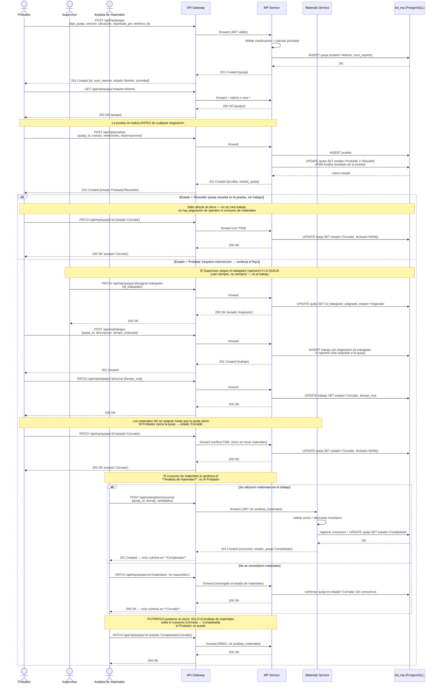
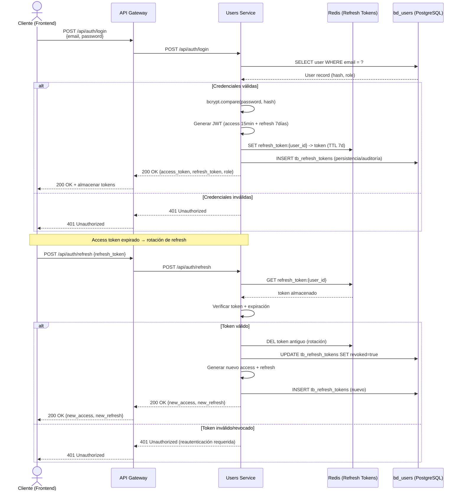
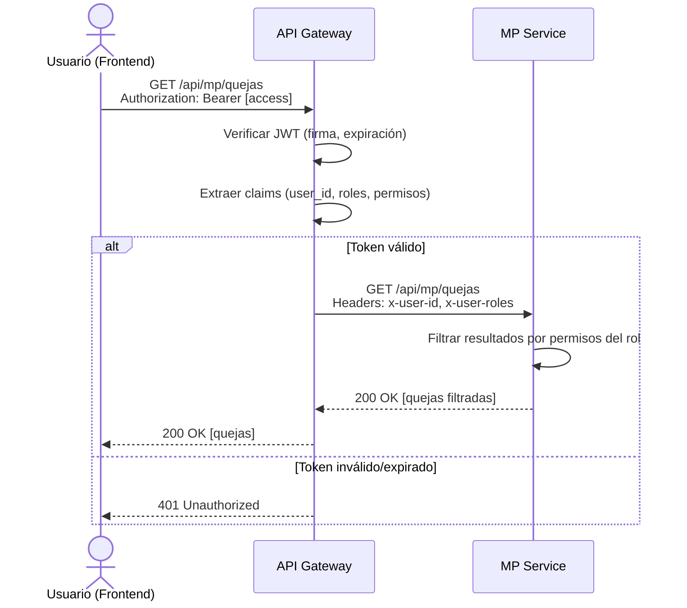
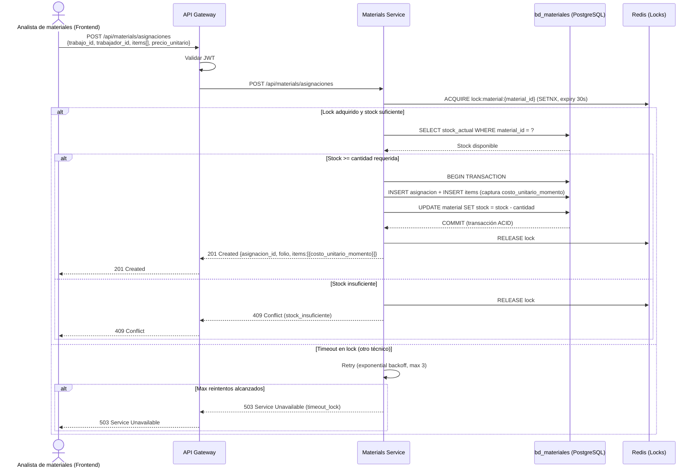
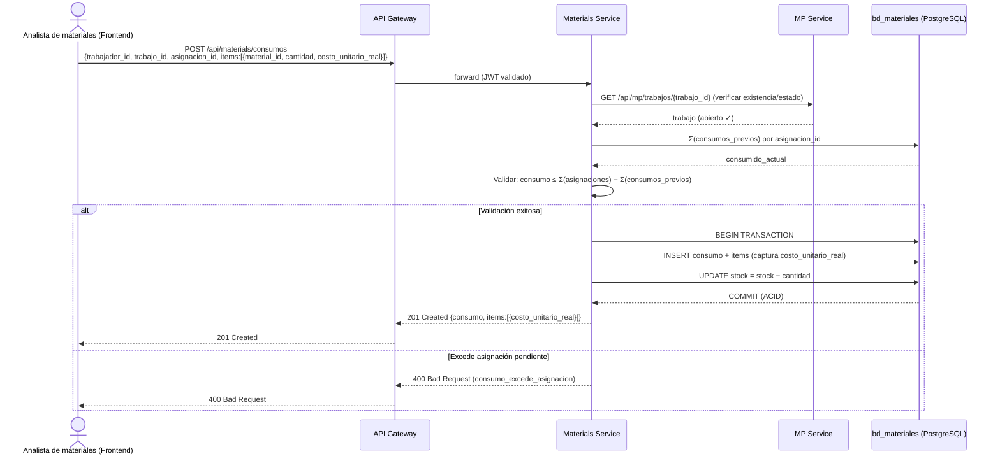
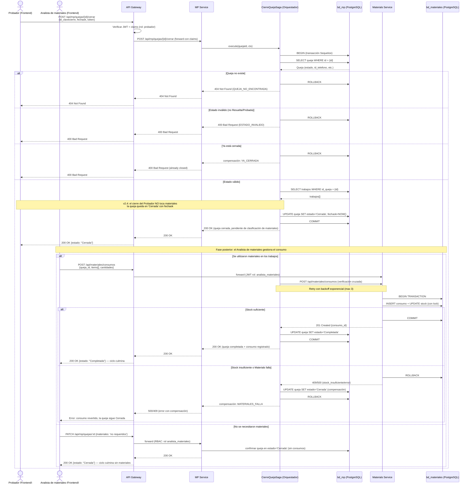
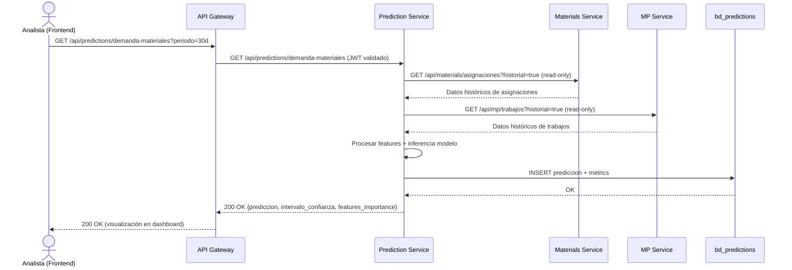

# 📊 Diagramas de Secuencia — SISGAD5

> **Versión:** 2.4 (dominio real: sin rol Operador; el Probador crea la queja, prueba ANTES de asignar, inserta trabajos y cierra → `Cerrada`; el Supervisor solo asigna operarios a la queja; **el consumo de materiales es exclusivo del Analista de materiales** — registra consumos → `Completada` o declara "no requeridos" y el ciclo culmina en `Cerrada`)
> **Fecha:** 2026-11-02
> **Tarea:** TASK-100-04
> **Estado:** ✅ Completada
> **Criterio:** escenarios críticos con diagramas Mermaid + tablas de mensajes
> **Fuentes fusionadas:** `docs/diagrams/sequence_diagrams/sequence_diagrams.md` (v. TASK-100-04, 4 escenarios) + `docs/08_sequence_diagrams.es.md` v1.0 (3 escenarios: flujo completo de queja, asignación/consumo de materiales, autenticación con refresh). Los ASCII-art de la v1.0 fueron convertidos a Mermaid; el contenido único de ambas versiones se conservó.

---

## Índice de escenarios

| # | Escenario | Tipo | Origen en fuentes previas |
|---|-----------|------|---------------------------|
| 1 | Flujo completo de queja (Abierta → Cerrada → Completada) | Crítico | 08_es §1 (roles corregidos v2.4) |
| 2 | Login y autenticación JWT con refresh rotativo | Crítico | diag §Esc.1 + 08_es §3 |
| 3 | Acceso a recurso protegido vía Gateway | Crítico | 08_es §3 |
| 4 | Asignación de materiales con validación de stock | Crítico | diag §Esc.2 + 08_es §2 |
| 5 | Consumo de materiales (validación vs asignación) | Crítico | 08_es §2 |
| 6 | Cierre de queja con consumo (saga orquestada) | Crítico | diag §Esc.3 |
| 7 | Predicción de demanda de materiales | Complementario | diag §Esc.4 |

---

## Escenario 1: Flujo completo de queja (Abierta → Cerrada → Completada)

**Roles del dominio (v2.4):** Probador (crea la queja, realiza pruebas, inserta trabajos, cierra; el estado `Probada`/`Resuelta` lo devuelve la BD tras registrarse la prueba) · Supervisor (jefe inscrito: **asigna el trabajador/operario a la queja**; no inserta trabajos ni crea quejas) · **Analista de materiales** (registra/edita el consumo de materiales post-cierre; si declara que no se necesitaron materiales en una queja `Cerrada`, el ciclo culmina). **No existe el rol "Operador"** — la queja la crea el Probador. **No existe asignación de trabajador al trabajo**: el operario se asigna únicamente a la queja.

**Actores:** Probador, Supervisor, Analista de materiales · **Participantes:** API Gateway, MP Service, Materials Service, bd_mp

### Tabla de Mensajes — Flujo Completo de Queja (roles v2.4)

| # | De | Hacia | Mensaje | Datos |
|---|----|-------|---------|-------|
| 1 | Probador | Sistema | `POST /api/mp/quejas` | {tipo_queja, servicio, ubicacion, reportado_por, telefono_id} — el Probador crea la queja (no existe el Operador) |
| 2 | Sistema | Probador | 201 Created | {queja: {id, num_reporte, estado: "Abierta", prioridad}} |
| 3 | Probador | Sistema | `GET /api/mp/quejas?estado=Abierta` | - |
| 4 | Probador | Sistema | `POST /api/mp/pruebas` | {queja_id, exitoso, mediciones, observaciones} — **la prueba va ANTES de la asignación** |
| 5 | Sistema (BD vía FSM) | Probador | 201 Created | {prueba, estado_queja: "Probada" \| "Resuelta"} — la BD devuelve el estado tras la prueba |
| 6a | Probador | Sistema | `PATCH /api/mp/quejas/:id` (rama Resuelta) | {estado: "Cerrada"} — cierre directo, sin trabajo ni materiales |
| 6b | Supervisor | Sistema | `PATCH /api/mp/quejas/:id/asignar-trabajador` (rama Probada) | {id_trabajador} — el operario se asigna **a la queja**, casi siempre pero no siempre |
| 7 | Probador | Sistema | `POST /api/mp/trabajos` (rama Probada) | {queja_id, descripcion, tiempo_estimado} — el probador inserta el trabajo; **sin campo de trabajador** |
| 8 | Probador | Sistema | `PATCH /api/mp/trabajos/:id/cerrar` | {tiempo_real} |
| 9 | Probador | Sistema | `PATCH /api/mp/quejas/:id` (cierre) | {estado: "Cerrada"} — el Probador cierra; NO toca materiales |
| 10 | Sistema | Probador | 200 OK | {queja: {estado: "Cerrada", fechaok}} |
| 11a | Analista de materiales | Sistema | `POST /api/materiales/consumos` (hubo materiales) | {queja_id, items[], cantidades} → registra consumos y deriva la queja a **"Completada"** — culmina el ciclo |
| 11b | Analista de materiales | Sistema | `PATCH /api/mp/quejas/:id` (no hubo materiales) | {materiales: "no requeridos"} → confirma **"Cerrada"** sin consumos — culmina el ciclo |
| 12 | Analista de materiales | Sistema | `PATCH /api/mp/quejas/:id` (post-cierre) | Solo edición del consumo (Cerrada ↔ Completada); RBAC exclusivo del Analista |

> **Reglas de dominio (v2.4):**
> 1. **No existe el rol "Operador"** — la queja la crea el **Probador**.
> 2. El **Supervisor** (jefe inscrito) **solo realiza asignaciones de trabajador a la queja**, nunca inserta trabajos ni crea quejas.
> 3. **La prueba se realiza antes de la asignación**; el estado `Probada`/`Resuelta` lo devuelve la BD (FSM) tras registrarse la prueba.
> 4. **El trabajador (operario) se asigna a la queja, no al trabajo** — no existe endpoint de asignación de trabajador al trabajo; el `POST /trabajos` no recibe técnico/trabajador.
> 5. El **Probador inserta el trabajo** (`POST /trabajos`) y se ejecuta casi siempre, salvo cuando la prueba resuelve la queja directamente (estado `Resuelta` → cierre sin trabajo).
> 6. **Los materiales no se asignan hasta que la queja cierre**: el Probador cierra → **`Cerrada`**. Posteriormente el **Analista de materiales** registra el consumo → **`Completada`**; si declara que no se necesitaron materiales, la queja permanece en `Cerrada` y el ciclo culmina ahí.
> 7. **El consumo de materiales es responsabilidad exclusiva del Analista de materiales** (rol `analista_materiales`): el Probador no puede registrar consumos ni cambiar Cerrada↔Completada.
> 8. `PUT`/`PATCH` posteriores al cierre sirven **únicamente** para editar el estado de la queja entre `Cerrada` y `Completada` (consumo de materiales), y solo los ejecuta el Analista de materiales.
> 9. **Nota:** el cierre real con trabajos asociados se ejecuta como saga orquestada con compensación — ver **Escenario 6**.

---

## Escenario 2: Login y Autenticación con JWT (+ Refresh Rotativo)

**Actores:** Cliente (Frontend) · **Participantes:** API Gateway, Users Service, Redis, bd_users

### Tabla de Mensajes — Login y Autenticación

| Paso | Emisor | Mensaje | Destino | Protocolo | Descripción |
| ---- | ------ | ------- | ------- | --------- | ----------- |
| 1 | Cliente (Frontend) | `POST /api/auth/login` | API Gateway | HTTPS | Envío de credenciales (email + password) |
| 2 | API Gateway | `POST /api/auth/login` | Users Service | REST/JSON | Reenvío de credenciales al servicio |
| 3 | Users Service | `SELECT * FROM usuarios WHERE email = ?` | bd_users | SQL | Búsqueda de usuario por email |
| 4 | bd_users | User record (con hash de password y role) | Users Service | SQL | Respuesta con datos del usuario |
| 5 | Users Service | `bcrypt.compare(password, hash)` | — | Internal | Validación de contraseña |
| 6 | Users Service | `JWT.sign({id, role, exp})` | — | Internal | Generación del access token (15 min) |
| 7 | Users Service | `JWT.sign({id, exp})` | — | Internal | Generación del refresh token (7 días) |
| 8 | Users Service | `SET refresh:{user_id} → token (TTL 7d)` | Redis | Redis | Almacenamiento del refresh token |
| 9 | Users Service | `INSERT tb_refresh_tokens` | bd_users | SQL | Persistencia para auditoría/revocación |
| 10 | Users Service | `200 OK {access, refresh, role}` | API Gateway | REST/JSON | Respuesta con tokens |
| 11 | API Gateway | `200 OK {access, refresh, role}` | Cliente | HTTPS | Respuesta al frontend |
| 12 | Cliente (Frontend) | `POST /api/auth/refresh` {refresh_token} | API Gateway | HTTPS | Renovación tras expiración del access |
| 13 | Users Service | Verificar refresh en Redis/BD, rotar | — | Internal | DELETE old + INSERT new (revoked=true anterior) |
| 14 | Users Service | `200 OK {new_access, new_refresh}` | API Gateway | REST/JSON | Nuevos tokens |
| 15 | API Gateway | `200 OK {new_access, new_refresh}` | Cliente | HTTPS | Respuesta al frontend |

---

## Escenario 3: Acceso a Recurso Protegido (Claims vía Gateway)

**Actores:** Usuario · **Participantes:** API Gateway, MP Service

### Tabla de Mensajes — Acceso a Recurso Protegido

| # | De | Hacia | Mensaje | Datos |
|---|----|-------|---------|-------|
| 1 | Usuario | Gateway | `GET /api/mp/quejas` | Header: Authorization: Bearer \<access\> |
| 2 | Gateway | - | Verificar JWT (firma, expiración) | - |
| 3 | Gateway | - | Extraer claims (user_id, roles) | - |
| 4 | Gateway | MP | `GET /api/mp/quejas` | Headers: X-User-Id, X-User-Roles |
| 5 | MP | Gateway | 200 OK | [quejas filtradas por permisos] |
| 6 | Gateway | Usuario | 200 OK | [quejas] |

---

## Escenario 4: Asignación de Materiales con Validación de Stock

**Actores:** Analista de materiales (Frontend) — v2.4: la asignación/consumo de materiales es exclusiva del Analista, ocurre después del cierre de la queja · **Participantes:** API Gateway, Materials Service, Redis (Locks), bd_materiales

### Tabla de Mensajes — Asignación de Materiales

| Paso | Emisor | Mensaje | Destino | Protocolo | Descripción |
| ---- | ------ | ------- | ------- | --------- | ----------- |
| 1 | Analista de materiales (Frontend) | `POST /api/materials/asignaciones` | API Gateway | HTTPS | Solicitud de asignación (múltiples ítems) |
| 2 | API Gateway | Verificar JWT | — | Internal | Validación de autenticación |
| 3 | API Gateway | `POST /api/materials/asignaciones` | Materials Service | REST/JSON | Reenvío de la solicitud |
| 4 | Materials Service | `SETNX lock:material:{id} (expiry 30s)` | Redis | Redis | Adquisición de distributed lock |
| 5 | Redis | `OK` o `EXISTS` | Materials Service | Redis | Respuesta de lock |
| 6 | Materials Service | `SELECT stock_actual WHERE id = ?` | bd_materiales | SQL | Consulta de stock disponible |
| 7 | bd_materiales | Stock disponible | Materials Service | SQL | Respuesta con cantidad en stock |
| 8 | Materials Service | `BEGIN TRANSACTION` | bd_materiales | SQL | Inicio de transacción |
| 9 | Materials Service | `INSERT INTO asignaciones` + `INSERT INTO items` | bd_materiales | SQL | Creación de registro (captura `costo_unitario_momento`) |
| 10 | Materials Service | `UPDATE material SET stock = stock - n` | bd_materiales | SQL | Decremento de stock |
| 11 | bd_materiales | `COMMIT` | Materials Service | SQL | Confirmación atómica de la transacción |
| 12 | Materials Service | `DEL lock:material:{id}` | Redis | Redis | Liberación del lock |
| 13 | Materials Service | `201 Created {asignacion_id, folio}` | API Gateway | REST/JSON | Confirmación de asignación creada |
| 14 | API Gateway | `201 Created` | Analista de materiales | HTTPS | Respuesta al frontend |
| 15 | Materials Service | `409 Conflict` (stock_insuficiente) | API Gateway | REST/JSON | Error: stock insuficiente |
| 16 | Materials Service | Retry con backoff exponencial (max 3 intentos) | — | Internal | Reintento por lock ocupado |

---

## Escenario 5: Consumo de Materiales (Validación vs Asignación)

**Actores:** Analista de materiales · **Participantes:** API Gateway, Materials Service, MP Service, bd_materiales

### Tabla de Mensajes — Consumo de Materiales

| # | De | Hacia | Mensaje | Datos |
|---|----|-------|---------|-------|
| 1 | Analista de materiales | Sistema | `POST /api/materials/consumos` | {trabajador_id, trabajo_id, asignacion_id, items: [...]} |
| 2 | Sistema | - | Verificar trabajo existente/abierto | `GET /api/mp/trabajos/{id}` |
| 3 | Sistema | - | Validar consumo ≤ asignación pendiente | Σ(consumos) ≤ Σ(asignaciones) − Σ(consumos_previos) |
| 4 | Sistema | - | Transacción: INSERT consumo + items | db.Transaction() |
| 5 | Sistema | - | Capturar costo_unitario_real | Input del Analista de materiales |
| 6 | Sistema | Analista de materiales | 201 Created | {consumo, items: [{costo_unitario_real}]} |

---

## Escenario 6: Cierre de Queja con Consumo de Materiales (Saga Orquestada)

**Actores:** Probador (cierra la queja → `Cerrada`) · Analista de materiales (registra el consumo → `Completada`) — v2.4: **el cierre NO invoca Materials Service**; la saga queda como mecanismo interno para cuando el Analista registra consumos sobre una queja cerrada. **Participantes:** API Gateway, MP Service, CierreQuejaSaga, bd_mp, Materials Service, bd_materiales

### Tabla de Mensajes — Cierre de Queja (Saga Orquestada)

| Paso | Emisor | Mensaje | Destino | Protocolo | Descripción |
| ---- | ------ | ------- | ------- | --------- | ----------- |
| 1 | Probador (Frontend) | `POST /api/mp/quejas/{id}/cerrar` | API Gateway | HTTPS | Cierre de queja con datos de cierre |
| 2 | API Gateway | Verificar JWT + claims (`rol: probador`) | — | Internal | Validación con claims (no llama a Users Service) |
| 3 | API Gateway | Forward request con headers `x-user-*` | MP Service | REST/JSON | Propagación de claims |
| 4 | MP Service | `CierreQuejaSaga.execute(quejaId, ctx)` | — | Internal | Inicio de orquestación |
| 5 | CierreQuejaSaga | `BEGIN` | bd_mp | SQL | Transacción local |
| 6 | CierreQuejaSaga | `SELECT queja WHERE id = ?` | bd_mp | SQL | Validar existencia y estado |
| 7 | CierreQuejaSaga | Validar FSM: estado ∈ {Resuelta, Probada} | — | Internal | Verificación de máquina de estados |
| 8 | CierreQuejaSaga | `UPDATE queja SET estado='Cerrada', fechaok=NOW()` + `COMMIT` (v2.4: el cierre NO toca materiales) | bd_mp | SQL | Estado final del cierre = `Cerrada` para todos los casos |
| 9 | Analista de materiales | `POST /api/materiales/consumos` {queja_id, items[]} | API Gateway → Materials Service | REST/JSON | Fase posterior: registro de consumo (RBAC rol analista_materiales) |
| 10 | Materials Service | `BEGIN TRANSACTION` + `INSERT consumo` + `UPDATE stock` | bd_materiales | SQL | Transacción ACID remota |
| 11 | MP Service (saga) | `UPDATE quejas SET estado='Completada'` al confirmarse el consumo | bd_mp | SQL | Culminación del ciclo con materiales |
| 12 | Analista de materiales | `PATCH /api/mp/quejas/:id {materiales:'no requeridos'}` (si no hubo consumo) | MP Service | REST/JSON | Confirma `Cerrada` sin consumos — culmina el ciclo |
| 13 | CierreQuejaSaga | Reversión a `'Cerrada'` si Materials falla (compensación) | bd_mp | SQL | El consumo se reintenta; la queja sigue cerrada |

---

## Escenario 7: Predicción de Demanda de Materiales (Complementario)

**Actores:** Analista · **Participantes:** API Gateway, Prediction Service, Materials Service, MP Service, bd_predictions

---

## Referencias

- [Casos de Uso](../../03_use_cases.es.md)
- [Modelo de Dominio](../../07_domain_model.es.md)
- [Máquinas de Estado](../../09_state_machines.es.md)
- [Estrategia de Seguridad](../../13_security.es.md)

---

## Registro de Cambios

### v2.4 — 2026-11-02 (rol Analista de materiales añadido al dominio)
1. **Nuevo actor "Analista de materiales"** en Escenarios 1, 4, 5 y 6: es quien **modifica/registra el consumo de materiales**, no el Probador.
2. **Escenario 1 rediseñado:** el Probador cierra la queja → `Cerrada` (sin tocar materiales). Después, el Analista de materiales: si hubo consumo → `POST /materiales/consumos` deriva la queja a **`Completada`** (culmina el ciclo); si declara que **no se necesitaron materiales** en una queja cerrada → permanece **`Cerrada`** y culmina el ciclo.
3. **RBAC post-cierre:** el `PUT/PATCH` entre `Cerrada` ↔ `Completada` es **exclusivo del Analista de materiales** (rol JWT `analista_materiales`); el Probador pierde esa capacidad.
4. **Escenario 6 (saga):** el cierre ya NO invoca Materials Service; la verificación cruzada de stock/consumo se ejecuta en la fase posterior del Analista, con compensación que devuelve la queja a `Cerrada` (antes revertía a `Resuelta`).
5. **Escenarios 4 y 5:** actor renombrado Probador → Analista de materiales (la asignación y el consumo de materiales le pertenecen).

### v2.3 — 2026-11-02 (segunda corrección del dominio real según revisión del propietario)
1. **Eliminado el rol "Operador" por completo** — no existe; la queja la crea el **Probador** (`POST /quejas`).
2. **Orden corregido:** la **prueba se realiza ANTES de la asignación** (antes, en v2.2 figuraba la asignación previa del Supervisor). El estado `Probada`/`Resuelta` lo devuelve la BD (FSM) tras registrarse la prueba.
3. **El trabajador (operario) se asigna a la QUEJA, no al trabajo**: nuevo paso `PATCH /quejas/:id/asignar-trabajador` ejecutado por el Supervisor (casi siempre, no siempre). **Eliminada toda asignación de técnico al trabajo** (`PATCH /trabajos/:id/asignar` fuera del flujo; `POST /trabajos` ya no recibe `tecnico_id`).
4. **Estados finales renombrados:** al cerrar, la queja queda en **`Cerrada`**; cuando se le asignan/consumen materiales pasa a **`Completada`**. Se elimina `Cerrada con materiales` / `Cerrada sin materiales`. El PATCH post-cierre solo edita el estado entre `Cerrada` ↔ `Completada`.
5. Escenario 6 (saga) alineado: estado final `Completada` (hubo consumo) o `Cerrada` (no hubo); claim JWT del cierre corregido a `rol: probador`.
6. Sintaxis Mermaid revalidada con @mermaid-js/mermaid-cli v11: los 7 bloques renderizan sin errores.

### v2.2 — 2026-11-02 (corrección de roles y estados según dominio real)
Correcciones aplicadas tras revisión del propietario (pendiente propagar a `docs/07_domain_model.es.md` y demás documentos cuando la revisión archivo-por-archivo llegue a cada uno):

1. **Roles:** se eliminó el rol inexistente "Operador como ejecutor de pruebas" → es el **Probador** quien realiza pruebas, cierra trabajos e **inserta los trabajos**. El rol "Jefe" fue renombrado a **Supervisor** (jefe inscrito; solo realiza asignaciones, nunca inserta trabajos). El Operador únicamente crea la queja.
2. **Orden del flujo:** la asignación de la queja al probador ocurre ANTES de la prueba; el estado `Probada`/`Resuelta` lo devuelve la BD (FSM) tras registrarse la prueba. Si `Resuelta` → cierre directo sin trabajo; si `Probada` → continúa con trabajo.
3. **Eliminada** la asignación de técnico *después* del trabajo: el técnico se asigna solo antes (en la creación del trabajo por el probador o adicionalmente por el supervisor).
4. **Nuevos estados de cierre:** `Cerrada con materiales` / `Cerrada sin materiales`. Los materiales no se asignan hasta que la queja cierre; la saga (Escenario 6) fija el estado final según existan consumos.
5. **Restricción post-cierre:** `PUT/PATCH` sobre queja cerrada solo permite editar el estado de consumo de materiales.
6. Escenarios 4, 5 y 6 actualizados con los roles correctos (Probador en lugar de Técnico/Analista; claim `rol: probador`).
7. Sintaxis Mermaid revalidada con @mermaid-js/mermaid-cli v11: los 7 bloques renderizan sin errores.
