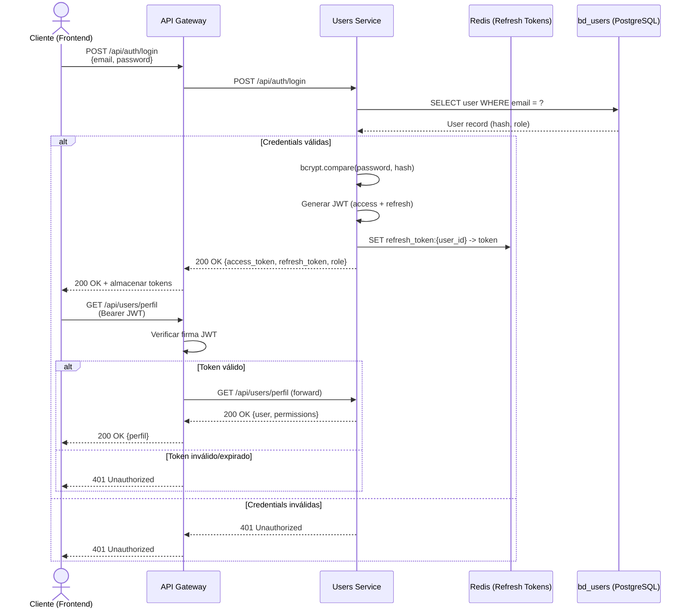
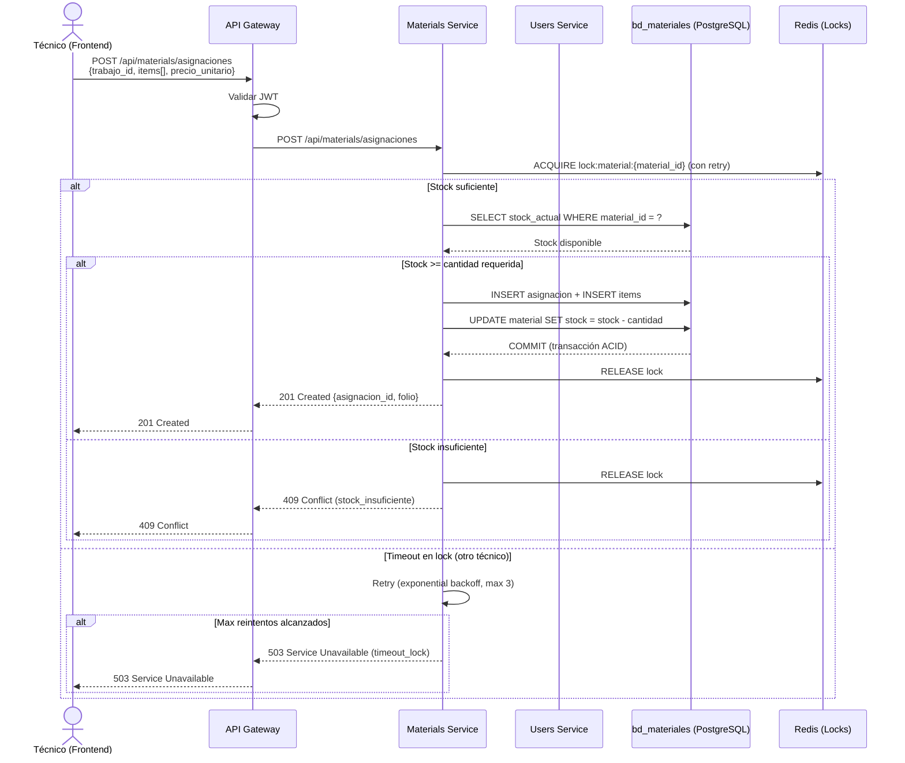
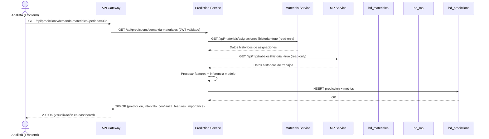

# 📊 Diagramas de Secuencia — SISGAD5

> **Tarea:** TASK-100-04
> **Tipo:** Diagramas UML de Secuencia
> **Estado:** ✅ Completada
> **Criterio:** 3 escenarios críticos con tablas de mensajes

---

## Escenario 1: Login y Autenticación con JWT



### Tabla de Mensajes — Login y Autenticación

| Paso | Emisor             | Mensaje                                          | Destino        | Protocolo | Descripción                                    |
| ---- | ------------------ | ------------------------------------------------ | -------------- | --------- | ---------------------------------------------- |
| 1    | Cliente (Frontend) | `POST /api/auth/login`                           | API Gateway    | HTTPS     | Envío de credenciales (email + password)       |
| 2    | API Gateway        | `POST /api/auth/login`                           | Users Service  | REST/JSON | Reenvío de credenciales al servicio             |
| 3    | Users Service      | `SELECT * FROM usuarios WHERE email = ?`         | bd_users       | SQL       | Búsqueda de usuario por email                   |
| 4    | bd_users           | User record (con hash de password y role)        | Users Service  | SQL       | Respuesta con datos del usuario                 |
| 5    | Users Service      | `bcrypt.compare(password, hash)`                 | —              | Internal  | Validación de contraseña                        |
| 6    | Users Service      | `JWT.sign({id, role, exp})`                      | —              | Internal  | Generación del access token (15 min)            |
| 7    | Users Service      | `JWT.sign({id, exp})`                            | —              | Internal  | Generación del refresh token (7 días)           |
| 8    | Users Service      | `SET refresh:{user_id} → token (TTL 7d)`         | Redis          | Redis     | Almacenamiento del refresh token                |
| 9    | Users Service      | `200 OK {access, refresh, role}`                 | API Gateway    | REST/JSON | Respuesta con tokens                            |
| 10   | API Gateway        | `200 OK {access, refresh, role}`                 | Cliente        | HTTPS     | Respuesta al frontend                           |
| 11   | Cliente (Frontend) | `GET /api/users/perfil` con `Authorization: Bearer {JWT}` | API Gateway | HTTPS     | Request autenticado al perfil de usuario        |
| 12   | API Gateway        | Verificar firma JWT, expiración                  | —              | Internal  | Validación del token                            |
| 13   | API Gateway        | `GET /api/users/perfil`                          | Users Service  | REST/JSON | Forward del request con user_id del JWT         |
| 14   | Users Service      | `SELECT * FROM usuarios WHERE id = ?`            | bd_users       | SQL       | Búsqueda del usuario por ID                     |
| 15   | Users Service      | `200 OK {perfil, permisos}`                      | API Gateway    | REST/JSON | Respuesta con datos del perfil                  |
| 16   | API Gateway        | `200 OK {perfil, permisos}`                      | Cliente        | HTTPS     | Respuesta al frontend                           |

---

## Escenario 2: Asignación de materiales con validación de stock



### Tabla de Mensajes — Asignación de Materiales

| Paso | Emisor             | Mensaje                                          | Destino        | Protocolo | Descripción                                    |
| ---- | ------------------ | ------------------------------------------------ | -------------- | --------- | ---------------------------------------------- |
| 1    | Técnico (Frontend) | `POST /api/materials/asignaciones`               | API Gateway    | HTTPS     | Solicitud de asignación de materiales          |
| 2    | API Gateway        | Verificar JWT                                    | —              | Internal  | Validación de autenticación                    |
| 3    | API Gateway        | `POST /api/materials/asignaciones`               | Materials Service | REST/JSON | Reenvío de la solicitud                       |
| 4    | Materials Service  | `SETNX lock:material:{id} (expiry 30s)`         | Redis          | Redis     | Adquisición de distributed lock                |
| 5    | Redis              | `OK` o `EXISTS`                                  | Materials Service | Redis     | Respuesta de lock                              |
| 6    | Materials Service  | `SELECT stock_actual WHERE id = ?`              | bd_materiales  | SQL       | Consulta de stock disponible                   |
| 7    | bd_materiales      | Stock disponible                                | Materials Service | SQL       | Respuesta con cantidad en stock                |
| 8    | Materials Service  | `BEGIN TRANSACTION`                             | bd_materiales  | SQL       | Inicio de transacción                          |
| 9    | Materials Service  | `INSERT INTO asignaciones` + `INSERT INTO items` | bd_materiales  | SQL       | Creación de registro de asignación             |
| 10   | Materials Service  | `UPDATE material SET stock = stock - n`         | bd_materiales  | SQL       | Decremento de stock                            |
| 11   | bd_materiales      | `COMMIT`                                        | Materials Service | SQL       | Confirmación atómica de la transacción         |
| 12   | Materials Service  | `DEL lock:material:{id}`                        | Redis          | Redis     | Liberación del lock                            |
| 13   | Materials Service  | `201 Created {asignacion_id, folio}`             | API Gateway    | REST/JSON | Confirmación de asignación creada              |
| 14   | API Gateway        | `201 Created`                                   | Técnico        | HTTPS     | Respuesta al frontend                          |
| 15   | Materials Service  | `409 Conflict` (stock_insuficiente)             | API Gateway    | REST/JSON | Error: stock insuficiente                      |
| 16   | Materials Service  | Retry con backoff exponencial (max 3 intentos)  | —              | Internal  | Reintento por lock ocupado                     |

---

## Escenario 3: Cierre de queja con consumo de materiales (Saga orquestada)

```mermaid
sequenceDiagram
    actor TE as Técnico (Frontend)
    participant GW as API Gateway
    participant MPS as MP Service
    participant SAGA as CierreQuejaSaga (Orquestador)
    participant MPDB as bd_mp (PostgreSQL)
    participant MS as Materials Service
    participant MADB as bd_materiales (PostgreSQL)

    TE->>GW: POST /api/mp/quejas/{id}/cerrar<br/>{id_clavecierre, fechaok, token}
    GW->>GW: Verificar JWT + claims (rol: tecnico)
    GW->>MPS: POST /api/mp/quejas/{id}/cerrar (forward con claims)
    MPS->>SAGA: execute(quejaId, ctx)

    SAGA->>MPDB: BEGIN (transacción Sequelize)
    SAGA->>MPDB: SELECT queja WHERE id = {id}
    MPDB-->>SAGA: Queja (estado, id_telefono, etc.)

    alt Queja no existe
        SAGA->>MPDB: ROLLBACK
        SAGA-->>MPS: 404 Not Found (QUEJA_NO_ENCONTRADA)
        MPS-->>GW: 404 Not Found
        GW-->>TE: 404 Not Found
    else Estado inválido (no Resuelta/Probada)
        SAGA->>MPDB: ROLLBACK
        SAGA-->>MPS: 400 Bad Request (ESTADO_INVALIDO)
        MPS-->>GW: 400 Bad Request
        GW-->>TE: 400 Bad Request
    else Ya está cerrada
        SAGA->>MPDB: ROLLBACK
        SAGA-->>MPS: compensación: YA_CERRADA
        MPS-->>GW: 400 Bad Request (already closed)
        GW-->>TE: 400 Bad Request
    else Estado válido
        SAGA->>MPDB: UPDATE queja SET estado='Cerrada', fechaok=NOW()
        SAGA->>MPDB: SELECT trabajos WHERE id_queja = {id}
        MPDB-->>SAGA: trabajos[]
        alt No hay trabajos (sin consumo)
            SAGA->>MPDB: COMMIT
            SAGA-->>MPS: 200 OK (queja cerrada, sin consumo)
            MPS-->>GW: 200 OK
            GW-->>TE: 200 OK {mensaje: "Queja cerrada"}
        else Hay trabajos
            SAGA->>MS: POST /api/materiales/consumos<br/>{trabajo_id, trabajador_id, ...}
            Alt Retry con backoff exponencial (max 3)
            MS->>MADB: BEGIN TRANSACTION
            MS->>MADB: INSERT consumo + UPDATE stock (con lock)
            alt Stock suficiente
                MS->>MADB: COMMIT
                MS-->>SAGA: 201 Created {consumo_id}
                SAGA->>MPDB: COMMIT
                SAGA-->>MPS: 200 OK (queja cerrada + consumo registrado)
                MPS-->>GW: 200 OK
                GW-->>TE: 200 OK {mensaje: "Queja cerrada exitosamente"}
            else Stock insuficiente o Materials falla
                MS->>MADB: ROLLBACK
                MS-->>SAGA: 409/500 (stock_insuficiente/error)
                SAGA->>MPDB: UPDATE queja SET estado='Resuelta' (compensación)
                SAGA->>MPDB: ROLLBACK
                SAGA-->>MPS: compensación: MATERIALES_FALLA
                MPS-->>GW: 500/409 (error con compensación)
                GW-->>TE: Error: cierre revertido, intente nuevamente
            end
        end
    end
```

### Tabla de Mensajes — Cierre de Queja (Saga Orquestada)

| Paso | Emisor | Mensaje | Destino | Protocolo | Descripción |
| ---- | ------ | ------- | ------- | --------- | ----------- |
| 1 | Técnico (Frontend) | `POST /api/mp/quejas/{id}/cerrar` | API Gateway | HTTPS | Cierre de queja con datos de cierre |
| 2 | API Gateway | Verificar JWT + claims (`rol: tecnico`) | — | Internal | Validación con claims (no llama a Users Service) |
| 3 | API Gateway | Forward request con headers `x-user-*` | MP Service | REST/JSON | Propagación de claims |
| 4 | MP Service | `CierreQuejaSaga.execute(quejaId, ctx)` | — | Internal | Inicio de orquestación |
| 5 | CierreQuejaSaga | `BEGIN` | bd_mp | SQL | Transacción local |
| 6 | CierreQuejaSaga | `SELECT queja WHERE id = ?` | bd_mp | SQL | Validar existencia y estado |
| 7 | CierreQuejaSaga | Validar FSM: estado ∈ {Resuelta, Probada} | — | Internal | Verificación de máquina de estados |
| 8 | CierreQuejaSaga | `UPDATE quejas SET estado='Cerrada'` | bd_mp | SQL | Cierre local |
| 9 | CierreQuejaSaga | `SELECT trabajos WHERE id_queja = ?` | bd_mp | SQL | Buscar trabajos asociados |
| 10 | CierreQuejaSaga | `POST /api/materiales/consumos` | Materials Service | REST/JSON | Registro de consumo (si hay trabajos) |
| 11 | Materials Service | `BEGIN TRANSACTION` + `INSERT consumo` + `UPDATE stock` | bd_materiales | SQL | Transacción ACID remota |
| 12 | CierreQuejaSaga | `COMMIT` | bd_mp | SQL | Confirmación local (si Materials OK) |
| 13 | CierreQuejaSaga | `UPDATE quejas SET estado='Resuelta'` (rollback) | bd_mp | SQL | Compensación (si Materials falla) |
| 14 | CierreQuejaSaga | `ROLLBACK` | bd_mp | SQL | Reversión de transacción local |

---

## Escenario 4: Predicción de demanda de materiales (bonus)



> **Nota:** El escenario 1, 2 y 3 son los 3 escenarios críticos solicitados. El escenario 4 es complementario y ya existe parcialmente en `ARCHITECTURE.md`.
