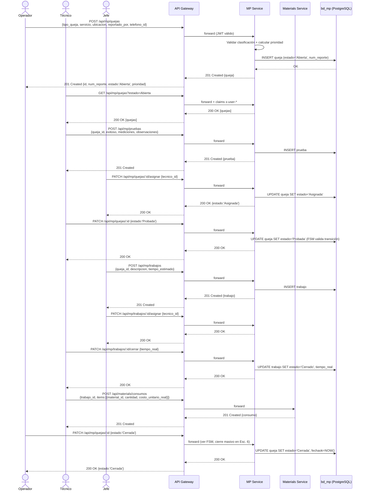
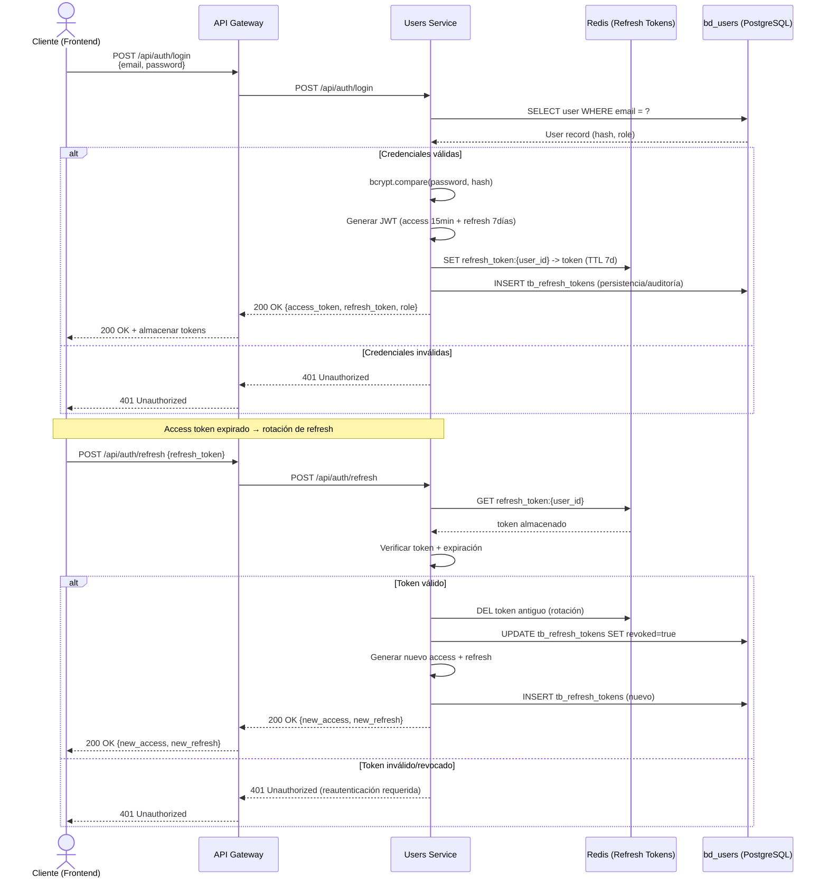
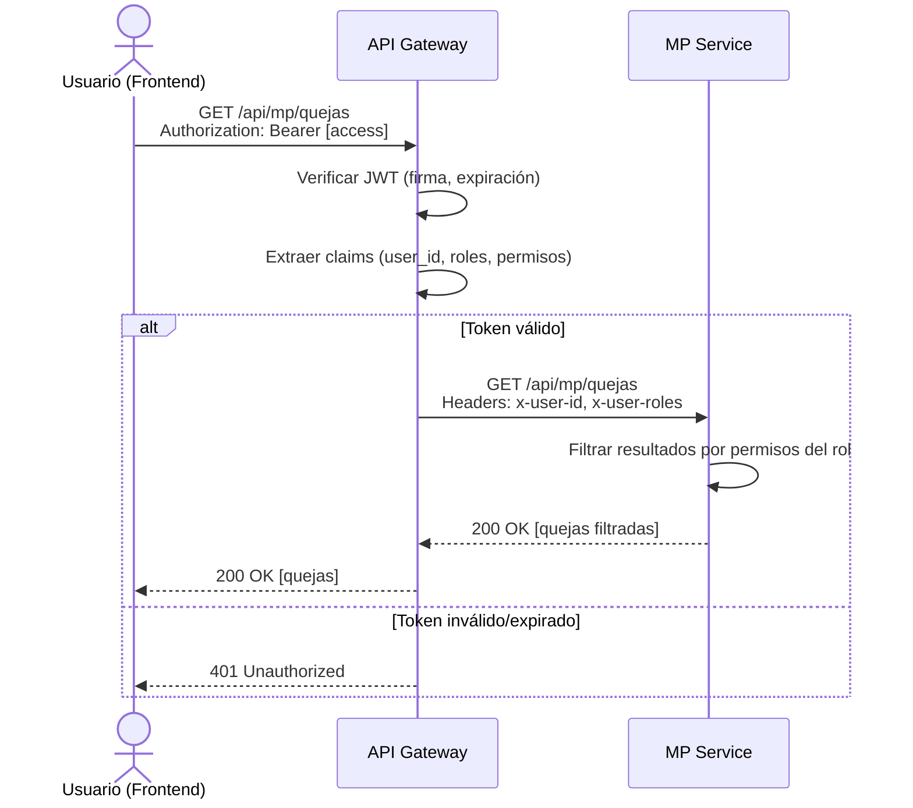
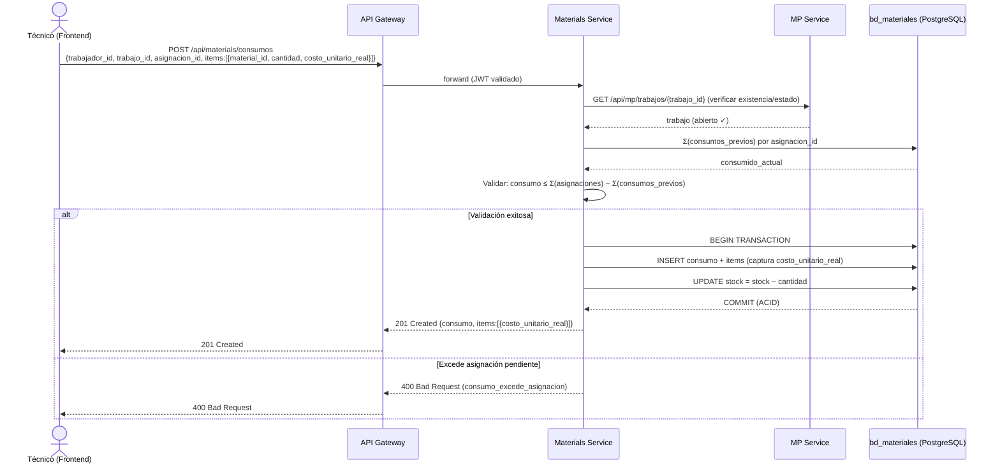
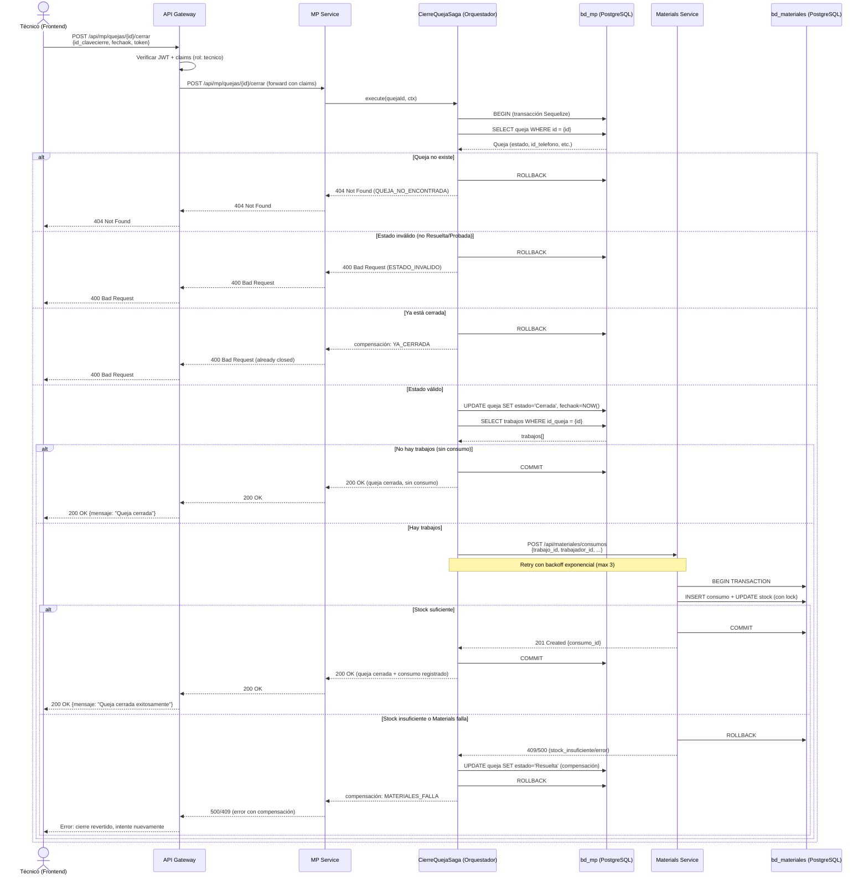
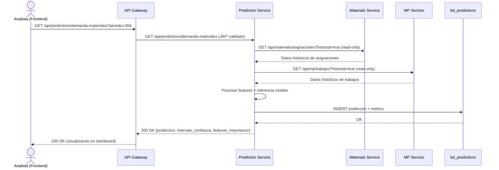

# 📊 Diagramas de Secuencia — SISGAD5

> **Versión:** 2.1 (documento fusionado y canónico — sintaxis Mermaid validada con @mermaid-js/mermaid-cli v11: los 7 escenarios renderizan sin errores)
> **Fecha:** 2026-11-02
> **Tarea:** TASK-100-04
> **Estado:** ✅ Completada
> **Criterio:** escenarios críticos con diagramas Mermaid + tablas de mensajes
> **Fuentes fusionadas:** `docs/diagrams/sequence_diagrams/sequence_diagrams.md` (v. TASK-100-04, 4 escenarios) + `docs/08_sequence_diagrams.es.md` v1.0 (3 escenarios: flujo completo de queja, asignación/consumo de materiales, autenticación con refresh). Los ASCII-art de la v1.0 fueron convertidos a Mermaid; el contenido único de ambas versiones se conservó.

---

## Índice de escenarios

| # | Escenario | Tipo | Origen en fuentes previas |
|---|-----------|------|---------------------------|
| 1 | Flujo completo de queja (Abierta → Cerrada) | Crítico | 08_es §1 |
| 2 | Login y autenticación JWT con refresh rotativo | Crítico | diag §Esc.1 + 08_es §3 |
| 3 | Acceso a recurso protegido vía Gateway | Crítico | 08_es §3 |
| 4 | Asignación de materiales con validación de stock | Crítico | diag §Esc.2 + 08_es §2 |
| 5 | Consumo de materiales (validación vs asignación) | Crítico | 08_es §2 |
| 6 | Cierre de queja con consumo (saga orquestada) | Crítico | diag §Esc.3 |
| 7 | Predicción de demanda de materiales | Complementario | diag §Esc.4 |

---

## Escenario 1: Flujo completo de queja (Abierta → Cerrada)

**Actores:** Operador, Técnico, Jefe · **Participantes:** API Gateway, MP Service, Materials Service, bd_mp

### Tabla de Mensajes — Flujo Completo de Queja

| # | De | Hacia | Mensaje | Datos |
|---|----|-------|---------|-------|
| 1 | Operador | Sistema | `POST /api/mp/quejas` | {tipo_queja, servicio, ubicacion, reportado_por, telefono_id} |
| 2 | Sistema | Operador | 201 Created | {queja: {id, num_reporte, estado: "Abierta", prioridad}} |
| 3 | Técnico | Sistema | `GET /api/mp/quejas?estado=Abierta` | - |
| 4 | Sistema | Técnico | 200 OK | [quejas] |
| 5 | Técnico | Sistema | `POST /api/mp/pruebas` | {queja_id, exitoso, mediciones, observaciones} |
| 6 | Sistema | Técnico | 201 Created | {prueba} |
| 7 | Operador/Jefe | Sistema | `PATCH /api/mp/quejas/:id/asignar` | {tecnico_id} |
| 8 | Sistema | - | 200 OK | {queja: {estado: "Asignada"}} |
| 9 | Técnico | Sistema | `PATCH /api/mp/quejas/:id` | {estado: "Probada"} |
| 10 | Jefe | Sistema | `POST /api/mp/trabajos` | {queja_id, descripcion, tiempo_estimado} |
| 11 | Jefe | Sistema | `PATCH /api/mp/trabajos/:id/asignar` | {tecnico_id} |
| 12 | Técnico | Sistema | `PATCH /api/mp/trabajos/:id/cerrar` | {tiempo_real} |
| 13 | Técnico | Sistema | `POST /api/materials/consumos` | {trabajo_id, items: [{material_id, cantidad, costo_unitario_real}]} |
| 14 | Sistema | Técnico | 201 Created | {consumo} |
| 15 | Operador/Jefe | Sistema | `PATCH /api/mp/quejas/:id` | {estado: "Cerrada"} |
| 16 | Sistema | Operador | 200 OK | {queja: {estado: "Cerrada"}} |

> **Nota:** el cierre real de queja con trabajos asociados se ejecuta como saga orquestada con compensación — ver **Escenario 6**.

---

## Escenario 2: Login y Autenticación con JWT (+ Refresh Rotativo)

**Actores:** Cliente (Frontend) · **Participantes:** API Gateway, Users Service, Redis, bd_users

### Tabla de Mensajes — Login y Autenticación

| Paso | Emisor | Mensaje | Destino | Protocolo | Descripción |
| ---- | ------ | ------- | ------- | --------- | ----------- |
| 1 | Cliente (Frontend) | `POST /api/auth/login` | API Gateway | HTTPS | Envío de credenciales (email + password) |
| 2 | API Gateway | `POST /api/auth/login` | Users Service | REST/JSON | Reenvío de credenciales al servicio |
| 3 | Users Service | `SELECT * FROM usuarios WHERE email = ?` | bd_users | SQL | Búsqueda de usuario por email |
| 4 | bd_users | User record (con hash de password y role) | Users Service | SQL | Respuesta con datos del usuario |
| 5 | Users Service | `bcrypt.compare(password, hash)` | — | Internal | Validación de contraseña |
| 6 | Users Service | `JWT.sign({id, role, exp})` | — | Internal | Generación del access token (15 min) |
| 7 | Users Service | `JWT.sign({id, exp})` | — | Internal | Generación del refresh token (7 días) |
| 8 | Users Service | `SET refresh:{user_id} → token (TTL 7d)` | Redis | Redis | Almacenamiento del refresh token |
| 9 | Users Service | `INSERT tb_refresh_tokens` | bd_users | SQL | Persistencia para auditoría/revocación |
| 10 | Users Service | `200 OK {access, refresh, role}` | API Gateway | REST/JSON | Respuesta con tokens |
| 11 | API Gateway | `200 OK {access, refresh, role}` | Cliente | HTTPS | Respuesta al frontend |
| 12 | Cliente (Frontend) | `POST /api/auth/refresh` {refresh_token} | API Gateway | HTTPS | Renovación tras expiración del access |
| 13 | Users Service | Verificar refresh en Redis/BD, rotar | — | Internal | DELETE old + INSERT new (revoked=true anterior) |
| 14 | Users Service | `200 OK {new_access, new_refresh}` | API Gateway | REST/JSON | Nuevos tokens |
| 15 | API Gateway | `200 OK {new_access, new_refresh}` | Cliente | HTTPS | Respuesta al frontend |

---

## Escenario 3: Acceso a Recurso Protegido (Claims vía Gateway)

**Actores:** Usuario · **Participantes:** API Gateway, MP Service

### Tabla de Mensajes — Acceso a Recurso Protegido

| # | De | Hacia | Mensaje | Datos |
|---|----|-------|---------|-------|
| 1 | Usuario | Gateway | `GET /api/mp/quejas` | Header: Authorization: Bearer \<access\> |
| 2 | Gateway | - | Verificar JWT (firma, expiración) | - |
| 3 | Gateway | - | Extraer claims (user_id, roles) | - |
| 4 | Gateway | MP | `GET /api/mp/quejas` | Headers: X-User-Id, X-User-Roles |
| 5 | MP | Gateway | 200 OK | [quejas filtradas por permisos] |
| 6 | Gateway | Usuario | 200 OK | [quejas] |

---

## Escenario 4: Asignación de Materiales con Validación de Stock

**Actores:** Analista/Técnico (Frontend) · **Participantes:** API Gateway, Materials Service, Redis (Locks), bd_materiales

### Tabla de Mensajes — Asignación de Materiales

| Paso | Emisor | Mensaje | Destino | Protocolo | Descripción |
| ---- | ------ | ------- | ------- | --------- | ----------- |
| 1 | Técnico/Analista (Frontend) | `POST /api/materials/asignaciones` | API Gateway | HTTPS | Solicitud de asignación (múltiples ítems) |
| 2 | API Gateway | Verificar JWT | — | Internal | Validación de autenticación |
| 3 | API Gateway | `POST /api/materials/asignaciones` | Materials Service | REST/JSON | Reenvío de la solicitud |
| 4 | Materials Service | `SETNX lock:material:{id} (expiry 30s)` | Redis | Redis | Adquisición de distributed lock |
| 5 | Redis | `OK` o `EXISTS` | Materials Service | Redis | Respuesta de lock |
| 6 | Materials Service | `SELECT stock_actual WHERE id = ?` | bd_materiales | SQL | Consulta de stock disponible |
| 7 | bd_materiales | Stock disponible | Materials Service | SQL | Respuesta con cantidad en stock |
| 8 | Materials Service | `BEGIN TRANSACTION` | bd_materiales | SQL | Inicio de transacción |
| 9 | Materials Service | `INSERT INTO asignaciones` + `INSERT INTO items` | bd_materiales | SQL | Creación de registro (captura `costo_unitario_momento`) |
| 10 | Materials Service | `UPDATE material SET stock = stock - n` | bd_materiales | SQL | Decremento de stock |
| 11 | bd_materiales | `COMMIT` | Materials Service | SQL | Confirmación atómica de la transacción |
| 12 | Materials Service | `DEL lock:material:{id}` | Redis | Redis | Liberación del lock |
| 13 | Materials Service | `201 Created {asignacion_id, folio}` | API Gateway | REST/JSON | Confirmación de asignación creada |
| 14 | API Gateway | `201 Created` | Técnico | HTTPS | Respuesta al frontend |
| 15 | Materials Service | `409 Conflict` (stock_insuficiente) | API Gateway | REST/JSON | Error: stock insuficiente |
| 16 | Materials Service | Retry con backoff exponencial (max 3 intentos) | — | Internal | Reintento por lock ocupado |

---

## Escenario 5: Consumo de Materiales (Validación vs Asignación)

**Actores:** Técnico · **Participantes:** API Gateway, Materials Service, MP Service, bd_materiales

### Tabla de Mensajes — Consumo de Materiales

| # | De | Hacia | Mensaje | Datos |
|---|----|-------|---------|-------|
| 1 | Técnico | Sistema | `POST /api/materials/consumos` | {trabajador_id, trabajo_id, asignacion_id, items: [...]} |
| 2 | Sistema | - | Verificar trabajo existente/abierto | `GET /api/mp/trabajos/{id}` |
| 3 | Sistema | - | Validar consumo ≤ asignación pendiente | Σ(consumos) ≤ Σ(asignaciones) − Σ(consumos_previos) |
| 4 | Sistema | - | Transacción: INSERT consumo + items | db.Transaction() |
| 5 | Sistema | - | Capturar costo_unitario_real | Input del técnico |
| 6 | Sistema | Técnico | 201 Created | {consumo, items: [{costo_unitario_real}]} |

---

## Escenario 6: Cierre de Queja con Consumo de Materiales (Saga Orquestada)

**Actores:** Técnico (Frontend) · **Participantes:** API Gateway, MP Service, CierreQuejaSaga, bd_mp, Materials Service, bd_materiales

### Tabla de Mensajes — Cierre de Queja (Saga Orquestada)

| Paso | Emisor | Mensaje | Destino | Protocolo | Descripción |
| ---- | ------ | ------- | ------- | --------- | ----------- |
| 1 | Técnico (Frontend) | `POST /api/mp/quejas/{id}/cerrar` | API Gateway | HTTPS | Cierre de queja con datos de cierre |
| 2 | API Gateway | Verificar JWT + claims (`rol: tecnico`) | — | Internal | Validación con claims (no llama a Users Service) |
| 3 | API Gateway | Forward request con headers `x-user-*` | MP Service | REST/JSON | Propagación de claims |
| 4 | MP Service | `CierreQuejaSaga.execute(quejaId, ctx)` | — | Internal | Inicio de orquestación |
| 5 | CierreQuejaSaga | `BEGIN` | bd_mp | SQL | Transacción local |
| 6 | CierreQuejaSaga | `SELECT queja WHERE id = ?` | bd_mp | SQL | Validar existencia y estado |
| 7 | CierreQuejaSaga | Validar FSM: estado ∈ {Resuelta, Probada} | — | Internal | Verificación de máquina de estados |
| 8 | CierreQuejaSaga | `UPDATE quejas SET estado='Cerrada'` | bd_mp | SQL | Cierre local |
| 9 | CierreQuejaSaga | `SELECT trabajos WHERE id_queja = ?` | bd_mp | SQL | Buscar trabajos asociados |
| 10 | CierreQuejaSaga | `POST /api/materiales/consumos` | Materials Service | REST/JSON | Registro de consumo (si hay trabajos) |
| 11 | Materials Service | `BEGIN TRANSACTION` + `INSERT consumo` + `UPDATE stock` | bd_materiales | SQL | Transacción ACID remota |
| 12 | CierreQuejaSaga | `COMMIT` | bd_mp | SQL | Confirmación local (si Materials OK) |
| 13 | CierreQuejaSaga | `UPDATE quejas SET estado='Resuelta'` (rollback) | bd_mp | SQL | Compensación (si Materials falla) |
| 14 | CierreQuejaSaga | `ROLLBACK` | bd_mp | SQL | Reversión de transacción local |

---

## Escenario 7: Predicción de Demanda de Materiales (Complementario)

**Actores:** Analista · **Participantes:** API Gateway, Prediction Service, Materials Service, MP Service, bd_predictions

---

## Referencias

- [Casos de Uso](../../03_use_cases.es.md)
- [Modelo de Dominio](../../07_domain_model.es.md)
- [Máquinas de Estado](../../09_state_machines.es.md)
- [Estrategia de Seguridad](../../13_security.es.md)
