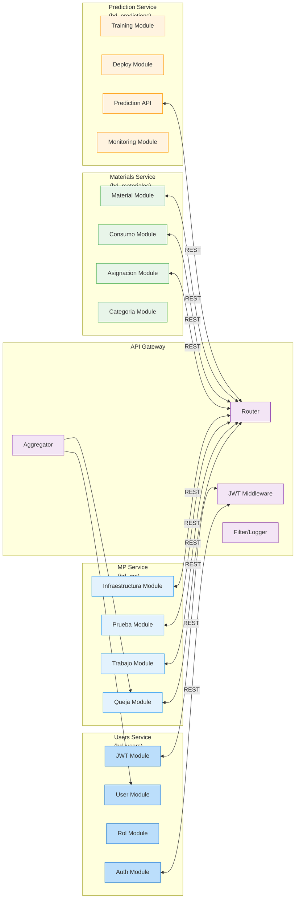

# Práctica 07 — Arquitectura del Sistema (C4/Microservicios)

> **Дисциплина:** Архитектура ПО
> **Специализация:** C4 Model + Microservicios
> **Цель:** Modelar las decisiones arquitecturais de SISGAD5

---

## 1. C4 Model — Nivel de Contexto

```mermaid
%%{init: {'theme': 'base', 'themeVariables': { 'fontSize': '16px' }}}%%
graph LR
    subgraph "Зона клиентов"
        CLI[Clientes\n(Navegador Web/Mobile)]
    end

    subgraph "Зона SISGAD5"
        GW[API Gateway\n(Node.js:5000)]
        US[Users Service\n(Node.js:5001)]
        MS[MP Service\n(Node.js:5002)]
        MAT[Materials Service\n(Go:5003)]
        PRED[Prediction Service\n(Python:5005)]
    end

    subgraph "Зона данных"
        PG[PostgreSQL\n(5432)]
        RD[Redis\n(6379)]
        ML[MLflow\n(MLOps)]
        GRF[Grafana\n(Monitoring)]
        Prome[Prometheus\n(Metrics)]
    end

    CLI -- "HTTPS + JWT" --> GW
    GW -- "REST" --> US
    GW -- "REST" --> MS
    GW -- "REST" --> MAT
    GW -- "REST" --> PRED

    US -- "SQL" --> PG
    MS -- "SQL" --> PG
    MAT -- "SQL" --> PG
    PRED -- "SQL" --> PG

    US -- "Cache" --> RD
    MS -- "Cache" --> RD
    MAT -- "Cache" --> RD
    PRED -- "Cache" --> RD

    PRED -- "MLflow API" --> ML
    PRED -- "Metrics" --> Prome
    Prome -- "Dashboards" --> GRF

    classDef client fill:#bbdefb,stroke:#1976d2
    classDef service fill:#e3f2fd,stroke:#2196f3
    classDef database fill:#e8f5e9,stroke:#4caf50
    classDef external fill:#fff3e0,stroke:#ff9800

    class CLI client
    class GW,US,MS,MAT,PRED service
    class PG,RD,ML,GRF,Prome database
```

---

## 2. C4 Model — Nivel de Contención (Microservicios)

### 2.1. Límites de servicios

| Сервис | Responsabilidad | DB Schema | Порт | Lenguaje | Framework |
|--------|-----------------|-----------|------|----------|-----------|
| **Users Service** | Пользователи, Roles, Permisos, Auth | `bd_users` | 5001 | JS/TS | Express + Sequelize |
| **MP Service** | Quejas, Técnicos, Trabajos, Tests, Инфраструктура | `bd_mp` | 5002 | JS/TS | Express + Sequelize + Zod |
| **Materials Service** | Materiales, Categorías, Asignaciones, Consumos | `bd_materiales` | 5003 | Go | gorilla/mux + GORM |
| **Prediction Service** | ML модели, Прогнозы | `bd_predictions` | 5005 | Python | FastAPI + scikit-learn |
| **API Gateway** | Агрегация, аутентификация, маршрутизация | - | 5000 | JS/TS | Express + http-proxy-middleware |

### 2.2. Flujo de datos por сервис



---

## 3. Principios arquitectónicos

### 3.1. Principios SOLID en микросервисах

| Principio | Применение в SISGAD5 |
|----------|------------------------|
| **Single Responsibility** | Cada servizio gestisce un solo bounded context |
| **Open/Closed** | Service extensions via plugins (hooks) |
| **Liskov Substitution** | Abstract repositories + concrete implementations |
| **Interface Segregation** | REST interfaces specificatge per entitat |
| **Dependency Inversion** | Dipend on interfaces, non concretizaciones |

### 3.2. Clean Architecture in Users Service

```mermaid
graph TD
    subgraph "Camada Presentation"
        CTRL[Controllers\n(AuthController,\nUserController)]
    end

    subgraph "Camada Application"
        SVC[Services\n(AuthService,\nUserService)]
    end

    subgraph "Camada Domain"
        ENT[Entities\n(User, Rol,\nPermiso, Sesion)]
        VAL[Value Objects\n(Email, UUID)]
        ENUM[Enums\n(UserRole,\nUserStatus)]
    end

    subgraph "Camada Infrastructure"
        REPO[Repositories\n(UserRepository,\nSesionRepository)]
        MID[Middlewares\n(JWT, RBAC)]
        EXT[External Services\n(Email, Redis)]
    end

    CTRL --> SVC
    SVC --> ENT
    SVC --> VAL
    SVC --> ENUM
    SVC --> REPO
    REPO --> ENT
    MID --> SVC
    EXT --> SVC
    SVC --> MID
    SVC --> EXT

    classDef pres fill:#bbdefb,stroke:#1976d2
    classDef app fill:#e3f2fd,stroke:#2196f3
    classDef domain fill:#e8f5e9,stroke:#4caf50
    classDef infra fill:#fff3e0,stroke:#ff9800

    class CTRL pres
    class SVC app
    class ENT,VAL,ENUM domain
    class REPO,MID,EXT infra
```

### 3.3. Restriccions arquitectónicas (из AGENTS.md)

| № | Restricción | Fundamento |
|---|-------------|------------|
| ARC-11 | Frontend → solo Gateway | Единая точka d'entrée, единый JWT |
| ARC-12 | Serviços não acessam BD de outros | Loose coupling, bounded contexts |
| ARC-13 | REST/JSON entre сервicos | Protocolo único, изоляция |
| ARC-14 | Materials Service solo lectura desde Prediction | Безопасность, no writes a bd_materiales |
| ARC-15 | PostgreSQL: 4 БД отдельные | Isolamento de dados, escalonamento independente |

---

## 4. Diagrama de despliegue

Ver [deployment_diagram](practice_08_deployment_diagram.es.md) para detalles.

---

## 5. Security Model

Ver [security_model](practice_10_security_model.es.md) para detalles.

---

## 6. DFD (Data Flow Diagram)

Ver [DFD](practice_09_dfd.es.md) para detalles.

---

## 7. Enlaces

- [Security Model](practice_10_security_model.es.md)
- [Deployment Diagram](practice_08_deployment_diagram.es.md)
- [DFD](practice_09_dfd.es.md)
- [Event Storming](practice_03_event_storming.es.md)
- [UML Dinámico](practice_06_uml_dynamic.es.md)