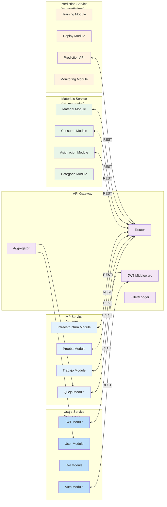

# Практика 07 — Архитектура системы (C4/Microservices)

> **Дисциплина:** Архитектура ПО
> **Специализация:** C4 Model + Microservices Architecture
> **Цель:** Моделирование архитектурных решений SISGAD5

---

## 1. C4 Model - Context Level

```mermaid
%%{init: {'theme': 'base', 'themeVariables': { 'fontSize': '16px' }}}%%
graph LR
    subgraph "Зона клиентов"
        CLI[Клиенты\n(Браузер Web/Mobile)]
    end
    
    subgraph "Зона SISGAD5"
        GW[API Gateway\n(Node.js:5000)]
        US[Users Service\n(Node.js:5001)]
        MS[MP Service\n(Node.js:5002)]
        MAT[Materials Service\n(Go:5003)]
        PRED[Prediction Service\n(Python:5005)]
    end
    
    subgraph "Зона данных"
        PG[PostgreSQL\n(5432)]
        RD[Redis\n(6379)]
        ML[MLflow\n(MLOps)]
        GRF[Grafana\n(Monitoring)]
        Prome[Prometheus\n(Metrics)]
    end
    
    CLI -- "HTTPS + JWT" --> GW
    GW -- "REST" --> US
    GW -- "REST" --> MS
    GW -- "REST" --> MAT
    GW -- "REST" --> PRED
    
    US -- "SQL" --> PG
    MS -- "SQL" --> PG
    MAT -- "SQL" --> PG
    PRED -- "SQL" --> PG
    
    US -- "Cache" --> RD
    MS -- "Cache" --> RD
    MAT -- "Cache" --> RD
    PRED -- "Cache" --> RD
    
    PRED -- "MLflow API" --> ML
    PRED -- "Metrics" --> Prome
    Prome -- "Dashboards" --> GRF
    
    classDef client fill:#bbdefb,stroke:#1976d2
    classDef service fill:#e3f2fd,stroke:#2196f3
    classDef database fill:#e8f5e9,stroke:#4caf50
    classDef external fill:#fff3e0,stroke:#ff9800
    
    class CLI client
    class GW,US,MS,MAT,PRED service
    class PG,RD,ML,GRF,Prome database
    class ML,PRED external
```

---

## 2. C4 Model - Containment Level (Microservices)

### 2.1. Service boundaries

| Сервис | Ответственность | DB Schema | Port | Language | Framework |
|--------|-----------------|-----------|------|----------|-----------|
| **Users Service** | Пользователи, Roles, Permisos, Auth | `bd_users` | 5001 | JS/TS | Express + Sequelize |
| **MP Service** | Quejas, Técnicos, Trabajos, Tests, Inf-telecom | `bd_mp` | 5002 | JS/TS | Express + Sequelize + Zod |
| **Materials Service** | Materiales, Categorías, Asignaciones, Consumos | `bd_materiales` | 5003 | Go | gorilla/mux + GORM |
| **Prediction Service** | ML модели, Прогнозы | `bd_predictions` | 5005 | Python | FastAPI + scikit-learn |
| **API Gateway** | Агрегация, аутентификация, маршрутизация | - | 5000 | JS/TS | Express + http-proxy-middleware |

### 2.2. Data flow per service



---

## 3. Архитектурные принципы

### 3.1. SOLID принципы в микросервисах

| Принцип | Применение в SISGAD5 |
|----------|------------------------|
| **Single Responsibility** | Каждый сервис отвечает за одну bounded context |
| **Open/Closed** | Service extensions via plugins (hooks) |
| **Liskov Substitution** | Abstract repositories + concrete implementations |
| **Interface Segregation** | REST interfaces specific per entity |
| **Dependency Inversion** | Depend on interfaces, not concretions |

### 3.2. Clean Architecture в Users Service

```mermaid
graph TD
    subgraph "Presentation Layer"
        CTRL[Controllers\n(AuthController,\nUserController)]
    end
    
    subgraph "Application Layer"
        SVC[Services\n(AuthService,\nUserService)]
    end
    
    subgraph "Domain Layer"
        ENT[Entities\n(User, Rol,\nPermiso, Sesion)]
        VAL[Value Objects\n(Email, UUID)]
        ENUM[Enums\n(UserRole,\nUserStatus)]
    end
    
    subgraph "Infrastructure Layer"
        REPO[Repositories\n(UserRepository,\nSesionRepository)]
        MID[Middlewares\n(JWT, RBAC)]
        EXT[External Services\n(Email, Redis)]
    end
    
    CTRL --> SVC
    SVC --> ENT
    SVC --> VAL
    SVC --> ENUM
    SVC --> REPO
    REPO --> ENT
    MID --> SVC
    EXT --> SVC
    SVC --> MID
    SVC --> EXT
    
    classDef pres fill:#bbdefb
    classDef app fill:#e3f2fd
    classDef domain fill:#e8f5e9
    classDef infra fill:#fff3e0
    
    class CTRL pres
    class SVC app
    class ENT,VAL,ENUM domain
    class REPO,MID,EXT infra
```

### 3.3. Архитектурные ограничения (из AGENTS.md)

| № | Ограничение | Обоснование |
|---|-------------|-------------|
| ARC-11 | Frontend → только Gateway | Единая точка входа, единый JWT |
| ARC-12 | Сервисы не обращаются к BD друг друга | Loose coupling, bounded contexts |
| ARC-13 | REST/JSON между сервисами | Единый протокол, изоляция |
| ARC-14 | Materials Service read-only из Prediction | Безопасность данных, no writes to bd_materiales |
| ARC-15 | PostgreSQL: 4 отдельные БД | Изоляция данных, независимое масштабирование |

---

## 4. Диаграмма развертывания (Deployment)

```mermaid
%%{init: {'theme': 'base', 'themeVariables': { 'fontSize': '12px' }}}%%
graph LR
    subgraph "Production Environment"
        subgraph "Docker Swarm / Kubernetes"
            GW_DEP[Gateway Service\nDocker Container]
            US_DEP[Users Service\nDocker Container]
            MS_DEP[MP Service\nDocker Container]
            MAT_DEP[Materials Service\nDocker Container]
            PRED_DEP[Prediction Service\nDocker Container]
        end
        
        subgraph "Database Tier"
            PG_DEP[(PostgreSQL\nMaster Instance)]
        end
        
        subgraph "Cache Tier"
            RD_DEP[(Redis\nCluster)]
        end
        
        subgraph "MLOps Tier"
            ML_DEP[(MLflow Server)]
            DVC_DEP[(DVC Storage)]
        end
        
        subgraph "Monitoring Tier"
            GRAF_DEP[Grafana]
            PROM_DEP[Prometheus]
        end
        
        subgraph "Frontend CDN"
            FE_DEP[React SPA\nVite Build\n(CDN)]
        end
    end
    
    FE_DEP -- "HTTPS" --> GW_DEP
    GW_DEP -- "JWT + REST" --> US_DEP
    GW_DEP -- "JWT + REST" --> MS_DEP
    GW_DEP -- "JWT + REST" --> MAT_DEP
    GW_DEP -- "JWT + REST" --> PRED_DEP
    
    US_DEP -- "SQL" --> PG_DEP
    MS_DEP -- "SQL" --> PG_DEP
    MAT_DEP -- "SQL" --> PG_DEP
    PRED_DEP -- "SQL" --> PG_DEP
    
    US_DEP -- "Cache" --> RD_DEP
    MS_DEP -- "Cache" --> RD_DEP
    MAT_DEP -- "Cache" --> RD_DEP
    PRED_DEP -- "Cache" --> RD_DEP
    
    PRED_DEP -- "MLflow API" --> ML_DEP
    PRED_DEP -- "DVC" --> DVC_DEP
    
    US_DEP -- "Metrics" --> PROM_DEP
    MS_DEP -- "Metrics" --> PROM_DEP
    MAT_DEP -- "Metrics" --> PROM_DEP
    PRED_DEP -- "Metrics" --> PROM_DEP
    
    PROM_DEP -- "Dashboards" --> GRAF_DEP
    
    classDef gateway fill:#f3e5f5
    classDef service fill:#e3f2fd
    classDef database fill:#e8f5e9
    classDef cache fill:#fff3e0
    classDef mlo fill:#ede7f6
    classDef mon fill:#ffebee
    classDef frontend fill:#bbdefb
    
    class GW_DEP gateway
    class US_DEP,MS_DEP,MAT_DEP,PRED_DEP service
    class PG_DEP database
    class RD_DEP cache
    class ML_DEP,DVC_DEP mlo
    class GRAF_DEP,PROM_DEP mon
    class FE_DEP frontend
```

---

## 5. Схема согласования запросов (Request Lifecycle)

```mermaid
sequenceDiagram
    participant U as Usuario
    participant FE as Frontend\n(React/Vite)
    participant GW as API Gateway\n(5000)
    participant MW as JWT Middleware
    participant RB as RBAC Middleware
    participant SVC as Target Service
    participant DB as Database
    
    U->>FE: Navegar a /dashboard/materiales
    FE->>FE: Verificar token en localStorage
    FE->>GW: GET /api/materials/materiales\n(Authorization: Bearer xxx)
    GW->>MW: verifyJWT(req.headers)
    MW->>MW: decode + validate token
    alt Token inválido
        MW-->>GW: 401 Unauthorized
        GW-->>FE: 401 Redirect a /login
    else Token válido
        MW->>MW: extractClaims(req)
        MW->>RB: checkPermission(req, claims)
        alt Sin permisos
            RB-->>GW: 403 Forbidden
            GW-->>FE: 403 Error
        else Con permisos
            RB->>SVC: GET /materiales\n(with claims via x-user headers)
            SVC->>DB: SELECT * FROM materiales WHERE activo=true
            DB-->>SVC: materiales[]
            SVC-->>GW: 200 OK + JSON
            GW-->>FE: Response (forwarded)
            FE->>U: Render dashboard с datos
    end
```

---

## 6. Ссылки

- [Security Model](practice_10_security_model.ru.md)
- [Deployment Diagram](practice_08_deployment_diagram.ru.md)
- [DFD](practice_09_dfd.ru.md)
- [Архитектура развертывания](../14_deployment.ru.md)
- [Event Storming](practice_03_event_storming.ru.md)