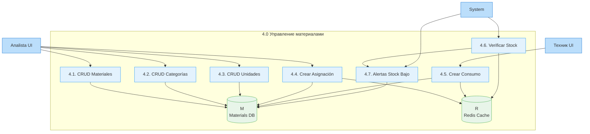
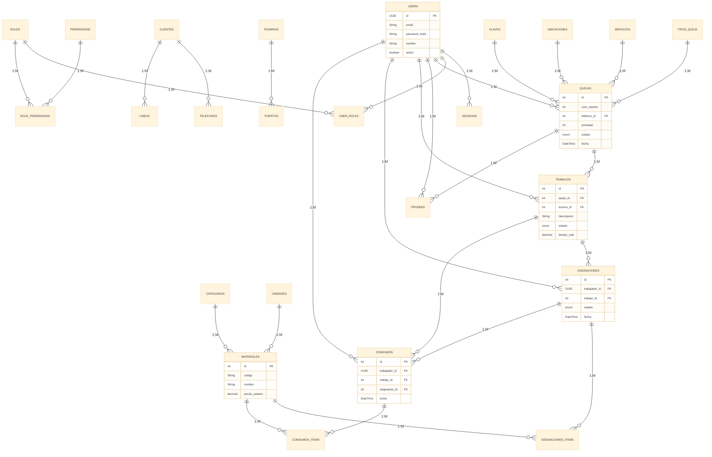

# Практика 09 — DFD (Data Flow Diagram)

> **Дисциплина:** Инженерия данных
> **Специализация:** Data Flow Diagram (DFD) — уровни 0, 1, 2
> **Методология:** Gane-Sarson notation
> **Цель:** Визуализация потока данных в SISGAD5

---

## 1. DFD Level 0 (Контекстный уровень)

Контекстный уровень показывает систему как единое целое и её границы с внешними сущностями.

```mermaid
%%{init: {'theme': 'base', 'themeVariables': { 'fontSize': '16px' }}}%%
graph LR
    subgraph "SISGAD5 DSS System"
        SYS[SISGAD5\nSystem]
    end
    
    subgraph "Внешние сущности"
        CLI[Клиент\n(Browser/Mobile)]
        OP[Оператор\n(WebApp)]
        TEC[Техник\n(Mobile App)]
        ANALISTA[Analista\n(WebApp)]
        JEFE[Jefe\n(WebApp)]
        ADMIN[Admin\n(WebApp)]
        DIR[Director\n(WebApp)]
        PRED_SYS[Prediction Engine\n(Microservice)]
        EMAIL[Email Service]
        ALERT[Alert System]
    end
    
    CLI -- "1. Отправить заявку\n(POST /api/mp/quejas)" --> SYS
    OP -- "2. Управлять данными\n(REST API)" --> SYS
    TEC -- "3. Выполнять работы\n(REST API)" --> SYS
    ANALISTA -- "4. Управлять материалами\n(REST API)" --> SYS
    JEFE -- "5. Назначать техников\n(REST API)" --> SYS
    ADMIN -- "6. Управлять пользователями\n(REST API)" --> SYS
    DIR -- "7. Просматривать дашборды\n(REST API)" --> SYS
    PRED_SYS -- "8. Получать данные\n(GET /api/predictions)" --> SYS
    SYS -- "9. Отправить прогнозы\n(POST /api/predictions)" --> PRED_SYS
    SYS -- "10. Уведомление клиенту\n(Email)" --> EMAIL
    SYS -- "11. Тревога низкого stock\n(Alert)" --> ALERT
    SYS -- "12. Отчёты\n(JSON/PDF)" --> CLI
    SYS -- "13. Дашборды\n(JSON)" --> DIR
    
    classDef system fill:#e3f2fd,stroke:#2196f3,stroke-width:3px
    classDef entity fill:#bbdefb,stroke:#1976d2,stroke-width:2px
    classDef external fill:#fff3e0,stroke:#ff9800,stroke-width:2px
    
    class SYS system
    class CLI,OP,TEC,ANALISTA,JEFE,ADMIN,DIR entity
    class PRED_SYS,EMAIL,ALERT external
```

### Данные на уровне 0

| № | Data Flow | Data Store | Описание |
|---|-----------|------------|----------|
| 1 | Reportar Queja | Q | Данные заявки + классификация |
| 2 | Управление данными | Q, T, P | CRUD операции |
| 3 | Выполнение работ | T, P, C | Тесты, работы, расходы |
| 4 | Управление материалами | M | Каталог, назначения, расходы |
| 5 | Назначение техников | T | Обновление назначений |
| 6 | Управление пользователями | U | CRUD пользователей/ролей |
| 7 | Просмотр дашбордов | Q, T, C, M | Агрегированные данные |
| 8 | Получение прогнозов | Q | Прогнозы от ML моделей |
| 9 | Отправка прогнозов | Q | Данные для моделей |
| 10 | Уведомления | - | Email/SMS оповещения |
| 11 | Тревоги | - | Alert система stock |
| 12 | Отчёты | Q, T, C, M | Экспорт в PDF/CSV |

---

## 2. DFD Level 1 (Функциональный уровень)

Разложение на главные процессы. Данные: 4 основных хранилища данных.

```mermaid
%%{init: {'theme': 'base', 'themeVariables': { 'fontSize': '12px' }}}%%
graph TD
    subgraph "DFDL Level 1"
        
        subgraph "Процессы"
            P1[1.0 Управление\nаутентификацией\n(Auth)]
            P2[2.0 Управление\nинфраструктурой\n(MP)]
            P3[3.0 Управление\nзаявками и\nработами (MP)]
            P4[4.0 Управление\nматериалами\n(Materials)]
            P5[5.0 Аналитика и\nпрогнозирование\n(Prediction)]
        end
        
        subgraph "Хранилища данных"
            U[(U\nUsers DB\n(bd_users))]
            Q[(Q\nMP DB\n(bd_mp))]
            M[(M\nMaterials DB\n(bd_materiales)]
            R[(R\nRedis Cache)]
        end
        
        subgraph "Внешние сущности"
            UI[Web/Mobile UI]
            ML[ML Service]
            EMAIL[Email Service]
        end
        
        %% Data flows
        UI -->|"login(email, password)"| P1
        P1 -->|"validate_token()"| UI
        P1 -->|"user_session(user_id, claims)"| U
        UI -->|"CRUD infra (tel, linea, pizarra)"| P2
        UI -->|"CRUD quejas/trabajos" | P3
        UI -->|"CRUD materiales/asignaciones/consumos"| P4
        P4 -->|"stock_updates"| R
        UIDIR[Web Admin] -->|"admin_queries"| P5
        P5 -->|"predictions"| UI
        P5 -->|"model_metrics"| R
        P5 -->|"training_data"| Q
        P5 <-->|"features + predictions"| ML
        P3 -->|"work_order_data"| P4
        P4 -->|"consumo_validation"| P3
        P2 -->|"catalog_references"| Q
        P1 -->|"user_roles"| U
        P2 -->|"user_lookup"| U
        P3 -->|"assigned_technician"| U
        P4 -->|"worker_lookup"| U
        P3 -->|"notifications"| EMAIL
        P4 -->|"email_alerts"| EMAIL
        
        %% Store connections
        P1 <--> U
        P2 <--> Q
        P3 <--> Q
        P4 <--> M
        P4 <--> R
        P2 <--> R
        P3 <--> R
        
        classDef process fill:#e3f2fd,stroke:#2196f3,stroke-width:2px
        classDef store fill:#e8f5e9,stroke:#4caf50,stroke-width:2px
        classDef entity fill:#fff3e0,stroke:#ff9800,stroke-width:2px
        
        class P1,P2,P3,P4,P5 process
        class U,Q,M,R store
        class UI,ML,EMAIL entity
    end
```

### Мини-DFD: Процесс 4.0 - Управление материалами



---

## 3. DFD Level 2 (Детализированный уровень — Процесс 3.0)

### 3.0.1. Создание заявки и классификация

```mermaid
%%{init: {'theme': 'base', 'themeVariables': { 'fontSize': '10px' }}}%%
flowchart LR
    subgraph "3.1. Reportar Queja"
        A31[Ingresar datos\nqueja] --> B31[Validar datos\nentrada]
        B31 --> C31[Clasificar:\n- TipoQueja\n- Servicio\n- Ubicacion\n- Clave]
        C31 --> D31[Calcular Prioridad\n(pesos sumados)]
        D31 --> E31[Guardar Queja\nen bd_mp]
    end
    
    subgráfica ["3.2. Asignar Técnico"]
        A32[Seleccionar técnico] --> B32[Verificar disponibilidad]
        B32 --> C32[Actualizar estado\nQueja → EnProgreso]
        C32 --> D32[Guardar cambio\nen bd_mp]
        D32 --> E32[Emitir evento\nQuejaAsignadaATecnico]
    end
    
    subgraph "3.3. Crear Trabajo"
        A33[Ingresar descripción] --> B33[Создать Trabajo]
        B33 --> C33[Связать с Queja]
        C33 --> D33[Guardar Trabajo\nen bd_mp]
        D33 --> E33[Emitir evento\nTrabajoCreado]
    end
    
    subgraph "3.4. Registrar Prueba"
        A34[Ingresar результаты] --> B34[Validar:\n- Queja/Trabajo existen\n- Técnico asignado]
        B34 --> C34[Guardar Prueba\nв bd_mp]
        C34 --> D34[Emitir evento\nPruebaRegistrada]
        D34 --> E34[Опционально:\n- QuejaCambioEstado]
    end
    
    subgraph "3.5. Cerrar Trabajo"
        A35[Ingresar tiempo_real] --> B35[Validar:\n- Trabajo asignado а técnику\n- tiempo_real > 0]
        B35 --> C35[Actualizar estado\nTrabajo → Cerrada]
        C35 --> D35[Guardar изменения\nв bd_mp]
        D35 --> E35[Emitir evento\nTrabajoCerrado]
    end
    
    subgraph "3.6. Cerrar Queja"
        A36[Verificar:\n- All работы cerrты\n- No hay próxимых проблем] --> B36[Cambiar estado\nQueja → Cerrada]
        B36 --> C36[Guardar en bd_mp]
        C36 --> D36[Emitir evento\nQuejaCerrada]
        D36 --> E36[Опционально:\n- Notificar клиента]
    end
    
    subgraph "Data Stores"
        DS_Q[(Q\nQueja DB)]
        DS_T[(T\nTrabajo DB)]
    end
    
    E31 --> DS_Q
    C31 --> DS_Q
    E32 --> DS_Q
    D32 --> DS_Q
    D33 --> DS_T
    E33 --> DS_T
    C34 --> DS_T
    D34 --> DS_Q
    D35 --> DS_T
    E35 --> DS_Q
    C36 --> DS_Q
    
    subgraph "External Events"
        EBUS[Saga Orchestrator\n(EventBus)]
    end
    
    E32 --> EBUS
    E33 --> EBUS
    D34 --> EBUS
    E35 --> EBUS
    D36 --> EBUS
    
    classDef process fill:#e3f2fd,stroke:#2196f3,stroke-width:1px
    classDef store fill:#e8f5e9,stroke:#4caf50,stroke-width:1px
    classDef entity fill:#fff3e0,stroke:#ff9800,stroke-width:1px
    
    class A31,B31,C31,D31,E31,A32,B32,C32,D32,E32,A33,B33,C33,D33,E33,process
    class A34,B34,C34,D34,E34,A35,B35,C35,D35,E35,A36,B36,C36,D36,E36 process
    class DS_Q,DS_T store
    class EBUS entity
```

---

## 4. DFD Data Dictionary

| Обозначение | Описание | Тип |
|-------------|----------|-----|
| **U** | Users DB (bd_users) | Хранилище |
| **Q** | MP DB (bd_mp) | Хранилище |
| **M** | Materials DB (bd_materiales) | Хранилище |
| **R** | Redis Cache | Хранилище |
| **UI** | Web/Mobile UI (users, operators) | Внешняя сущность |
| **ML** | Prediction Engine | Внешняя сущность |
| **EMAIL** | Email Service | Внешняя сущность |
| **ALERT** | Alert System | Внешняя сущность |
| **1-12** | Data flows (см. таблицу выше) | Поток данных |

---

## 5. Схема потоков данных (ERD-style)



---

## 6. Ссылки

- [Event Storming](practice_03_event_storming.ru.md)
- [UML Dinámico](practice_06_uml_dynamic.ru.md)
- [Security Model](practice_10_security_model.ru.md)